# 生成式推荐系统

本文沿着三条线整理生成式推荐：先对照判别式与生成式建模，再看语义 ID 如何支持 TIGER 检索，最后比较工业排序架构与 OneRec 的端到端训练。

## 判别式推荐与生成式推荐

### 判别式推荐

判别式推荐以用户与物品的静态特征（如 ID、类目属性）及动态特征（如行为序列）为输入，预测点击率（CTR）、转化率（CVR）等业务指标。其核心是学习条件概率 $$p(y=1\mid u,i,c)$$，用于估计用户 $$u$$ 在上下文 $$c$$ 中对物品 $$i$$ 产生正向交互的概率；$$y$$ 表示交互标签。

<figure>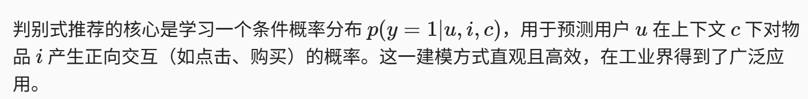<figcaption>
判别式推荐建模
</figcaption></figure>

### 生成式推荐

生成式推荐根据用户属性、上下文以及历史交互序列（包括物品 ID 与曝光后的反馈行为），直接生成下一步行为或物品。它将推荐建模为序列生成过程：

$$
\begin{align}
p_\theta(i_{1:T}\mid u,c) &= \prod_{t=1}^{T}p_\theta(i_t\mid i_{<t},u,c)
\end{align}
$$

其中，$$\theta$$ 表示模型参数，$$i_{1:T}$$ 表示长度为 $$T$$ 的物品序列，$$i_{<t}$$ 表示第 $$t$$ 步之前的历史序列，$$u$$ 和 $$c$$ 分别表示用户与上下文。

<figure>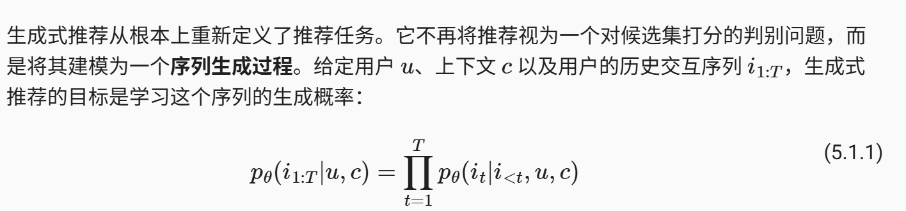<figcaption>
生成式推荐建模
</figcaption></figure>

### 两类范式的差异

判别式推荐通常存在以下局限：

- 推荐链路与**网络结构复杂**，工程优化成本较高。
- 信息在多阶段链路中流动受限，**较依赖特征工程**，且各阶段的优化目标往往不一致。

生成式推荐尝试用统一的序列目标贯通表示、召回与生成，但也带来了离散物品表示、生成约束和在线推理效率等新问题。

## 生成式推荐模型

### Transformer

#### 注意力机制

标准缩放点积注意力先计算查询与键的相似度，再通过 softmax 得到注意力权重：

$$
\begin{align}
\mathbf A &= \operatorname{softmax}\!\left(\frac{\mathbf Q\mathbf K^{\mathsf T}}{\sqrt{d_k}}\right)
\end{align}
$$

其中，$$\mathbf Q,\mathbf K\in\mathbb R^{T\times d_k}$$ 分别表示查询矩阵和键矩阵，$$d_k$$ 表示键向量维度，$$T$$ 表示序列长度，$$\mathbf A\in\mathbb R^{T\times T}$$ 表示注意力权重矩阵。部分推荐模型会调整或替换 softmax 归一化，以强化兴趣相关信号，但图中展示的是标准形式。

<figure>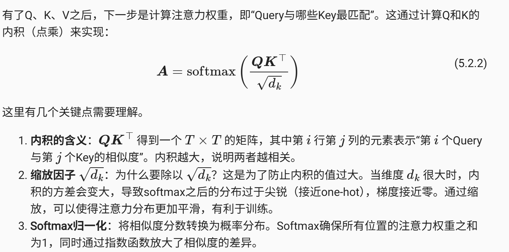<figcaption>
注意力权重计算
</figcaption></figure>

#### 位置编码

Transformer 常用正弦位置编码（sinusoidal positional encoding）、相对位置编码和旋转位置编码（RoPE）。推荐系统除序列顺序外，还需显式建模物品—物品、物品—行为及行为—行为之间的绝对位置关系与时间差。

> 即使物品 1 和物品 2 在序列中相邻，如果两次行为间隔数年，它们也可能没有显著关联。

#### 编码器—解码器架构

LLM 通常采用仅解码器（decoder-only）架构；推荐输入不仅包含行为序列，还包括用户画像和推荐目标。编码器可压缩这些条件信息，并通过交叉注意力与解码器交互，从而控制自回归生成方向。

<figure>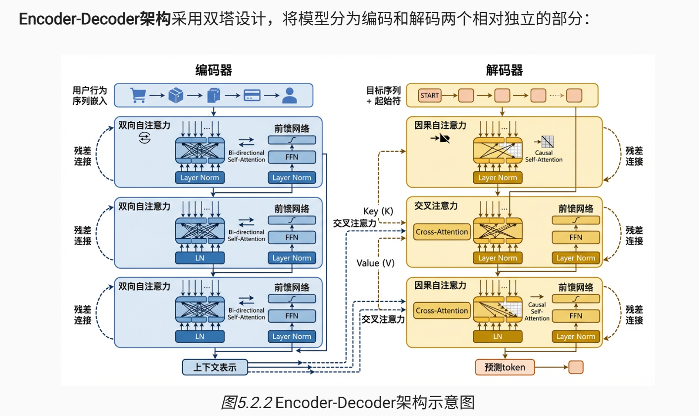<figcaption>
编码器解码器架构
</figcaption></figure>

<figure>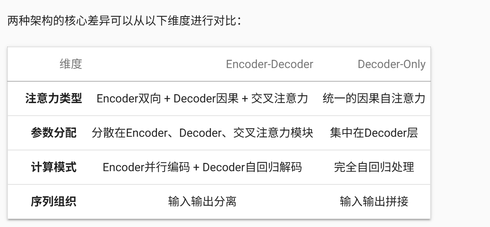<figcaption>
双架构对比
</figcaption></figure>

#### 定制化掩码

标准因果掩码会阻止当前位置关注未来信息：

$$
\begin{align}
\operatorname{Attention}(\mathbf Q,\mathbf K,\mathbf V) &= \operatorname{softmax}\!\left(\frac{\mathbf Q\mathbf K^{\mathsf T}}{\sqrt{d_k}}+\mathbf M\right)\mathbf V
\end{align}
$$

其中，$$\mathbf Q,\mathbf K\in\mathbb R^{T\times d_k}$$，$$\mathbf V\in\mathbb R^{T\times d_v}$$，掩码矩阵 $$\mathbf M\in\mathbb R^{T\times T}$$，输出矩阵属于 $$\mathbb R^{T\times d_v}$$。

$$
\begin{align}
M_{ij} &= \begin{cases}
0, & j\le i,\\
-\infty, & j>i.
\end{cases}
\end{align}
$$

其中，$$M_{ij}$$ 表示位置 $$i$$ 对位置 $$j$$ 的掩码值；当 $$j>i$$ 时，未来位置在 softmax 后获得零权重。

<figure>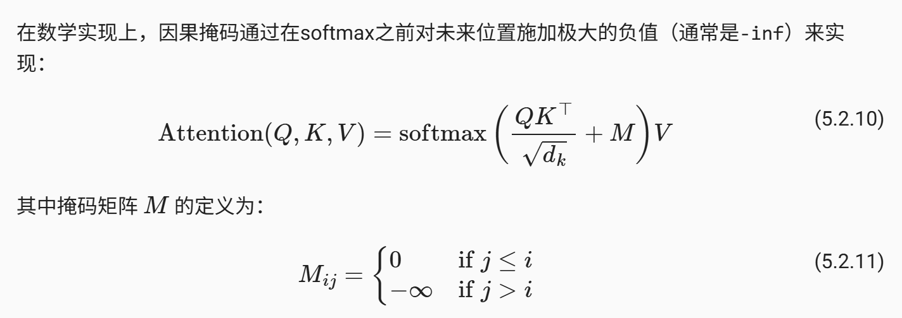<figcaption>
因果掩码计算
</figcaption></figure>

还可以将用户行为序列划分为多个会话，通过会话级掩码增强会话内关联并减少跨会话噪声；多任务场景也可按点击、转化等目标设计不同的可见范围。

<figure>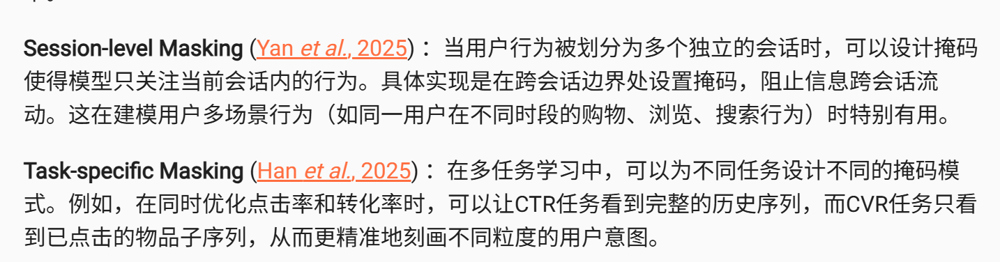<figcaption>
定制化掩码
</figcaption></figure>

### 扩散模型

扩散模型先在前向过程中逐步加入噪声，再在反向过程中学习去噪。用于推荐时，它既可增强用户或物品表示，也可并行生成推荐序列，并承担多模态融合或协同图建模任务。

<figure>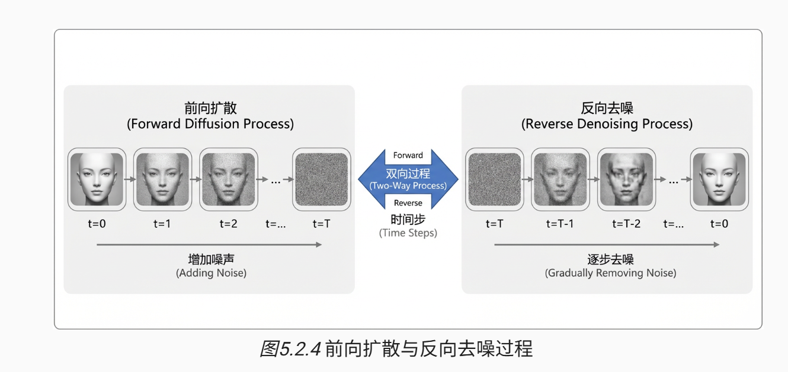<figcaption>
扩散与去噪过程
</figcaption></figure>

<figure>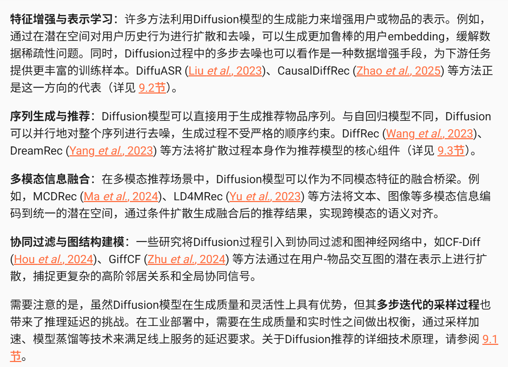<figcaption>
扩散推荐应用
</figcaption></figure>

扩散模型的生成质量与灵活性较强，但多步采样会增加推理延迟；工业部署通常需要在生成质量和实时性之间权衡。

### LLM 用于推荐

- 预训练：对齐语言建模与推荐建模的目标，并兼顾用户行为序列和多模态内容。
- 指令微调：将推荐任务表达为可学习的指令，同时处理高度 ID 化的物品。
- 偏好对齐：推荐系统难以定义统一奖励信号，通常需要综合多样性、个性化等多个目标。

<figure>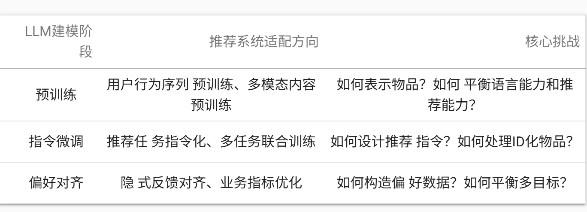<figcaption>
大模型推荐适配
</figcaption></figure>

## 物品分词与语义 ID

### 稀疏 ID 范式（Sparse ID-Based）

思路是沿用传统推荐系统的编码方式：每个物品对应一个 ID，再由嵌入层编码。

优点是实现简单、技术成熟，并可复用传统推荐链路中的嵌入层；缺点是物品数量巨大时词表容易膨胀，新物品也难以利用 LLM 的语义泛化能力，存在冷启动问题。

<figure>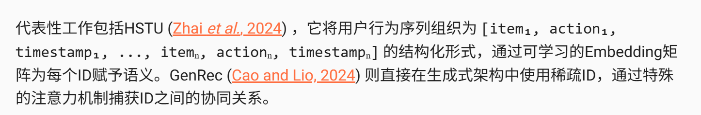<figcaption>
稀疏标识范式
</figcaption></figure>

### 文本 ID 范式（Text-Based）

思路是沿用 LLM 的分词方式，使用多个自然语言令牌描述一个物品。

优点是能够发挥 LLM 的泛化能力，且语义表达比稀疏 ID 更丰富；缺点是自然语言具有模糊性和歧义性，同一物品可能对应多种表述，从而增加生成与匹配的不确定性。

<figure>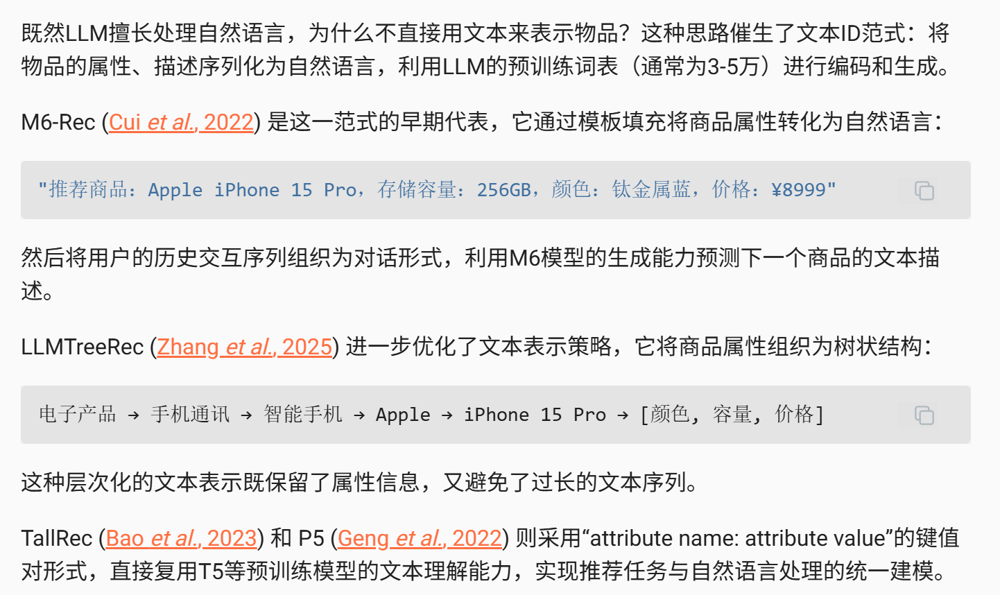<figcaption>
文本标识范式
</figcaption></figure>

### 语义 ID 范式（Semantic ID-Based）

语义 ID 借鉴流式索引召回等方法，根据物品的潜在表示进行多级量化或聚类，得到离散令牌序列。

- 组合空间：通过多级聚类可组合出规模巨大的离散编码空间。词表大小为 $K=8000$、序列长度为 $L=4$ 时，理论容量为 $K^L=8000^4\approx4\times10^{15}$。

<figure>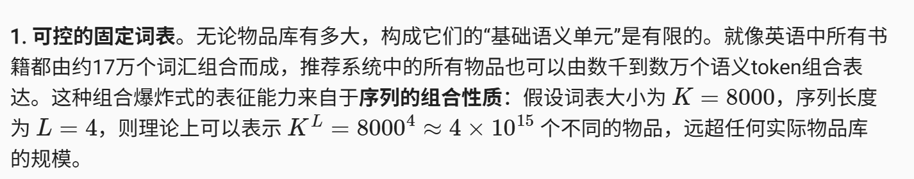<figcaption>
语义组合空间
</figcaption></figure>

- 层次结构：层次化编码为模型提供较强的归纳偏置。模型可把对“篮球”前缀 `[10, 5]` 的偏好迁移到共享该前缀的其他物品。

<figure>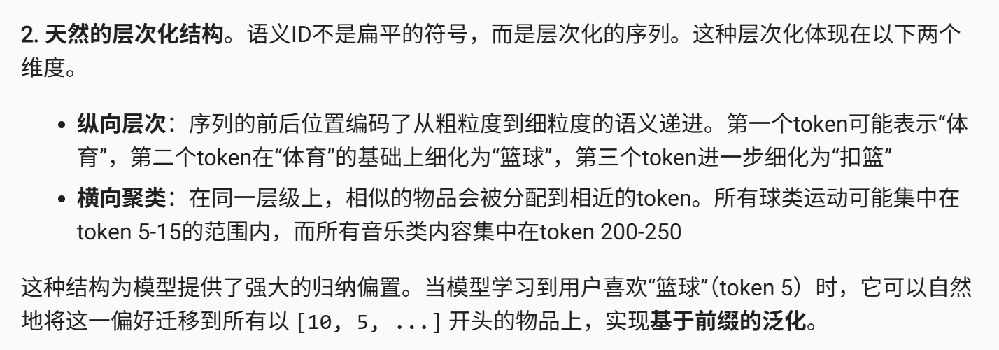<figcaption>
语义标识层次
</figcaption></figure>

- 推理能力：令牌可从一级类目、二级类目逐步过渡到细粒度属性，使模型能够隐式学习概念层面的推理过程。

<figure>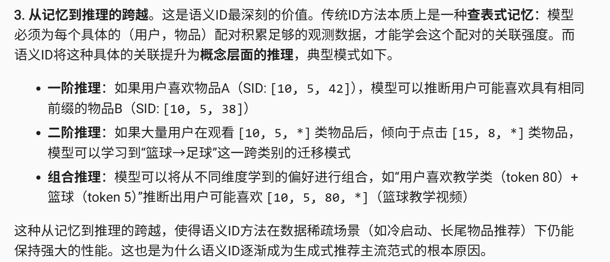<figcaption>
语义标识推理
</figcaption></figure>

#### VQ-VAE：反向传播优化聚类

VQ-VAE 先由编码器得到连续表示，再从可学习码本中选择最近码字，最后由解码器重建输入。

<figure>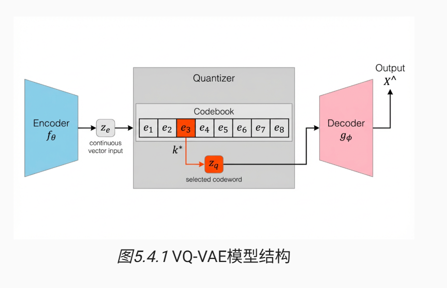<figcaption>
VQ-VAE结构
</figcaption></figure>

##### 分配码字

$$
\begin{align}
\mathbf E &= [\mathbf e_1,\mathbf e_2,\ldots,\mathbf e_K]\in\mathbb R^{d\times K},\\
k^{*} &= \underset{j\in\{1,\ldots,K\}}{\arg\min}\,\lVert\mathbf z_e-\mathbf e_j\rVert_2,\\
\mathbf z_q &= \mathbf e_{k^{*}}
\end{align}
$$

其中，$$\mathbf E$$ 表示码本矩阵，$$K$$ 表示码本大小，$$d$$ 表示向量维度，$$\mathbf z_e,\mathbf e_j,\mathbf z_q\in\mathbb R^d$$ 分别表示编码器输出、第 $$j$$ 个码字和量化结果，$$k^{*}$$ 表示最近码字的索引。

<figure>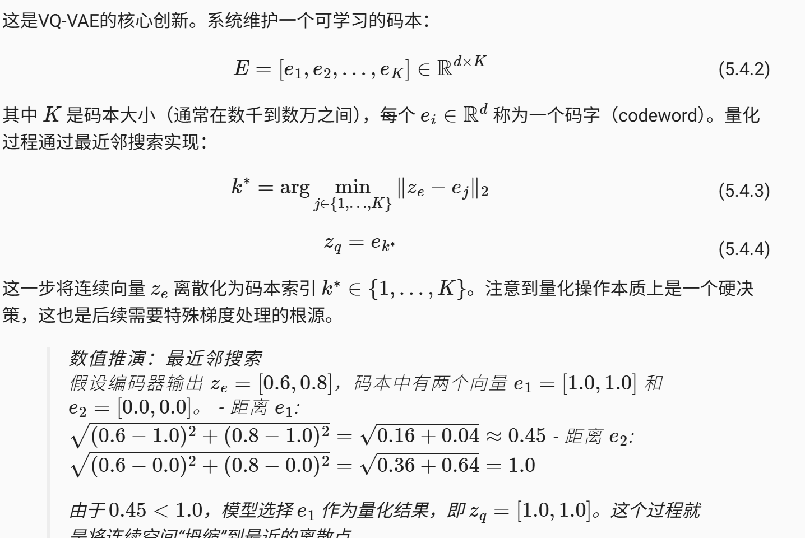<figcaption>
码本与码字分配
</figcaption></figure>

##### 损失优化

$$
\begin{align}
\mathcal L_{\mathrm{VQ}} &= \underbrace{\lVert\mathbf x-\hat{\mathbf x}\rVert_2^2}_{\mathcal L_{\mathrm{recon}}}\notag\\
&\quad+\underbrace{\lVert\operatorname{sg}[\mathbf z_e]-\mathbf z_q\rVert_2^2}_{\mathcal L_{\mathrm{codebook}}}\notag\\
&\quad+\underbrace{\beta\lVert\mathbf z_e-\operatorname{sg}[\mathbf z_q]\rVert_2^2}_{\mathcal L_{\mathrm{commit}}}
\end{align}
$$

其中，$$\mathbf x$$ 和 $$\hat{\mathbf x}$$ 分别表示输入与重建结果，$$\mathcal L_{\mathrm{recon}}$$、$$\mathcal L_{\mathrm{codebook}}$$ 和 $$\mathcal L_{\mathrm{commit}}$$ 分别表示重建损失、码本损失和承诺损失，$$\operatorname{sg}$$ 表示停止梯度操作，$$\beta$$ 表示承诺损失权重。

<figure>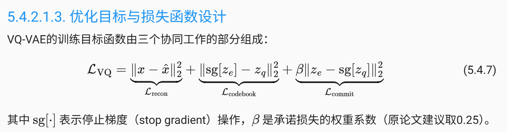<figcaption>
VQ-VAE损失函数
</figcaption></figure>

##### 近似可导

量化的最近邻选择不可导，VQ-VAE 使用直通估计器，在前向传播中执行离散选择，在反向传播中近似复制梯度：

$$
\begin{align}
\frac{\partial\mathcal L}{\partial\mathbf z_e} &\approx \frac{\partial\mathcal L}{\partial\mathbf z_q}
\end{align}
$$

其中，$$\mathcal L$$ 表示训练损失，$$\mathbf z_e,\mathbf z_q\in\mathbb R^d$$ 分别表示量化前后的向量；该式采用分母布局表示梯度。

<figure>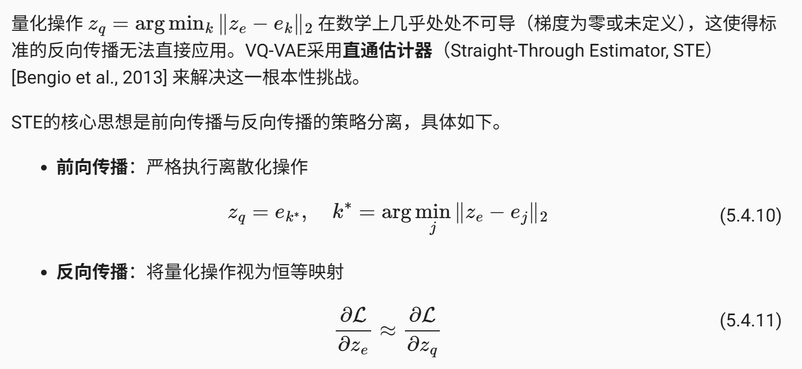<figcaption>
直通估计梯度
</figcaption></figure>

#### RQ-VAE：多层残差量化

单层量化的编码容量与表达精度有限。RQ-VAE **逐层量化**残差，以码字序列形成组合编码空间。

<figure>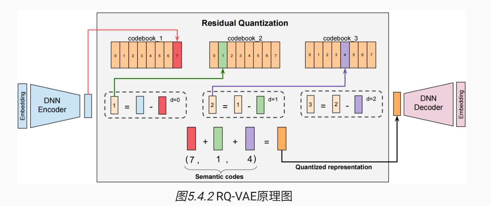<figcaption>
RQ-VAE残差量化
</figcaption></figure>

##### 残差量化

每一层都对全部物品在该层的残差进行量化，并设置 $$K$$ 个码字：

$$
\begin{align}
\mathbf r_0 &= \mathbf z_e,\\
k_\ell &= \underset{j\in\{1,\ldots,K\}}{\arg\min}\,\lVert\mathbf r_{\ell-1}-\mathbf e_j^{(\ell)}\rVert_2,\\
\mathbf r_\ell &= \mathbf r_{\ell-1}-\mathbf e_{k_\ell}^{(\ell)},\\
\mathbf z_q &= \sum_{\ell=1}^{L}\mathbf e_{k_\ell}^{(\ell)}
\end{align}
$$

其中，$$L$$ 表示量化层数，$$\mathbf z_e,\mathbf r_\ell,\mathbf e_j^{(\ell)},\mathbf z_q\in\mathbb R^d$$，$$k_\ell$$ 表示第 $$\ell$$ 层选中的码字索引；最终语义 ID 为 $$[k_1,k_2,\ldots,k_L]$$。

<figure>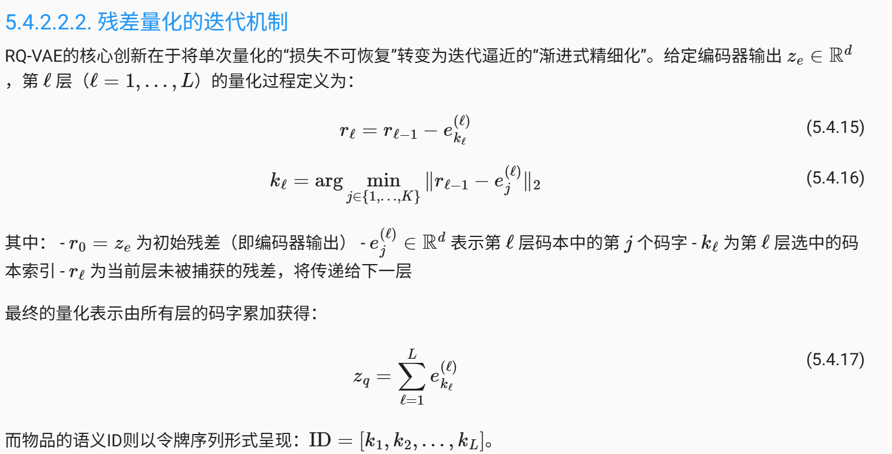<figcaption>
残差量化迭代
</figcaption></figure>

一维示例中，目标值 $$z=5.5$$；第一层选择 $$5$$ 后得到 $$r_1=0.5$$，第二层选择 $$0.4$$ 后得到 $$r_2=0.1$$，最终以 $$\hat z=5.4$$ 逼近原值。

<figure>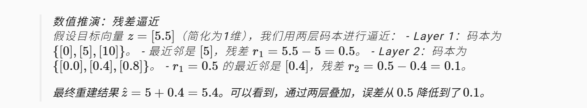<figcaption>
残差逼近示例
</figcaption></figure>

##### 优化函数

$$
\begin{align}
\mathcal L_{\mathrm{RQ}} &= \lVert\mathbf x-\hat{\mathbf x}\rVert_2^2\notag\\
&\quad+\sum_{\ell=1}^{L}\lVert\operatorname{sg}[\mathbf r_{\ell-1}]-\mathbf e_{k_\ell}^{(\ell)}\rVert_2^2\notag\\
&\quad+\beta\sum_{\ell=1}^{L}\lVert\mathbf r_{\ell-1}-\operatorname{sg}[\mathbf e_{k_\ell}^{(\ell)}]\rVert_2^2,\\
\frac{\partial\mathcal L}{\partial\mathbf r_{\ell-1}} &\approx \frac{\partial\mathcal L}{\partial\mathbf e_{k_\ell}^{(\ell)}}
\end{align}
$$

其中，$$\mathcal L_{\mathrm{RQ}}$$ 表示 RQ-VAE 损失，$$\mathbf x,\hat{\mathbf x}$$ 表示输入与重建结果，$$\beta$$ 表示承诺损失权重；第二行表示每一层使用直通估计器近似传播梯度。

<figure>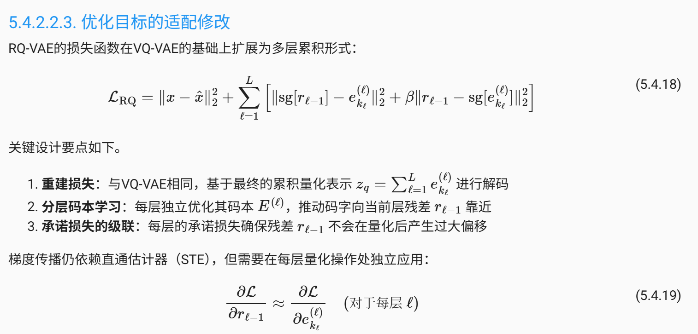<figcaption>
RQ-VAE损失函数
</figcaption></figure>

#### RQ-K-Means：工业化量化

RQ-VAE 通过**反向传播**联合优化表示与码字分配。工业场景也可将表示学习与码本构建解耦，对预训练表示逐层执行 K-Means，以降低联合训练成本，并便于为新物品增量分配语义 ID。

<figure>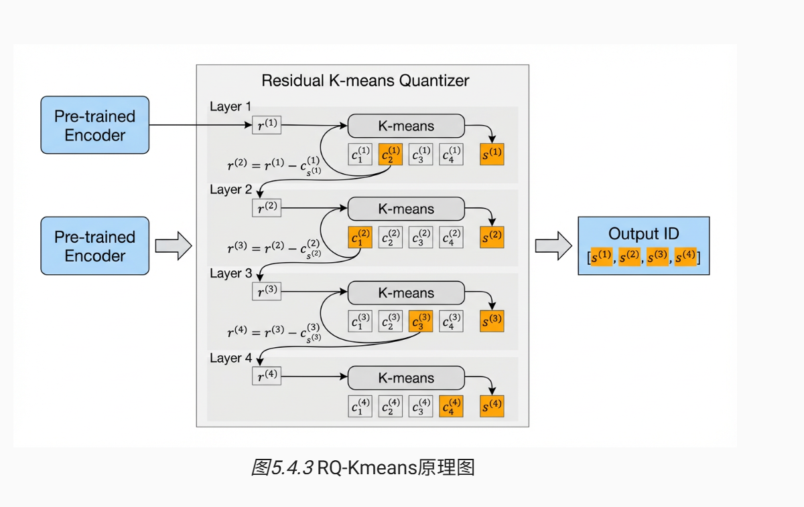<figcaption>
RQ-KMeans结构
</figcaption></figure>

$$
\begin{align}
\mathcal C^{(\ell)} &= \operatorname{KMeans}(\mathcal R^{(\ell)},K),\\
s_i^{(\ell)} &= \underset{k\in\{1,\ldots,K\}}{\arg\min}\,\lVert\mathbf r_i^{(\ell)}-\mathbf c_k^{(\ell)}\rVert_2,\\
\mathbf r_i^{(\ell+1)} &= \mathbf r_i^{(\ell)}-\mathbf c_{s_i^{(\ell)}}^{(\ell)},\\
\tilde{\mathbf m}_i &= \sum_{\ell=1}^{L}\mathbf c_{s_i^{(\ell)}}^{(\ell)}
\end{align}
$$

其中，$$\mathcal R^{(\ell)}$$ 表示第 $$\ell$$ 层的残差集合，$$\mathcal C^{(\ell)}$$ 表示由 $$K$$ 个中心组成的码本，$$s_i^{(\ell)}$$ 表示物品 $$i$$ 的码字索引，$$\mathbf r_i^{(\ell)},\mathbf c_k^{(\ell)},\tilde{\mathbf m}_i\in\mathbb R^d$$，$$\tilde{\mathbf m}_i$$ 表示量化重建向量。

<figure>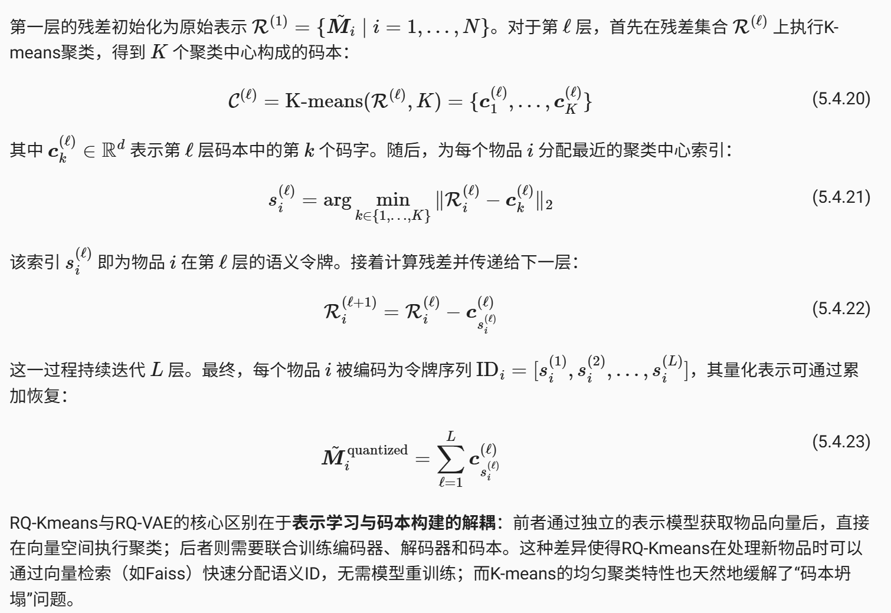<figcaption>
RQ-KMeans量化
</figcaption></figure>

#### RQ-OPQ：混合编码

部分 RQ 实现会丢弃最后一层量化后的残差，而该残差仍包含品牌型号、价格区间等难以被层次聚类捕获的细粒度特征。RQ-OPQ 使用 RQ 表示共性语义，再用优化乘积量化（OPQ）编码剩余的个性特征。

##### OPQ 优化

OPQ 先学习正交旋转矩阵，再将旋转后的残差划分为 $$M$$ 个子空间，并在各子空间的子码本中寻找最近邻：

$$
\begin{align}
\tilde{\mathbf r} &= \mathbf R\mathbf r_L, & \mathbf R^{\mathsf T}\mathbf R &= \mathbf I_d,\\
q_m &= \underset{\mathbf c\in\mathcal C_m}{\arg\min}\,\lVert\tilde{\mathbf r}_m-\mathbf c\rVert_2
\end{align}
$$

其中，$$\mathbf r_L\in\mathbb R^d$$ 表示 RQ 最后一层残差，$$\mathbf R\in\mathbb R^{d\times d}$$ 表示正交旋转矩阵，$$\tilde{\mathbf r}_m\in\mathbb R^{d/M}$$ 表示第 $$m$$ 个子向量，$$\mathcal C_m$$ 表示对应子码本，$$q_m$$ 表示最近码字索引。若每个子码本大小为 $$K_{\mathrm{sub}}$$，则组合容量为 $$K_{\mathrm{sub}}^M$$。

<figure>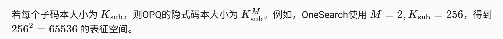<figcaption>
OPQ码本规模
</figcaption></figure>

<figure>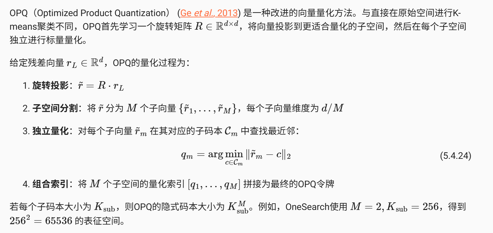<figcaption>
OPQ量化流程
</figcaption></figure>

##### 共性语义与个性特征

- RQ 部分负责共性语义：前三层 ID 如 `[102, 8, 1]` 可分别对应“电子产品”“手机通讯”“Apple/苹果”，用于确定商品的层级身份。
- OPQ 部分负责个性特征：剩余残差中的“粉色”“256 GB”等正交属性可编码为补充 ID `[56, 99]`，用于匹配具体偏好。

最终 ID `[102, 8, 1, 56, 99]` 同时保留层级语义和特定库存量单位（SKU）的属性，从而缓解长尾商品的区分与召回问题。

### 局限性

#### SID 冲突

量化存在信息损失，多个物品可能映射到同一个语义 ID。根本原因之一是**码本利用不均衡**：大量物品集中在**少数聚类**中心附近，而部分中心很少被使用，使实际容量低于理论容量。

缓解策略主要分为两类：训练阶段**改进量化**算法，例如采用均匀分配或限制聚类中心容量；推理阶段则接受冲突，并在 SID 序列中加入额外信息消除歧义，例如以前几层捕获共性语义、以后几层编码独特特征。

#### 目标不一致

语义 ID 生成通常由表示提取、SID 量化和生成模型训练三个阶段组成。阶段间独立优化会导致目标难以端到端对齐：表示模型未必针对推荐任务优化，量化过程也未必考虑下游生成模型的偏好。

可行方向包括联合优化，使梯度跨阶段传播；也可以设计循环一致性等自监督任务，确保 SID 保留物品核心语义，并通过迭代训练促进各组件相互适应。

#### 多模态融合

推荐物品通常包含内容语义、协同信号和场景属性等**多模态信息**。不同模态在语义空间中的分布并不一致，简单拼接或加权平均**难以充分利用其互补性**。

融合方法可分为表示层融合和量化层融合：前者通过门控机制或对比学习整合多模态表示；后者为不同模态维护独立量化通道，并在码本层面整合信息，例如使用模态专属码本或混合专家架构动态分配权重。

# 推荐系统的scaling

## DLRM系统的scaling困难

**特征瓶颈。** DLRM 常用点击率、平均观看时长等统计量压缩用户历史。扩大模型容量后，输入仍是这些预聚合特征，模型能利用的历史信息仍受限。

**架构碎片化。** FM、DCN、DIN、MMoE 等模块分别处理不同的特征交互或任务。只扩大单个模块，收益往往局限在该模块负责的部分。

**逐物品评分。** 每条训练样本对应一个用户—物品—动作三元组，只提供一次交互的监督信号。推理时独立评分，计算成本随候选数量线性增长，也难以直接利用候选之间的关联。

## 用户的行为序列建模：物品+行动

传统方法只建模物品序列，预测下一个物品，却没有考虑用户对每个物品的响应。

交替记录物品和响应，得到序列 $$[\phi_0,a_0,\ldots,\phi_{n-1},a_{n-1}]$$。其中，$$\phi_i$$ 是第 $$i$$ 个物品，$$a_i$$ 是对应的用户动作。预测后续物品对应召回，给定候选物品预测用户响应对应排序。

<figure>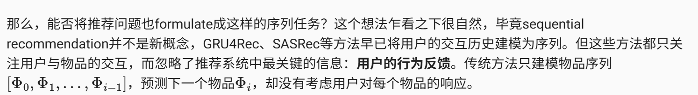<figcaption>
仅按物品建模
</figcaption></figure>

<figure>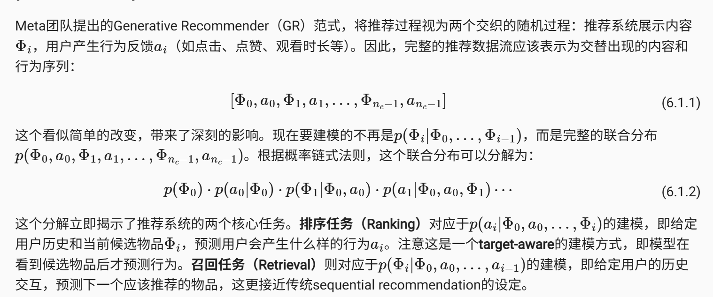<figcaption>
物品与动作交替序列
</figcaption></figure>

## 统一的特征空间

传统DLRM的一个显著特点是特征的异构性和碎片化。一个典型的工业级推荐模型可能使用上千个特征，包括类别型（Sparse）特征和数值型（Dense）特征。

用户 ID、类目等离散特征可以保留并去重。对于点击率等历史聚合指标，序列模型可以尝试直接从原始行为中学习相关规律。

> 是否保留数值特征取决于任务。统计特征仍可能为模型提供有用的归纳偏置。

<figure>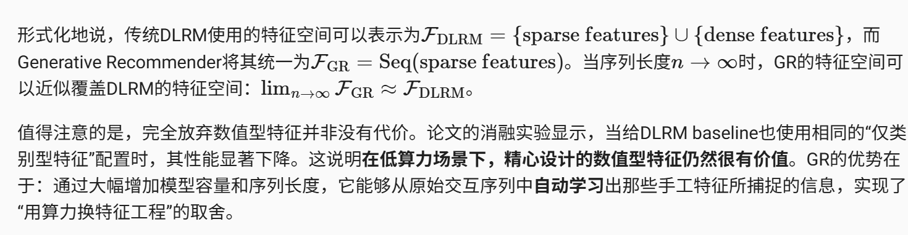<figcaption>
推荐特征空间对照
</figcaption></figure>

## 训练效率的提升

一次前向传播，可以从序列中**学习多个物品的动作**，比传统方法的**用户-物品-动作**三元组预测需要的前向传播次数更少。

<figure>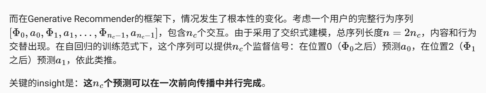<figcaption>
单次前向的多位置监督
</figcaption></figure>

# TIGER：Recommender Systems with Generative Retrieval

1. TIGER 为每个物品分配语义 ID（SID），根据用户的交互历史生成下一个物品的 SID，再通过查找表返回物品。
2. 论文在 Amazon Reviews 的三个子数据集上用 Recall 和 NDCG 评估顺序推荐，并与当时的基线比较。
3. SID 的层次结构还支持两种用法。冷启动时按前缀匹配未见物品。需要增加多样性时，在不同层级调整解码采样。

图表来自 [TIGER 原论文](https://arxiv.org/abs/2305.05065)。

<figure>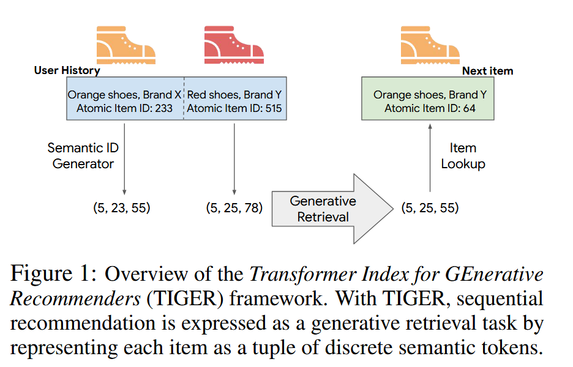<figcaption>
TIGER 检索总览
</figcaption></figure>

## 框架

TIGER 先根据物品内容构建 SID，再用编码器—解码器预测 SID。两部分的衔接点是由离散码字组成的物品标识。

<figure>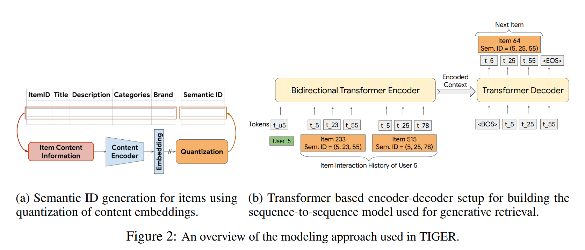<figcaption>
TIGER 编码与解码
</figcaption></figure>

### RQ-VAE 生成物品 SID

**内容编码。** 实验将标题、价格、品牌和类目等属性拼成文本，再用预训练的 Sentence-T5 生成 768 维物品向量。RQ-VAE 对该向量进行残差量化，前三级各输出一个码字。训练首批数据时，用 K-Means 的聚类中心初始化码本，以降低码本坍缩风险。

<figure>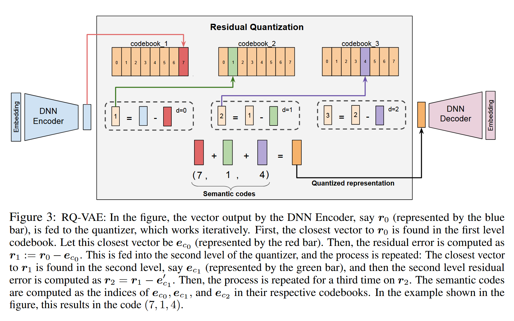<figcaption>
TIGER 残差量化
</figcaption></figure>

**冲突处理。** RQ-VAE 训练完成后，TIGER 在三码前缀末尾追加一个消歧码。例如，两个共享前缀 `(7, 1, 4)` 的物品分别获得 `(7, 1, 4, 0)` 和 `(7, 1, 4, 1)`。没有冲突时第四码取 0。最终，查找表将每个完整的四码 SID 映射到一个物品。

**层次结构。** 同一个首码之下，第二码还能区分更细的类目分布。下图对比了按首码和第二码分组的结果。

<figure>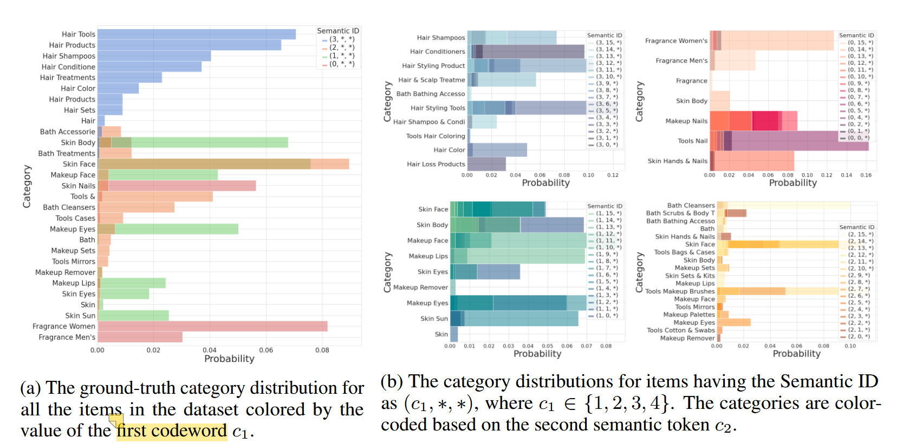<figcaption>
码字与类目分布
</figcaption></figure>

### T5X 编码器—解码器

输入由一个用户令牌和一串历史物品的 SID 令牌组成。给定 $$n$$ 个历史物品，模型预测第 $$n+1$$ 个物品的 SID。TIGER 使用 T5X 实现 Transformer 编码器—解码器。

四个码位分别使用 256 个令牌，共 $$4\times256=1024$$ 个物品码字令牌。用户 ID 哈希到 2,000 个用户令牌之一。用户令牌为检索提供额外的个性化信息。

## 实验

### 冷启动实验

在 Amazon Beauty 数据集上，论文从训练分区移除 5% 的测试物品，模拟上线后新增的物品。RQ-VAE 和序列模型都在剩余的训练数据上训练。训练完成后，再为语料库中的所有物品编码，包括被移除的未见物品。

预测 SID 后，用完整四码查找已见物品，并将前三码相同的未见物品纳入候选。超参数 $$\varepsilon$$ 限制前 $$K$$ 个结果中未见物品的比例。图中在 $$\varepsilon=0.1$$ 时，TIGER 在所报告的各个 Recall@K 上均高于 `Semantic_KNN`；右图中，所测试的 $$\varepsilon\ge0.1$$ 设置也高于该基线。

<figure>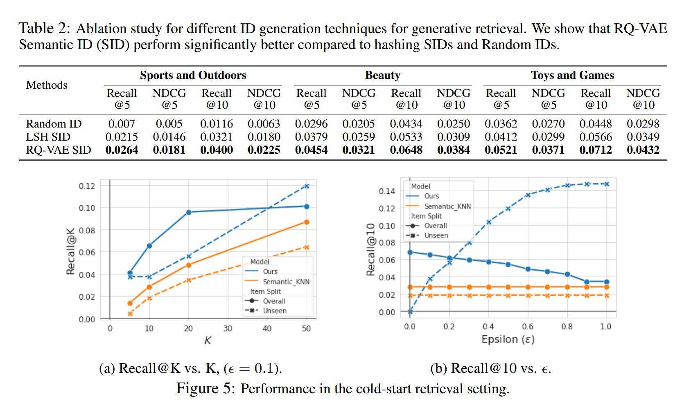<figcaption>
冷启动召回与编码消融
</figcaption></figure>

### 多样性实验

论文用 **Entropy@K** 衡量前 $$K$$ 个预测物品的真实类目分布。提高解码温度后，表中的类别熵随之上升。由于 SID 具有层次结构，对首码采样可以改变粗粒度类目，对后续码位采样则可在类目内部扩大选择。

<figure>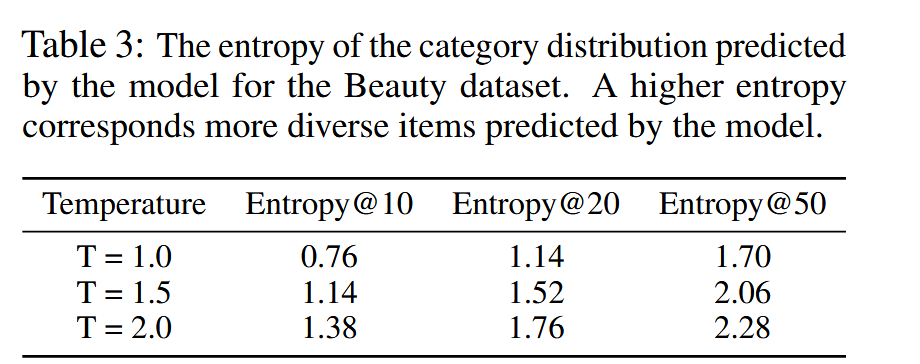<figcaption>
解码温度与类目熵
</figcaption></figure>

<figure>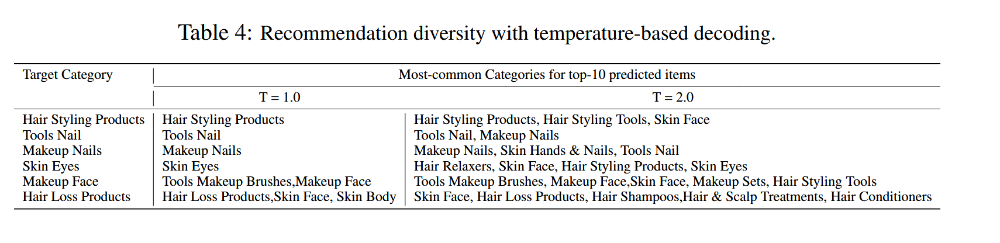<figcaption>
不同温度的推荐类目
</figcaption></figure>

### 无效 SID

自回归解码有时会生成查找表中不存在的四码组合。可以扩大束搜索范围，再筛掉无效结果。论文也讨论了前缀匹配，用部分匹配的 SID 检索语义接近的物品，并将这一扩展留作后续工作。

### SID 量化的可扩展性

论文将三个数据集合并生成 SID，再在 Beauty 上评估推荐效果。对比仅用 Beauty 学习的 SID，联合量化的指标略有下降。

<figure>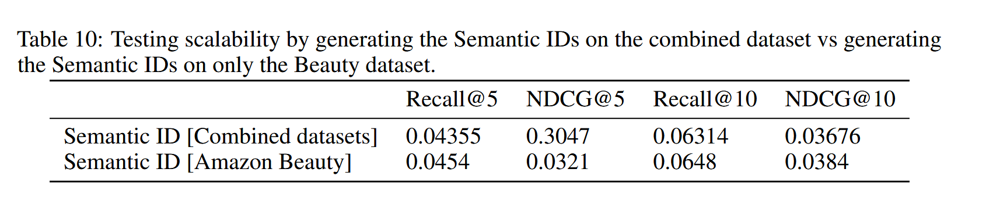<figcaption>
联合量化的检索表现
</figcaption></figure>

# 工业推荐的序列建模与排序架构

## HSTU

### point-wise聚合替代softmax注意力机制

HSTU 用逐元素激活替代 softmax，保留用户对物品的绝对兴趣强度。若序列长度为 $$T$$，查询与键矩阵 $$\mathbf Q,\mathbf K\in\mathbb R^{T\times d_k}$$，值矩阵 $$\mathbf V\in\mathbb R^{T\times d_v}$$，聚合可写为

$$
\mathbf Y=\operatorname{SiLU}(\mathbf Q\mathbf K^{\mathsf T}+\mathbf B)\mathbf V
$$

其中，$$\mathbf B\in\mathbb R^{T\times T}$$ 是位置与时间相关的注意力偏置，$$\mathbf Y\in\mathbb R^{T\times d_v}$$ 是聚合结果。

<figure>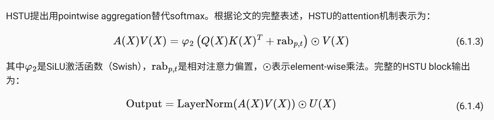<figcaption>
HSTU 注意力计算
</figcaption></figure>

### 绝对位置编码和时序编码

HSTU 的相对注意力偏置可写成 $$B_{ij}=f(p_i-p_j,t_i-t_j,\mathrm{type}_i,\mathrm{type}_j)$$。其中，$$p_i$$ 是位置，$$t_i$$ 是时间戳，令牌类型用于区分物品和动作。

<figure>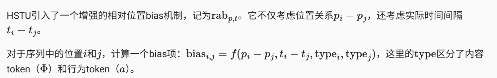<figcaption>
位置与时间偏置
</figcaption></figure>

### 训练和推理

#### 训练：Stochastic Length（随机长度）

训练时在完整序列与截短序列之间随机采样，让多数训练序列更短，同时保留一部分完整历史，用于学习长期兴趣。

<figure>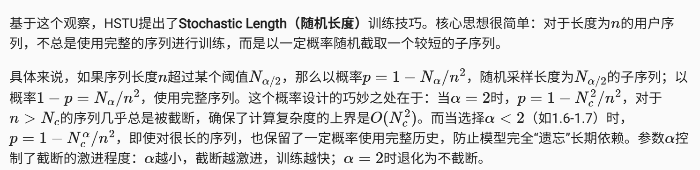<figcaption>
随机长度训练
</figcaption></figure>

#### 推理：M-FALCON-全局成本分摊的推理算法

<figure>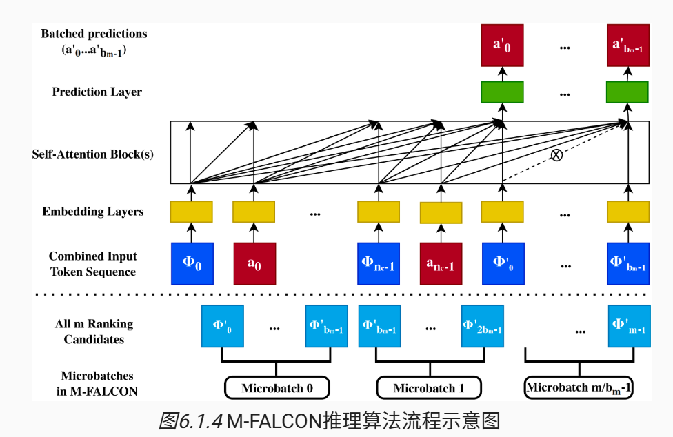<figcaption>
M-FALCON 推理
</figcaption></figure>

## HSTU的优化

### 自回归

#### 历史位置的监督损失

如果自回归只是一个可选技巧，**更多监督信号应该提升性能**。

但实验结果显示AUC显著下降。这可以用“one-epoch问题” (Huang et al., 2025) 解释：推荐数据中，用户ID、物品ID等稀疏特征占据绝大部分参数。由于长尾分布，大量ID只出现一两次。在历史位置计算loss时，模型倾向于“记住”每个交互细节，但这难以泛化。

举个例子，假设用户小明的历史序列是“看了科技博主A的视频→点赞→看了美食博主B的视频→收藏”。如果在历史位置计算loss，模型会学习预测：“看了科技博主A后会点赞”。但这个模式难以泛化，测试集中小明可能看科技博主C的视频，模型却没见过这个组合。

此外，**如果只训练一个epoch（推荐系统的常见做法），模型没有机会纠正这种过拟合**。

#### 因果掩码的时间约束

第二组实验在历史位置使用全可见mask，允许双向attention。从**特征交互角度看这应该增强表达能力**，但性能仍然下降，且随模型规模增大下降幅度扩大。全可见掩码让历史位置看到后续行为，削弱了按时间组织序列的归纳偏置。因果掩码为模型保留按时间预测的约束。

继续上面的例子，如果允许双向attention，模型在处理“看了科技博主A”这个行为时，能看到后面的“点赞”和“看了美食博主B”。这可能让模型学到虚假关联，比如“因为后面看了美食视频，所以给科技视频点赞”。但在现实中，用户在时刻的行为不可能被未来的行为影响。

因果掩码只允许当前位置访问当时已知的历史，避免模型在训练中借用未来信息。

### 训练方式

#### 用户级与逐交互训练

相比之下，样本组织方式的影响较小。传统DLRM采用**point-wise**训练，每个样本对应一次交互。

HSTU采用user-level训练，意思是**将同一用户的多次交互组织成序列**。这看似能带来梯度估计的稳定性和防止信息泄露的好处。

但实验显示，保持序列化组织但只在最后位置计算loss（模拟point-wise），性能几乎没有下降。

> 在保留完整历史序列和自回归架构的情况下，**只监督最后一个候选**，与监督**多个位置相比**，模型效果差异很小。

<figure>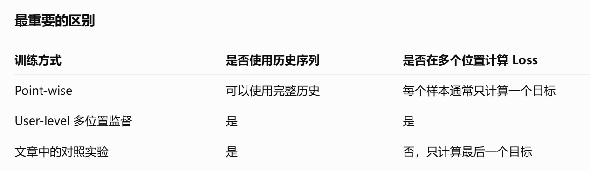<figcaption>
训练监督位置对照
</figcaption></figure>

<figure>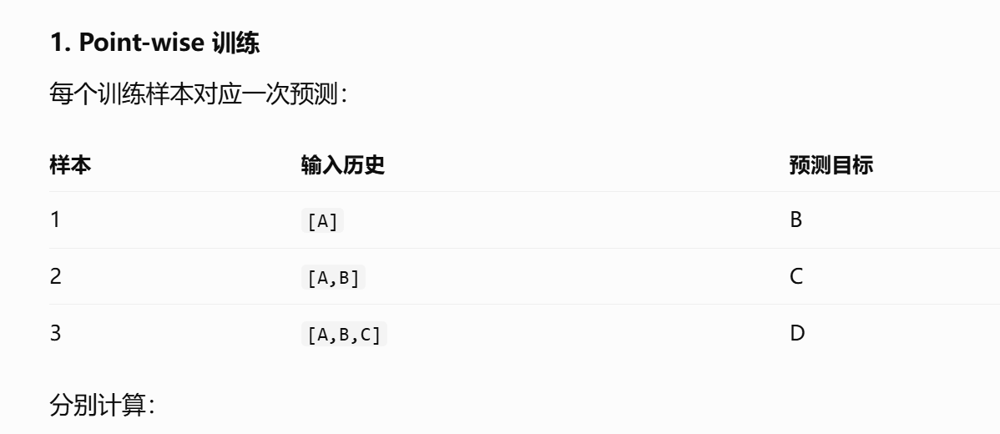<figcaption>
逐交互训练样例
</figcaption></figure>

### 特征工程

团队进一步测试了工业常用模块的兼容性。SIM、PPNet、PLE等模块在生成式架构下仍然有效。

特征工程方面的实验也有新发现：**大部分历史聚合特征的价值大幅降低**，因为模型的序列建模能力可以自动学会这些统计规律。

但实时特征依然重要，它们捕捉训练窗口外的新信息。此外，特征工程的简化释放了系统资源，为处理更大规模候选集创造了可能。

### 优化1：Action-Oriented，动作-序列编码到一个隐向量中

GenRank 把物品和动作合并为一个令牌。第 $$i$$ 次交互的物品嵌入 $$\boldsymbol\psi(x_i)\in\mathbb R^d$$ 与动作嵌入 $$\boldsymbol\phi(a_i)\in\mathbb R^d$$ 相加，得到

$$
\mathbf e_i=\boldsymbol\psi(x_i)+\boldsymbol\phi(a_i)
$$

<figure>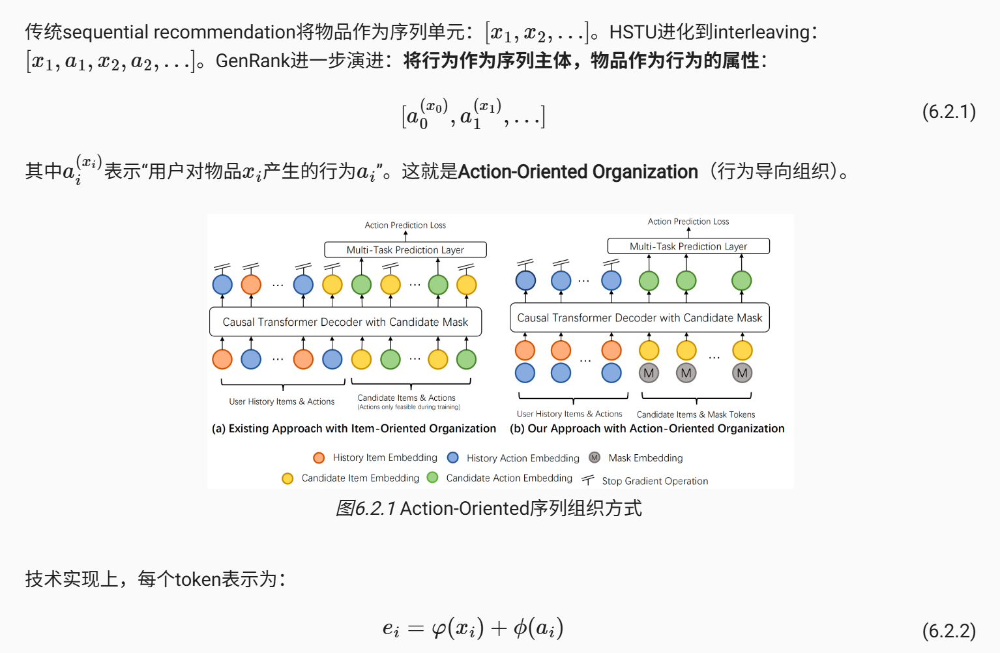<figcaption>
动作导向序列结构
</figcaption></figure>

<figure>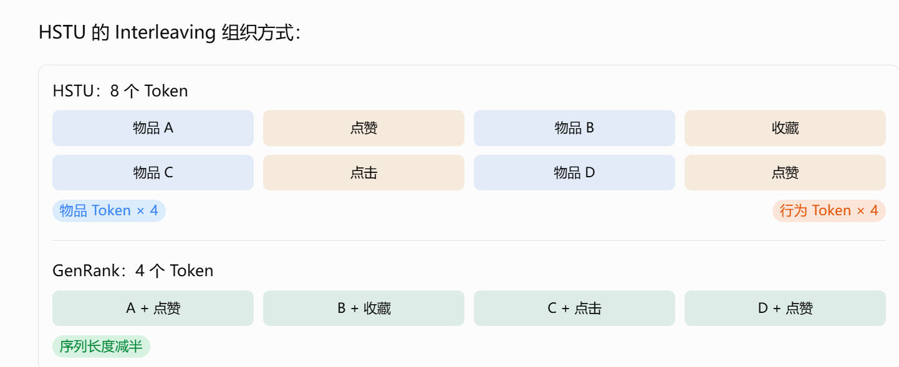<figcaption>
物品与动作令牌对照
</figcaption></figure>

<figure>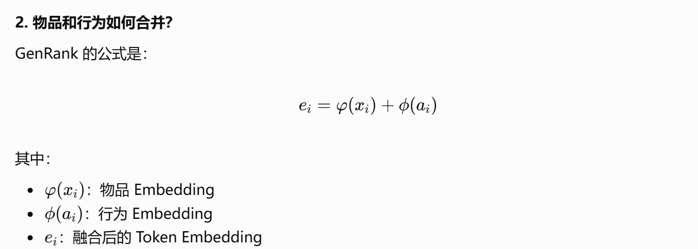<figcaption>
物品与动作嵌入相加
</figcaption></figure>

对于候选物品，还需要特殊mask action，主要用于表示当前模型的**预测目标**是什么？例如CTR还是CVR？

<figure>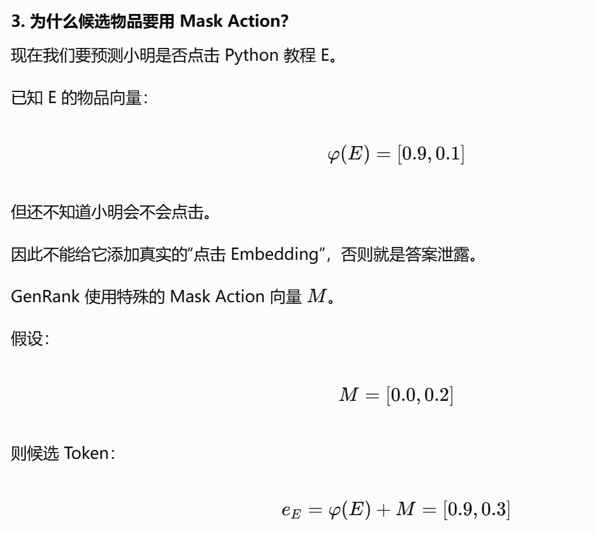<figcaption>
候选掩码动作示例
</figcaption></figure>

每个候选物品只关注历史和自身。历史序列内部按时间使用因果掩码。

<figure>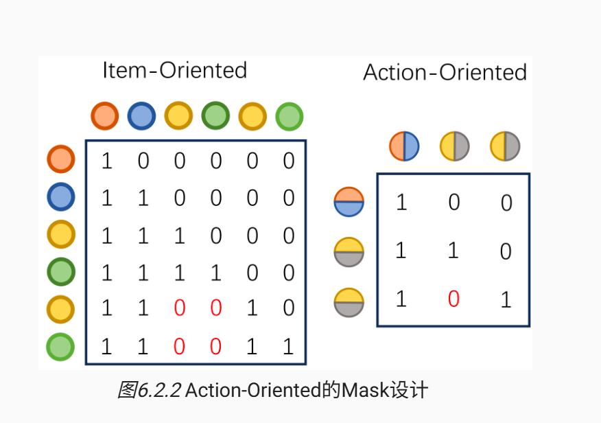<figcaption>
动作导向掩码
</figcaption></figure>

<figure><figcaption>
候选注意力可见范围
</figcaption></figure>

### 优化2：位置与时间的编码

位置编码记录令牌的序列索引。请求索引编码标识同一次请求中的行为，请求间时间编码保留与上一次请求的时间间隔。

<figure><figcaption>
位置与请求编码
</figcaption></figure>

<figure><figcaption>
时间感知注意力偏置
</figcaption></figure>

## MTGR：生成式，重新引入特征工程

### HSTU/GenRank的根本假设：严格自回归

生成式/自回归的方式，限制了特征的交叉融合。

美团团队的消融实验给出了明确答案：**去除交叉特征后**，即使是最大规模的生成式模型，性能也会退化到甚至不如中等规模的传统DLRM。这不是一个可以通过scaling弥补的gap，而是信息本身的缺失。

<figure><figcaption>
严格自回归分解
</figcaption></figure>

### 核心贡献：混合特征工程和自回归

MTGR 将同一用户的样本聚合在一起，主要收益来自共享历史计算。

MTGR 复用同一用户的历史序列计算，同时为候选物品加入实时特征和交叉特征，用于判别式打分。动态掩码控制不同类型令牌的可见范围。

#### 特征建模

<figure><figcaption>
MTGR 令牌序列
</figcaption></figure>

<figure><figcaption>
MTGR 特征编码
</figcaption></figure>

<figure><figcaption>
MTGR 输入令牌示例
</figcaption></figure>

<figure><figcaption>
候选交叉特征示例
</figcaption></figure>

<figure><figcaption>
候选令牌投影
</figcaption></figure>

### 分层次归一化

MTGR 将用户、序列、实时和候选令牌分组归一化。组 $$g$$ 内的输入 $$x_i$$ 使用该组的均值 $$\mu_g$$、标准差 $$\sigma_g$$ 以及仿射参数 $$\gamma_g,\beta_g$$。

$$
\operatorname{GLN}(x_i)=\gamma_g\frac{x_i-\mu_g}{\sigma_g}+\beta_g
$$

<figure><figcaption>
分组层归一化
</figcaption></figure>

### Dynamic Masking：静态特征忽略因果性，动态特征建模因果性

<figure><figcaption>
动态掩码规则
</figcaption></figure>

<figure><figcaption>
MTGR 掩码矩阵
</figcaption></figure>

## RankMixer：偏判别式，硬件效率优化

RankMixer（Zhu 等，2025）面向 GPU 执行效率设计。它用 Token Mixing 替代自注意力，用逐令牌前馈网络处理不同类型的特征，再通过稀疏 MoE 扩展参数容量。

每个 RankMixer 块包含 Multi-head Token Mixing 和 Per-Token FFN。输入先编码为 $$T$$ 个同维度令牌，经 $$L$$ 层 RankMixer 块处理后，通过平均池化得到输出。

<figure><figcaption>
RankMixer 总体架构
</figcaption></figure>

<figure><figcaption>
RankMixer 块计算
</figcaption></figure>

### Token Mixing：替换注意力层，只进行组合

把每个令牌按特征维度分成多个头，再按头重排来自不同令牌的子向量，供后续 FFN 融合特征。

<figure><figcaption>
多头令牌混合
</figcaption></figure>

### Per-Token FFN：特异参数

因为输入和输出的序列维度是**固定的**，因此可以为固定序列长度中的每个token，**分配特异化参数**。

每个位置只执行自己的 FFN。参数需要分别存储，令牌混合本身通过重排完成，无可学习参数。

<figure><figcaption>
逐令牌前馈网络
</figcaption></figure>

### Sparse MoE：扩展表达能力

但**如何扩展到十亿甚至百亿参数**？直接增加模型深度和宽度会线性增加计算量，推理延迟也会同比增加，这在工业场景中不可接受。

Sparse Mixture-of-Experts（MoE）提供了解决方案：不是让所有参数都参与每个样本的计算，而是根据样本特性动态选择一部分expert。这样模型参数量可以很大，但每个样本的计算量是固定的（只激活少数expert）。

MoE的理想工作模式是每个expert专门化到某种特定样本模式。但在推荐场景中，**实现有效的expert specialization面临三大挑战**。

RankMixer 采用 ReLU 路由，将非正路由分数置零。不同令牌可以激活不同数量的专家。

<figure><figcaption>
ReLU 专家路由
</figcaption></figure>

<figure><figcaption>
路由激活示例
</figcaption></figure>

<figure><figcaption>
稀疏专家聚合
</figcaption></figure>

## OneTrans：统一序列与特征建模

OneTrans（Zhang 等，2025）用同一个 Transformer 主干同时建模用户序列和非序列特征。两类输入分别编码为 S-tokens 和 NS-tokens，再拼接成一个序列，让不同类型的特征在同一主干内交互。

<figure><figcaption>
OneTrans 架构对照
</figcaption></figure>

<figure><figcaption>
序列与非序列分词
</figcaption></figure>

<figure><figcaption>
OneTrans 总体架构
</figcaption></figure>

### 混合参数化

<figure><figcaption>
混合因果注意力
</figcaption></figure>

<figure><figcaption>
混合参数前馈层
</figcaption></figure>

### 渐进式蒸馏

<figure><figcaption>
金字塔序列压缩
</figcaption></figure>

# 端到端生成式建模

## OneRec-v1

本节按多模态表示、语义 ID、用户特征、编码器—解码器和后训练来梳理 OneRec。架构和实验见 [OneRec 技术报告](https://arxiv.org/html/2506.13695v3)。

### 协同感知的多模态表示

协同感知的多模态表示学习。每个视频包含丰富的多模态信息，包括标题、标签、语音转文字（ASR）、图像转文字（OCR）、封面图和采样帧。这些信息通过视觉语言模型（如 miniCPM-V-8B）处理后，生成 1280 个 Token 向量。为了实现高效处理，采用 **QFormer 模块将这些向量压缩为 4 个可学习的查询向量**。

<figure><figcaption>
多模态查询压缩
</figcaption></figure>

然而，仅依赖内容特征生成的语义 ID 无法捕捉协同过滤信号。为此，OneRec-V1 引入了**物品对对比学习**：从用户行为中提取高协同相似度的物品对（如同一用户正向点击的物品），通过对比损失拉近这些物品对的表示，使语义 ID 能够同时编码内容语义和行为模式。

**还加入了标题生成的辅助任务**，确保表示保留内容理解能力。

> 采用batch-wise的对比损失学习。正样本定义为：U2I，用户**点击过的物品**和用户**历史中与其相似度最高**的物品；I2I，与**展示高相似度** (Swing相似度)的物品对。

<figure><figcaption>
对比与标题生成损失
</figcaption></figure>

### RQ-Kmeans：残差量化

用对比学习和标题生成训练得到的多模态表示做残差 K-Means。与前面的 RQ-K-Means 一样，每层对上一级的剩余残差聚类。OneRec 采用三层量化。

<figure><figcaption>
OneRec 残差量化
</figcaption></figure>

### 特征工程

#### User Static Pathway

<figure><figcaption>
用户静态特征映射
</figcaption></figure>

#### Short-term Pathway

只取20个用户交互的视频序列，**构造一系列特征拼接**然后映射到统一维度。

> 视频相关的特征**与之前提取的多模态特征基本无关**，vid表示视频id，后续被替换为sid。

<figure><figcaption>
近期交互特征
</figcaption></figure>

#### Positive-feedback Pathway

取用户高度交互过的视频序列。

<figure><figcaption>
高参与度交互特征
</figcaption></figure>

#### Lifelong Pathway

通过使用之前的**多模态特征**进行聚类，选取不超过M个物品，基准是**选择离聚类中心最近的物品**。

多模态向量用于聚类。选出代表视频后，再取视频 ID、作者 ID 等特征。播放时长和视频时长等统计量使用所在簇的均值。

长期路径保留约 2,000 条代表性行为，再用 Q-Former 压缩为 128 个查询表示。

<figure><figcaption>
长期历史压缩
</figcaption></figure>

### 编码器与解码器

编码器聚合各条用户特征路径。解码器通过因果自注意力读取已生成的码字，通过交叉注意力读取编码器输出，并用稀疏 MoE 扩展表达能力。

<figure><figcaption>
解码器与预测目标
</figcaption></figure>

<figure><figcaption>
OneRec 编解码架构
</figcaption></figure>

### 强化学习：ECPO

<figure><figcaption>
OneRec 奖励体系
</figcaption></figure>

#### P-Score

P-Score 用多塔网络学习个性化偏好分。各任务塔通过二元交叉熵（BCE）预测相应行为。任务塔的隐藏状态与用户、物品表示一起输入 MLP，由融合塔输出偏好分。训练时分别计算各任务的 BCE，再按目标权重汇总。

<figure><figcaption>
偏好分多任务损失
</figcaption></figure>

#### EC-GRPO

ECPO 对负优势样本使用提前裁剪，限制策略概率比率过大时的梯度。对正优势样本沿用 GRPO 的裁剪方式。组内优势由候选的奖励标准化得到。

$$
A_i=\frac{r_i-\operatorname{mean}(r_1,\ldots,r_G)}
{\operatorname{std}(r_1,\ldots,r_G)}
$$

其中，$$G$$ 是组内候选数，$$r_i$$ 是第 $$i$$ 个候选的 P-Score 奖励。

<figure><figcaption>
ECPO 训练目标
</figcaption></figure>

<figure><figcaption>
ECPO 提前裁剪
</figcaption></figure>

#### 生成格式正则化

**合法率**衡量生成的 SID 中有多少可以映射到真实视频。SID 的组合空间大于视频库，部分码字组合无法查表。技术报告观察到，负优势更新可能把概率质量挤向少数高概率结果，使一部分合法码字与非法码字变得难以区分。

格式奖励从候选中随机取样。合法候选使用优势值 1，非法候选不参与这项更新。

$$
A_i =
\begin{cases}
1, & o_i\in\mathcal I_{\mathrm{legal}},\\
0, & o_i\notin\mathcal I_{\mathrm{legal}}.
\end{cases}
$$

其中，$$o_i$$ 是第 $$i$$ 个候选，$$\mathcal I_{\mathrm{legal}}$$ 是可映射到真实视频的候选集合。

<figure><figcaption>
挤压效应与格式奖励
</figcaption></figure>

### Rejection Sampling Fine-Tuning

先让模型生成多个候选答案，再用奖励模型或规则筛选出质量较高的答案，最后把这些高质量答案作为监督数据，对原模型进行 SFT 微调。

*拒绝采样微调流程*

### 实验

#### 使用 SID 替换 VID

VID 为每个视频分配独立标识，词表规模随视频库增长。SID 用多个共享码本中的码字表示视频，能在较小词表中保留语义结构。

<figure><figcaption>
SID 与 VID 对比
</figcaption></figure>

#### 搜索策略：如何生成多个候选？

OneRec 比较了束搜索与 top-k、top-p 采样在强化学习中生成候选的效果。实验中束搜索表现更好。报告将这一结果与 SID 的前缀结构联系起来。

#### On-policy vs Off-policy

实验比较了两种生成训练候选的方式。Off-policy 使用预训练模型，on-policy 使用当前策略。使用当前策略时，离线奖励改善更明显，在线指标的增益则相对有限。

<figure><figcaption>
当前与预训练策略对比
</figcaption></figure>

#### 格式奖励验证

加入 ECPO 后，未使用格式奖励的基线合法率低于 50%。实验对比了两种取样策略，均从 128 个生成候选中选 5 个计算格式损失。

按概率取前 5 个时，选中样本很快达到 100% 合法，全部候选的合法率却先升后降。随机选 5 个时，全部候选的合法率稳步提升，最终达到约 95%。

#### Industrial Scenario Alignment

以搬运和二次剪辑为主的内容曝光超过阈值 $$f$$ 时，OneRec 降低这类候选的 P-Score 奖励，以控制曝光比例。
