## 智能体如何与环境交互
+ LLM 根据上下文生成输出。实际操作和结果观测由运行智能体的程序负责。
+ 智能体沿用强化学习中的交互思想，通过工具执行动作，并根据环境返回的观察决定下一步。

## ReAct：推理-执行架构

<figure>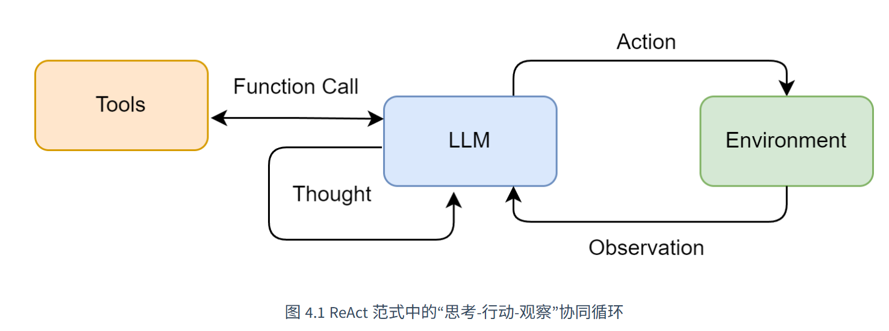<figcaption><p>推理行动观察循环</p></figcaption></figure>

### 执行流程

+ 用户提交任务后，LLM 根据当前上下文给出下一步动作。
+ 智能体程序解析动作请求，调用对应的 Python 函数或 API，并记录工具返回的观察。
+ 程序把原任务和本轮动作、观察传给模型，模型据此决定下一步。
+ 当模型判断任务已经完成时，智能体返回最终答案。

### 示例

<figure>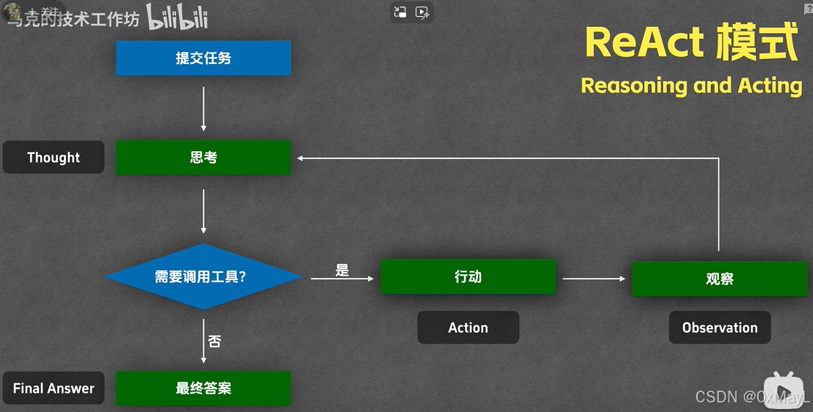<figcaption><p>ReAct 工具决策</p></figcaption></figure>

<figure>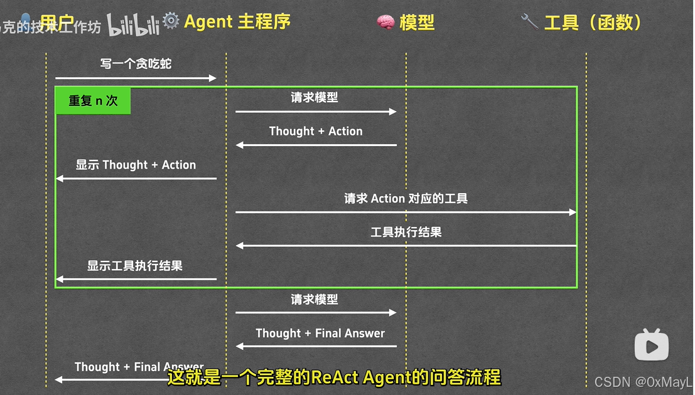<figcaption><p>ReAct 交互时序</p></figcaption></figure>

### 伪代码
将每轮动作和工具返回的观察追加到历史中，供下一轮使用。

```python
def run(self, question: str):
    self.history = []
    current_step = 0
    while current_step < self.max_steps:

        # 构造prompt
        history = "\n".join(self.history)
        tools_desc = self.tool_executor.getAvailableTools()
        prompt = REACT_PROMPT_TEMPLATE.format(
            tools=tools_desc, question=question, history=history
        )
        messages = [{"role": "user", "content": prompt}]
        response = self.llm_client.think(
            messages=messages, temperature=0.7
        )

        # 解析LLM的输出，输出格式保护
        thought, action = self._parse_output(response)

        if thought:
            print(f"🤔 思考: {thought[:10]}")
        else:
            raise ValueError("未能解析出有效的Thought，LLM输出可能不符合预期格式。")

        if action:
            print(f"🛠️ 行动: {action[:10]}")
            # 解析Action，执行工具或输出最终答案
            if action.startswith("Finish"):
                final_answer = self._parse_action_input(action)
                print(f"🎉 最终答案: {final_answer[:10]}")
                return final_answer
            else:
                # 解析工具调用
                tool_name, tool_input = self._parse_action(action)
                if tool_name and tool_input:
                    tool_func = self.tool_executor.getTool(tool_name)
                    if tool_func:
                        observation = tool_func(tool_input)
                        print(f"🔍 观察: {observation[:10]}")
                        # 将观察结果加入历史: 理论上不需要thought
                        self.history.append(f"Action: {action}\nObservation: {observation}")
                    else:
                        raise ValueError(f"未找到名为 '{tool_name}' 的工具。")
                else:
                    raise ValueError("未能解析出有效的Action，LLM输出可能不符合预期格式。")
        else:
            raise ValueError("未能解析出有效的Action，LLM输出可能不符合预期格式。")
        current_step += 1
```

## Plan-Act

### 执行流程
+ Plan模型负责首先提出一个**朴素但完整的计划**
+ **执行Agent**负责执行这个计划中的特定步骤，然后返回一个观察

可选：新增replan-agent，用于进一步提炼和修改计划。

+ Agent主程序**拼接用户输入+上一次输入的计划+上一次输出的观察**输入给Re-Plan模型
+ Replan模型会更新新的计划：**删除已经完成的部分**，对**剩余计划进行进一步细化**或者修改。
+ 重复此流程。

<figure>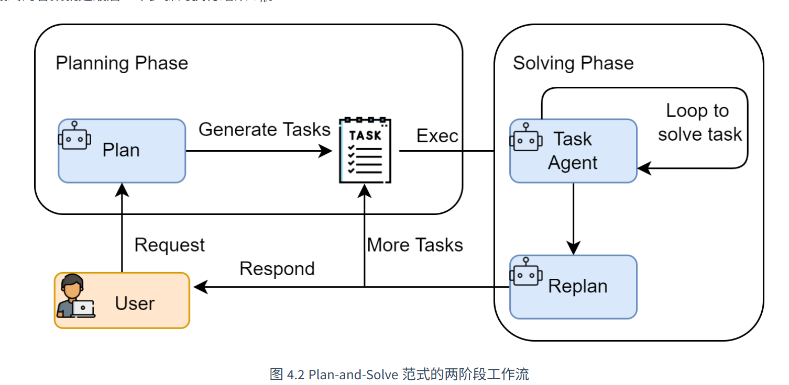<figcaption><p>规划与执行两阶段</p></figcaption></figure>

### 伪代码

执行过程：**迭代n步**，将**当前步骤**的执行结果放在历史中来。

```python
class PlanAndSolveAgent:
    def __init__(self, llm_client: HelloAgentsLLM):
        self.llm_client = llm_client
        self.planner = Planner(self.llm_client)
        self.executor = Executor(self.llm_client)

    def run(self, question: str):
        print(f"\n--- 开始处理问题 ---\n问题: {question}")
        plan = self.planner.plan(question)
        if not plan:
            print("\n--- 任务终止 --- \n无法生成有效的行动计划。")
            return
        final_answer = self.executor.execute(question, plan)
        print(f"\n--- 任务完成 ---\n最终答案: {final_answer}")
```

### 示例

<figure>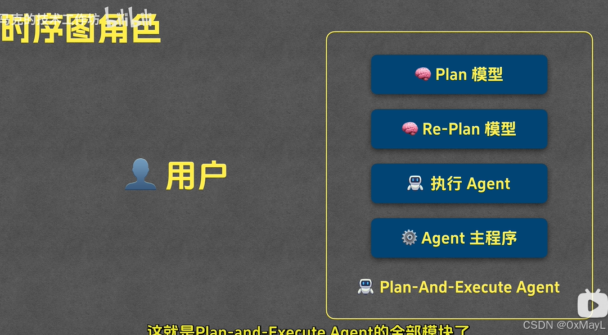<figcaption><p>规划执行角色</p></figcaption></figure>

执行流程：

<figure>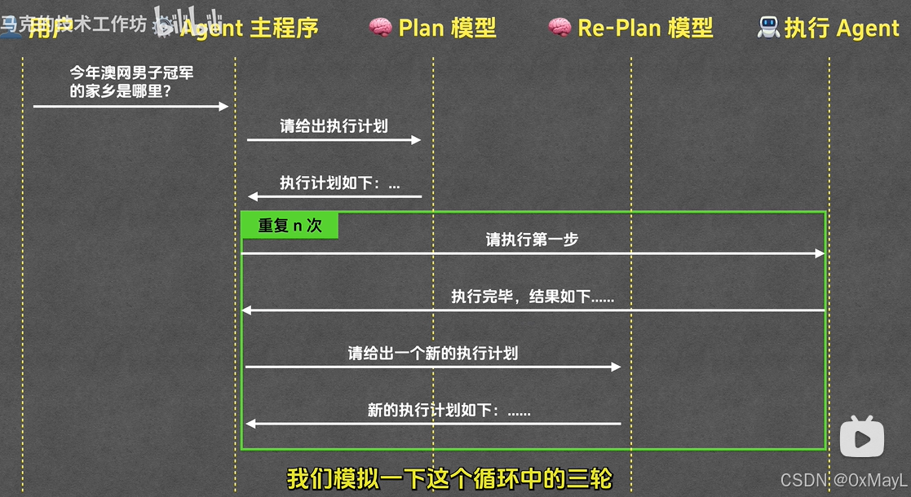<figcaption><p>执行与重规划时序</p></figcaption></figure>

## Reflection

<figure>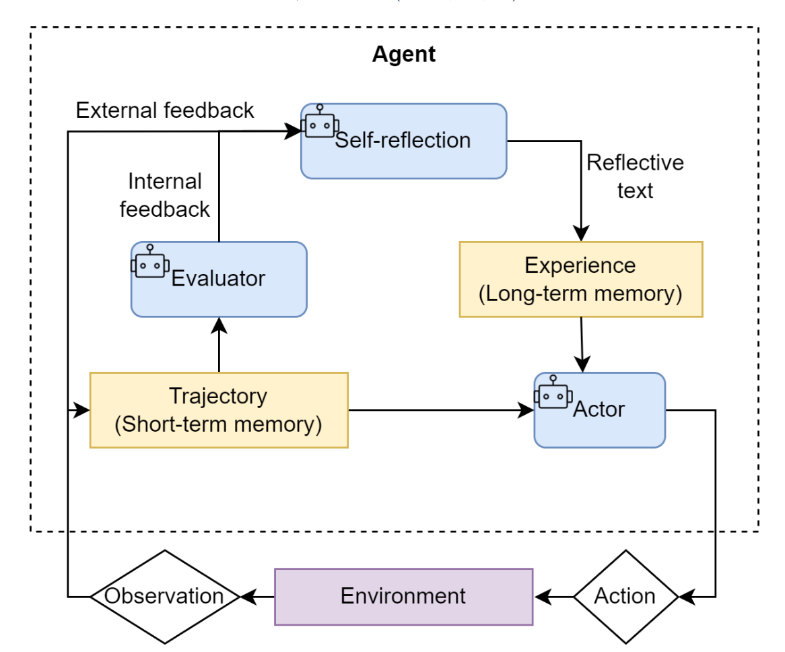<figcaption><p>智能体反思回路</p></figcaption></figure>

### 执行流程
+ Reflection 把对上一轮产出的评估反馈用于下一轮修订。
+ 按任务提示生成初稿。
+ 由评估智能体检查产出并提出修订意见。
+ 重复评估与修订，直到评估者认为无需改进，或达到预设的迭代上限。

### 伪代码

```python
class ReflectionAgent:
    def __init__(self, llm_client, max_iterations=3):
        self.llm_client = llm_client
        self.memory = Memory()
        self.max_iterations = max_iterations

    def run(self, task: str):
        print(f"\n--- 开始处理任务 ---\n任务: {task}")

        # 初次尝试
        initial_prompt = INITIAL_PROMPT_TEMPLATE.format(task=task)
        initial_code = self._get_llm_response(initial_prompt)
        self.memory.add_record('execution', initial_code)

        for i in range(self.max_iterations):
            print(f"\n--- 第 {i+1} 轮反思与优化 ---")
            last_code = self.memory.get_last_execution()
            if not last_code:
                print("❌ 未找到上一轮的代码尝试，无法继续反思。")
                break

            # 反思阶段
            reflect_prompt = REFLECT_PROMPT_TEMPLATE.format(task=task, code=last_code)
            feedback = self._get_llm_response(reflect_prompt)
            self.memory.add_record('reflection', feedback)

            if "无需改进" in feedback:
                print("✅ 代码已达到最优，无需进一步优化。")
                print(f"最终代码:\n{last_code}")
                break

            # 优化阶段
            refine_prompt = REFINE_PROMPT_TEMPLATE.format(
                task=task,
                last_code_attempt=last_code,
                feedback=feedback
            )
            refined_code = self._get_llm_response(refine_prompt)
            self.memory.add_record('execution', refined_code)

        print("\n--- 任务处理完成 ---")
        print("最终代码尝试: {}".format(self.memory.get_last_execution()))
```

## 记忆：Memory和RAG

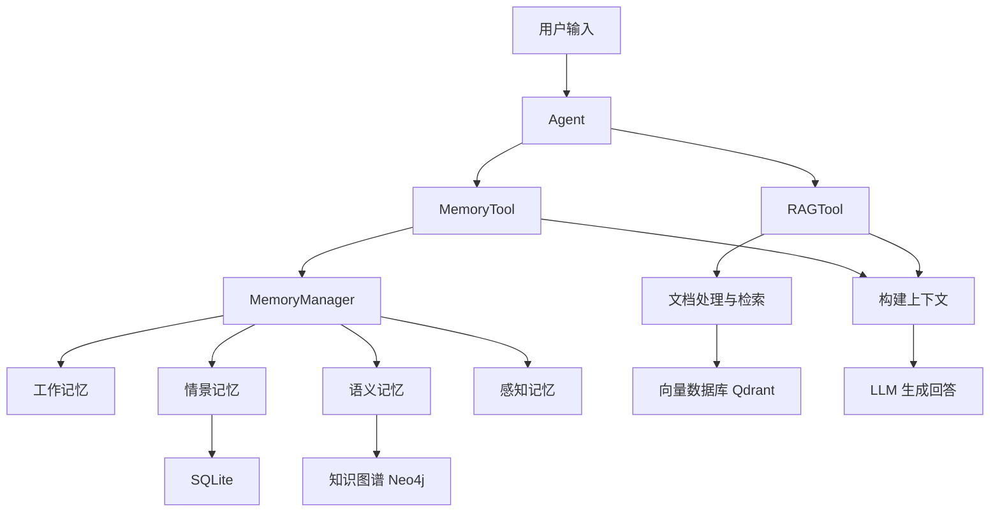

### 记忆与检索如何配合

Memory 为当前任务提供历史交互与任务状态，RAG 从外部知识库取回相关文档。下面以 PDF 入库和问答为例，展示两类信息如何汇入同一上下文。

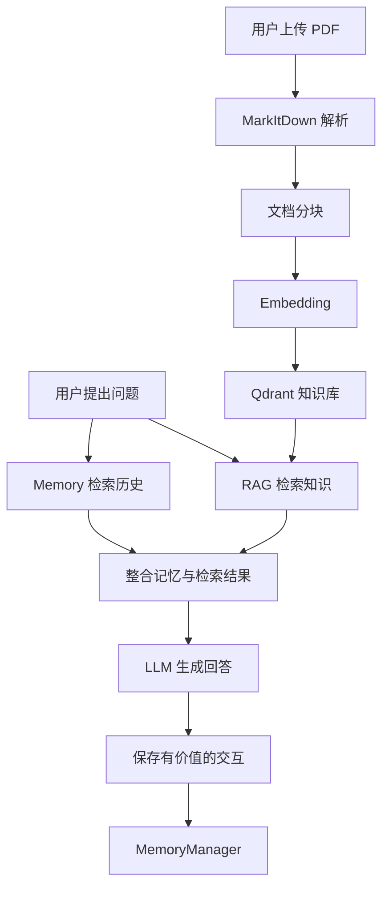

### 示例
+ 示例通过 `AGENTS.md` 记录记忆与工具调用等行为约定。
+ 记忆写入 `memory.md` 和 `memory/*` 下的日志。

#### 记忆示例

<figure>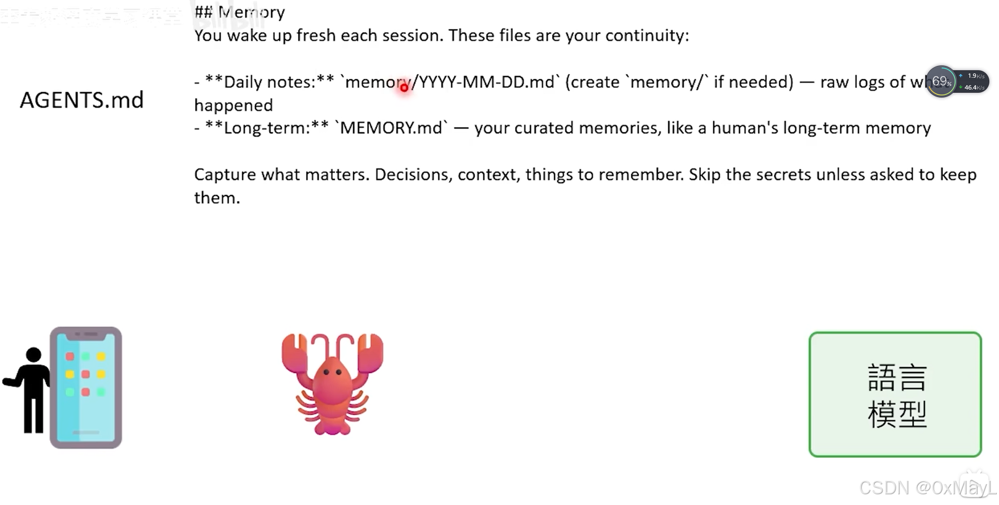<figcaption><p>记忆写入规则</p></figcaption></figure>

<figure>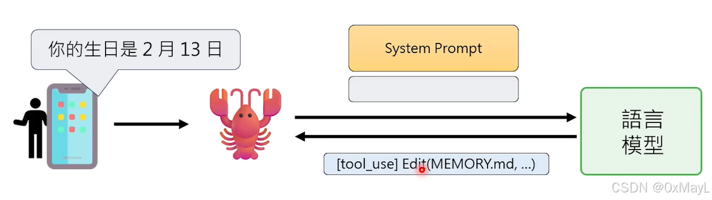<figcaption><p>长期记忆写入</p></figcaption></figure>

#### 检索示例

<figure>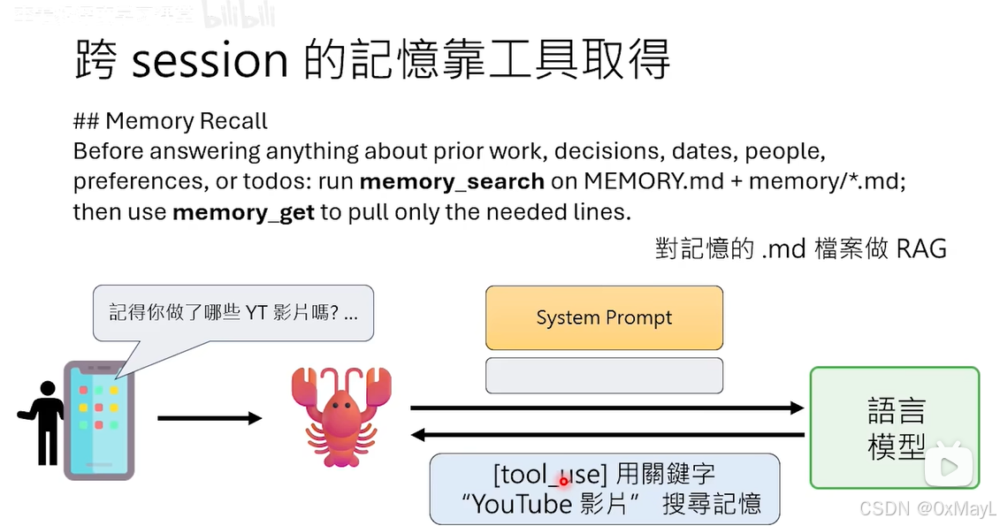<figcaption><p>跨会话记忆检索</p></figcaption></figure>

<figure>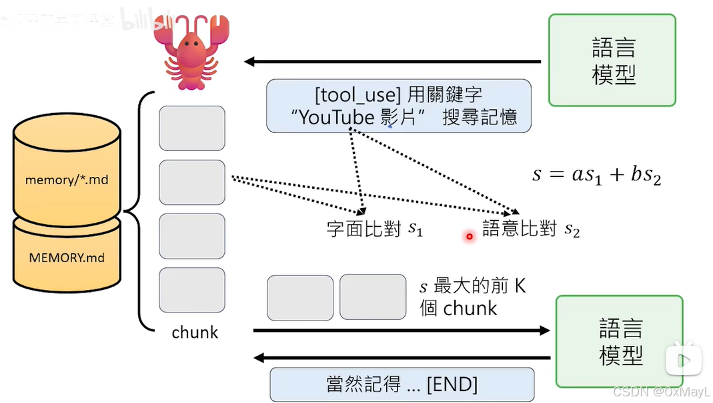<figcaption><p>混合检索评分</p></figcaption></figure>

图中的记忆检索示例把字面匹配与语义匹配合并为一个得分。

$$
\begin{align}
s &= a s_1 + b s_2
\end{align}
$$

其中，$$s$$ 为综合得分，$$s_1$$ 和 $$s_2$$ 分别为字面匹配与语义匹配得分，$$a$$ 和 $$b$$ 为对应权重。

## 上下文工程

### 上下文组成与限制

内容包括：
+ 系统，用户提示词
+ history：对话历史
+ memory：记忆，分别短期和长期记忆
+ rag：外部知识库，从中检索到的一些资源。
+ tools：内部或者外部mcp等工具调用的信息。

限制：
+ token限制
+ 有效信息的限制：不是将对话历史和外部资源**全部添加到上下文**中就一定有效。

<figure>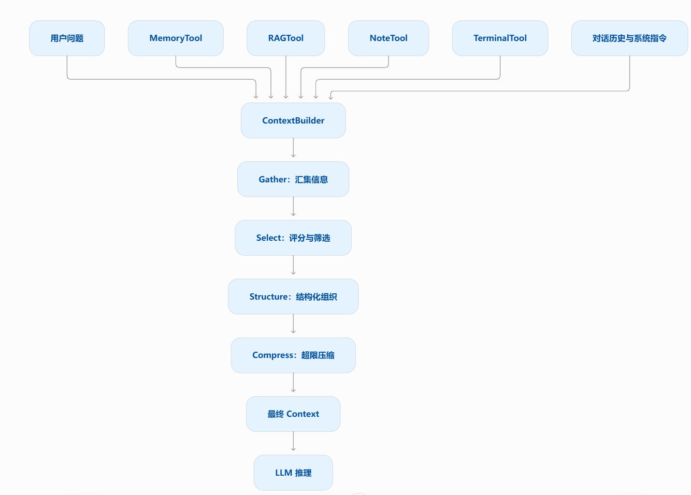<figcaption><p>上下文构建流水线</p></figcaption></figure>

### GSSC 流水线

<figure>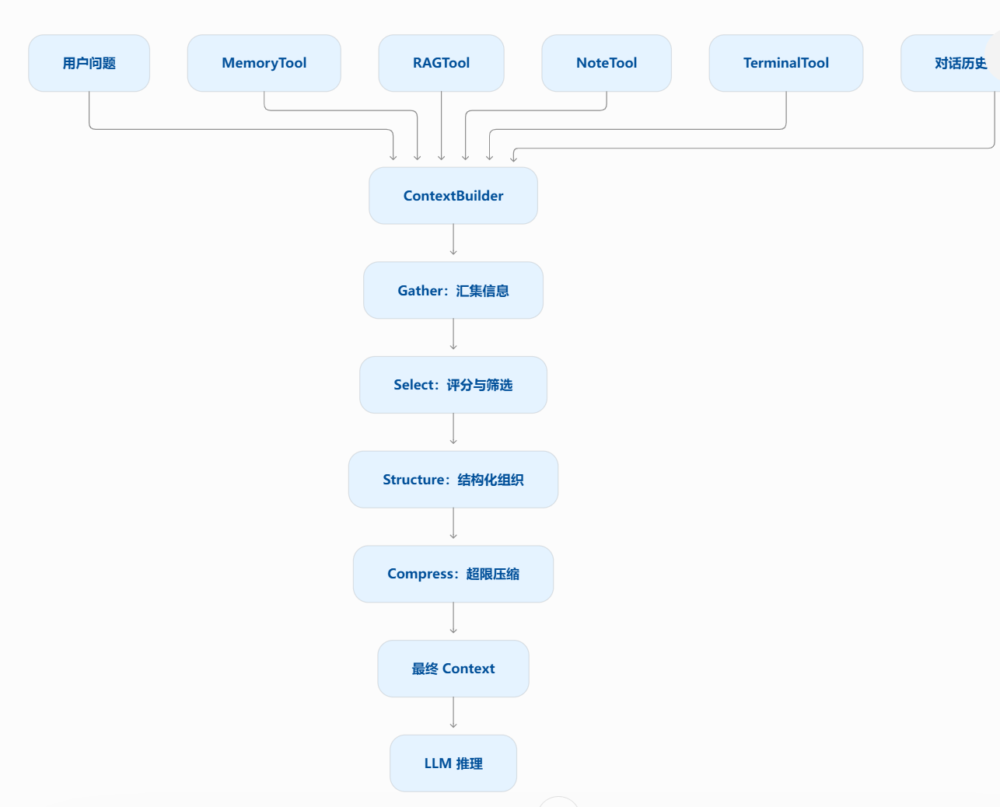<figcaption><p>上下文筛选与压缩</p></figcaption></figure>

#### 统一候选信息格式

不同数据源返回的信息格式可能完全不同。

例如：
- Memory 返回历史记忆。
- RAG 返回相关文档块。
- Terminal 返回命令执行结果。
- NoteTool 返回任务状态。
如果直接将它们拼接成 Prompt，无法统一控制信息质量。

因此，本章通过 ContextPacket 封装候选信息。

```python
from dataclasses import dataclass
from datetime import datetime
from typing import Optional, Dict, Any

@dataclass
class ContextPacket:
    content: str
    timestamp: datetime
    token_count: int
    relevance_score: float = 0.5
    metadata: Optional[Dict[str, Any]] = None
```

字段含义：

| 字段 | 作用 |
| --- | --- |
| content | 信息正文 |
| timestamp | 用于计算信息新近性 |
| token_count | 衡量上下文成本 |
| relevance_score | 信息与当前任务的相关程度 |
| metadata | 数据类型、来源等辅助信息 |

#### Gather 收集候选上下文

```python
# 检索历史记忆
memory_results = self.memory_tool.run({
    "action": "search",
    "query": user_query,
    "limit": 10,
    "min_importance": 0.3
})

# 检索知识库
rag_results = self.rag_tool.run({
    "action": "search",
    "query": user_query,
    "limit": 5,
    "min_score": 0.3
})

# 获取最近对话
recent_history = conversation_history[-5:]
```

有三个关键设计：

第一，限制检索数量。

Memory 最多检索 10 条、RAG 最多检索 5 条、对话历史取最近 5 条。这是原文示例采用的配置，不是通用最优值。

第二，单个信息源故障不应该导致整个流程失败。

使用 try-except 隔离检索失败：

```python
try:
    results = self.rag_tool.run(...)
except Exception as e:
    print(f"RAG 检索失败: {e}")
```

第三，系统指令不能与普通信息完全同等对待。

系统指令属于高优先级配置，而普通检索内容属于候选数据。

后续筛选必须保留这种区别。

#### Select 按 Token 预算筛选上下文

相关性评分 + 时间新近性 + 贪心选择。
第一步：计算综合评分
本章配置：
```python
relevance_weight = 0.7
recency_weight = 0.3
```

评分公式：

$$
\begin{align}
S_i &= 0.7R_i + 0.3T_i
\end{align}
$$

其中：

- $R_i$：第 $i$ 条信息的相关性。
- $T_i$：信息的新近性。
- $S_i$ 表示第 $i$ 条信息的综合得分。
例如：

| 信息 | 相关性 | 新近性 | 综合分数 |
| --- | --- | --- | --- |
| 当前任务要求 | 0.95 | 1.0 | 0.965 |
| 昨天的项目决策 | 0.9 | 0.9 | 0.900 |
| 三个月前的讨论 | 0.7 | 0.2 | 0.550 |
| 无关工具日志 | 0.1 | 1.0 | 0.370 |

可以看到：

即使某条信息非常新，如果相关性太低，也不应该占据过多上下文空间。
第二步：过滤低相关信息
本章使用：
`min_relevance = 0.1`

其作用是剔除低于最低相关性阈值的候选信息。
第三步：贪心选择
基本逻辑如下：
```python
packets.sort(key=lambda packet: packet.score, reverse=True)
selected = []
used_tokens = 0
for packet in packets:
    if used_tokens + packet.token_count <= budget:
        selected.append(packet)
        used_tokens += packet.token_count
```

按得分从高到低扫描候选项，跳过超出剩余 Token 预算的条目。

这实际上是一个带容量限制的信息选择问题。

形式化表达：

$$
\begin{align}
\max \sum_{i=1}^{n}S_i x_i
\end{align}
$$

约束：

$$
\begin{align}
\sum_{i=1}^{n}C_i x_i\le B
\end{align}
$$

其中：

- $S_i$：信息价值。
- $C_i$：Token 成本。
- $B$：Token 预算。
- $x_i\in\{0,1\}$：是否选中信息。
该问题可以看成一种 0-1 背包问题。

按分数排序的贪心策略实现简单，但可能错过总分更高的组合。

例如，一条高分但非常长的信息，可能消耗掉大量预算，导致多条短而重要的信息无法进入上下文。

实际工程中，可以进一步考虑：

$$
\begin{align}
D_i &= \frac{S_i}{C_i}
\end{align}
$$

其中，$$D_i$$ 表示第 $$i$$ 条信息每个 Token 的价值，$$S_i$$ 为综合得分，$$C_i$$ 为 Token 成本。

#### Structure 组织上下文

本章使用固定的上下文模板：

```text
[Role & Policies]
你是一个代码分析助手。
不要修改用户文件。

[Task]
分析当前项目的代码质量。

[Evidence]
从代码库中检索到的相关代码和文档。

[Context]
项目目前处于第二阶段。
上一轮发现数据库连接模块存在重复逻辑。

[Output]
输出问题、原因和改进建议。
```

示例中的 `_structure()` 输出五个区域。
1. Role & Policies
2. Task
3. Evidence
4. Context
5. Output

### 记忆的失败案例：光说不练
+ 智能体在回复中表示已记录，但 `memory/*` 下没有新增内容。

<figure>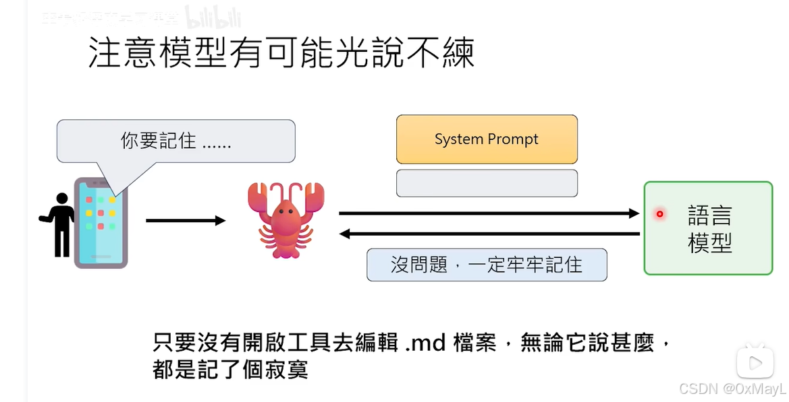<figcaption><p>记忆未写入案例</p></figcaption></figure>

### HEARTBEAT：心跳机制
+ 心跳机制在预设时机将检查指令交给模型，由智能体按指令判断是否需要执行操作。

<figure>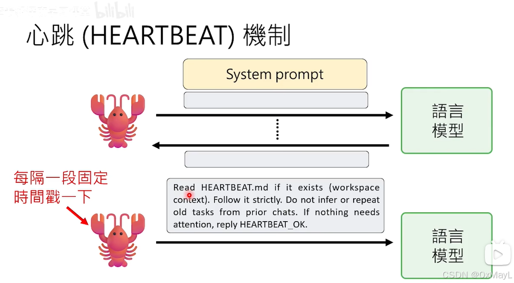<figcaption><p>心跳机制</p></figcaption></figure>

### 上下文压缩

上下文接近预算时，可以把较早的对话压缩成摘要，保留当前任务仍需要的结论与约束。

<figure>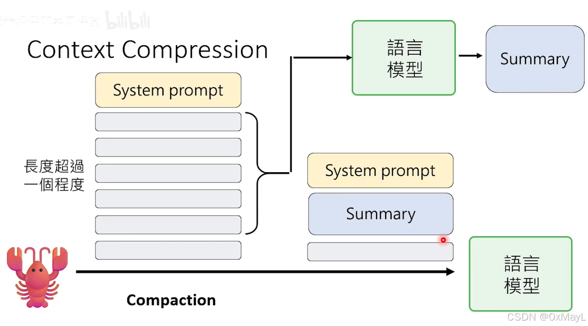<figcaption><p>上下文摘要压缩</p></figcaption></figure>

<figure>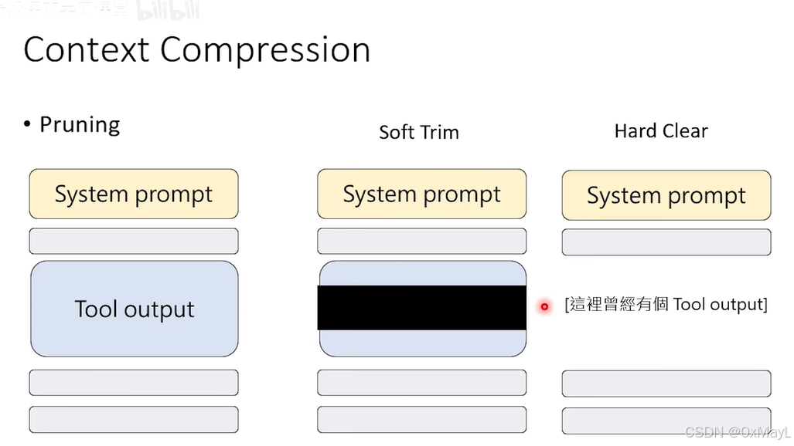<figcaption><p>工具输出裁剪</p></figcaption></figure>

## 子智能体如何分担任务
+ 把复杂任务拆成若干子任务，分别交给拥有独立上下文的子智能体。
+ 主智能体接收各个子任务的结果，并将它们汇总成最终产出。
+ 主智能体可以只保留结论与必要证据，从而节省自身的上下文预算。

<figure>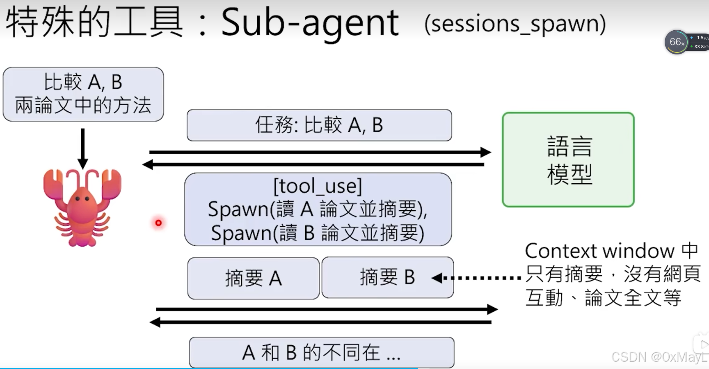<figcaption><p>子智能体并行摘要</p></figcaption></figure>

## Function Calling：输出格式约定
+ Function Calling 用结构化格式表达工具调用。应用向模型提供工具描述和参数约定，模型返回工具名与参数。
+ 智能体程序解析并校验这些参数，执行工具后把结果交回模型。

<figure>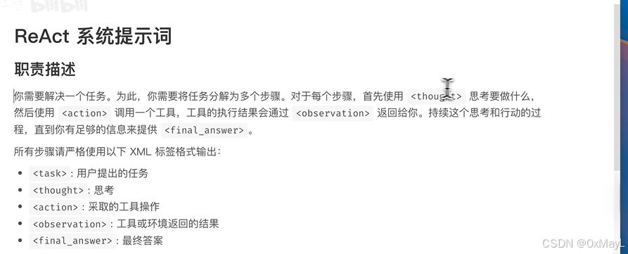<figcaption><p>ReAct 输出格式</p></figcaption></figure>

## 智能体通信协议

<figure>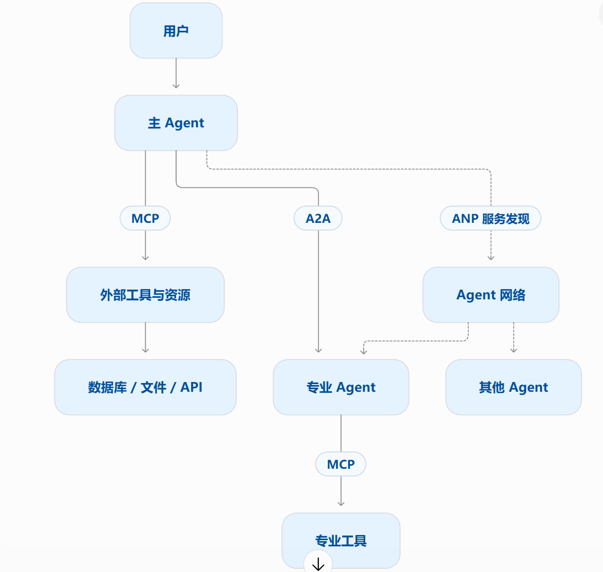<figcaption><p>智能体协议分工</p></figcaption></figure>

### 协作示例

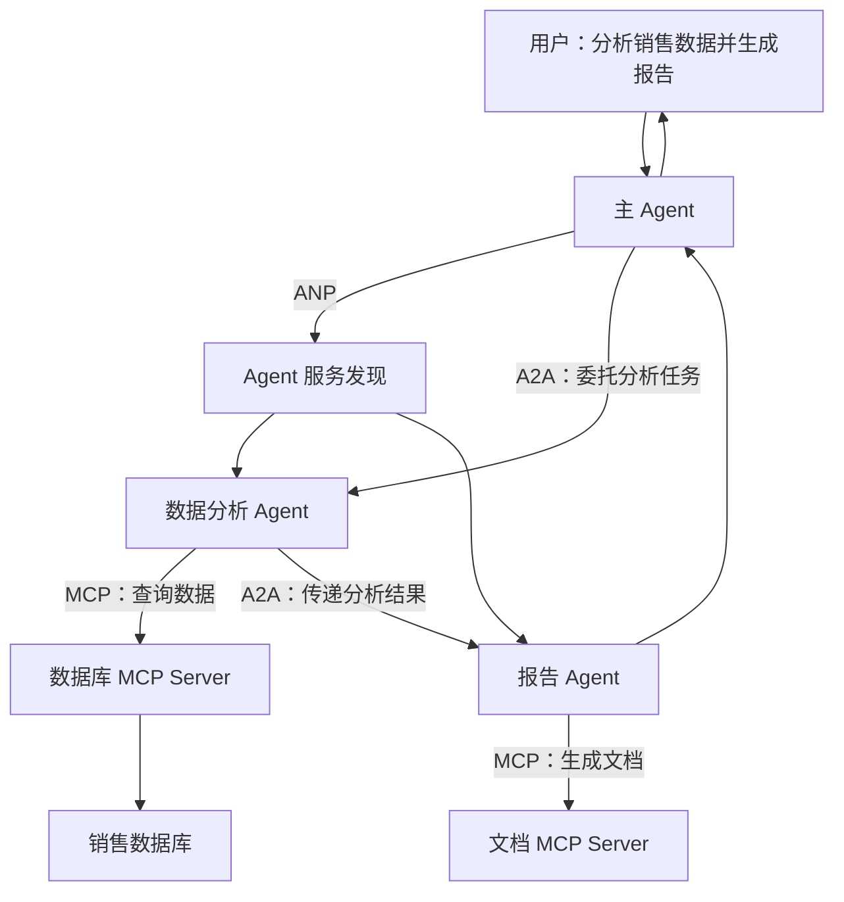

### MCP：模型上下文协议

<figure>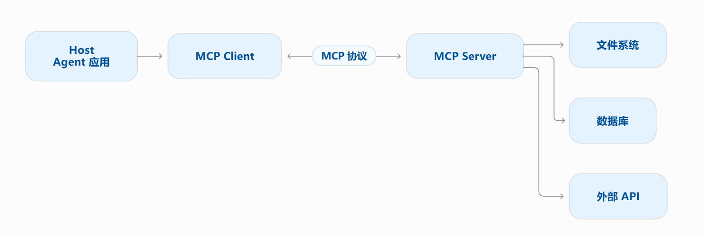<figcaption><p>MCP 连接架构</p></figcaption></figure>

<figure>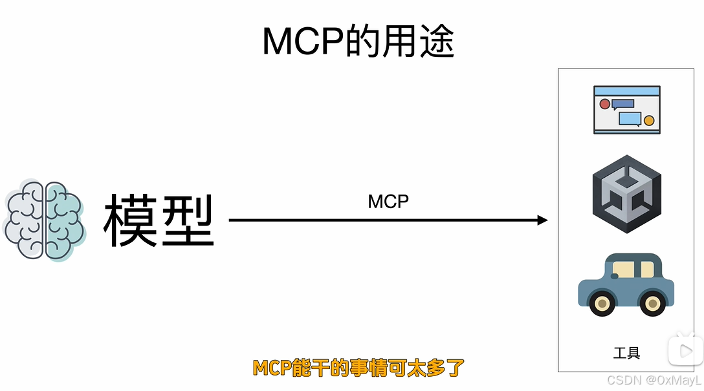<figcaption><p>MCP 工具接入</p></figcaption></figure>

#### MCP Host
+ MCP Host 是支持 MCP 的应用，负责管理客户端与服务端的连接。智能体应用可以担任 Host。

<figure>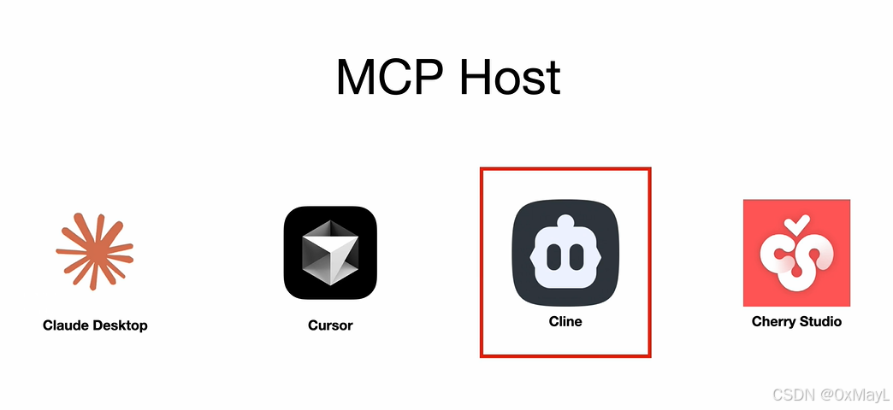<figcaption><p>MCP 主机示例</p></figcaption></figure>

#### MCP Server 与工具
+ MCPServer：**MCP Server 提供客户端可访问的能力**。服务端可以通过 Python 等语言实现，并向客户端暴露工具。

<figure>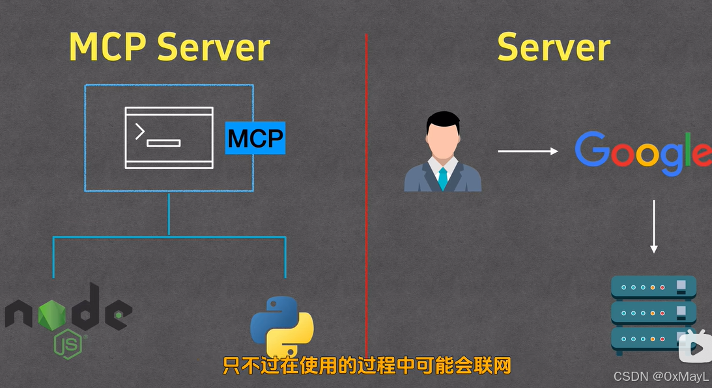<figcaption><p>MCP 服务端示例</p></figcaption></figure>

<figure>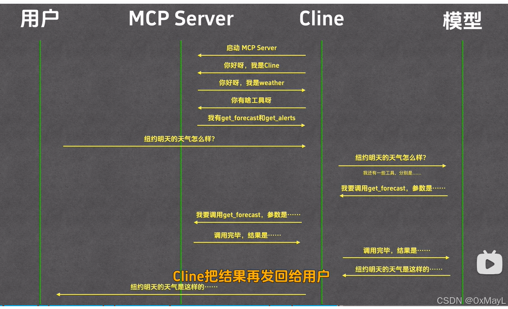<figcaption><p>MCP 天气查询时序</p></figcaption></figure>

### A2A：两个智能体的通信
A2A 让能够独立执行任务的智能体交换任务、状态和产出。

<figure>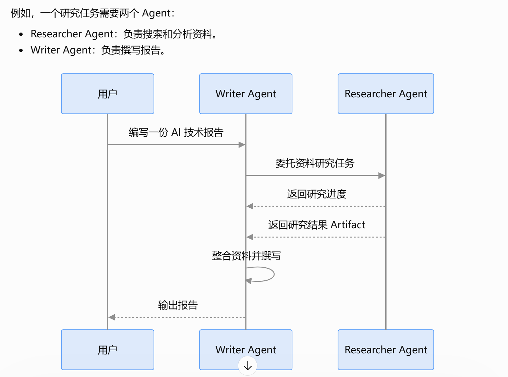<figcaption><p>研究与写作智能体协作</p></figcaption></figure>

#### A2A 的核心数据结构
需要重点理解三个概念。
**Agent Card** 描述 Agent 的身份、能力和连接方式。

```json
{
  "name": "Researcher",
  "description": "负责研究AI相关技术",
  "url": "https://example.com/a2a",
  "skills": [
    {
      "id": "research",
      "name": "技术研究"
    }
  ]
}
```

**Task** 表示需要执行的任务及其状态。

```text
submitted
   ↓
working
   ↓
completed
```

**Artifact** 表示任务产出的报告、文件或数据。

```json
{
  "artifactId": "report_001",
  "name": "Research Report",
  "parts": [
    {
      "kind": "text",
      "text": "AI技术研究结果..."
    }
  ]
}
```

#### A2A 的通信流程

```text
Agent A
   ↓
获取 Agent B 的 Agent Card
   ↓
确认 Agent B 支持所需技能
   ↓
发送任务请求
   ↓
Agent B 执行任务
   ↓
查询或订阅任务状态
   ↓
获取 Artifact
   ↓
Agent A 继续处理
```

### ANP：智能体网络

**Service Registration** 注册 Agent 的能力和连接信息。**Service Discovery** 按能力或类型查找 Agent。

```python
discovery = ANPDiscovery()

register_service(
    discovery=discovery,
    service_id="nlp_agent_1",
    service_name="NLP Agent",
    service_type="nlp",
    capabilities=[
        "text_analysis",
        "translation"
    ],
    endpoint="http://localhost:8001",
    metadata={
        "load": 0.3
    }
)
```

**Routing** 根据服务能力、负载和成本选择目标。**DID** 支持去中心化身份标识与验证。

DID（Decentralized Identifier）的核心是让 Agent 能够使用可验证的标识表示自己的身份。

概念性流程：
1. Agent A 拥有 DID 及对应的密钥。
2. Agent A 对请求进行数字签名。
3. Agent B 解析 DID，获得用于验证的公钥信息。
4. Agent B 验证签名，确认请求来源和完整性。

身份验证只能**证明某个请求对应特定身份**，不意味着该 Agent 一定可信或具备执行任务的权限。

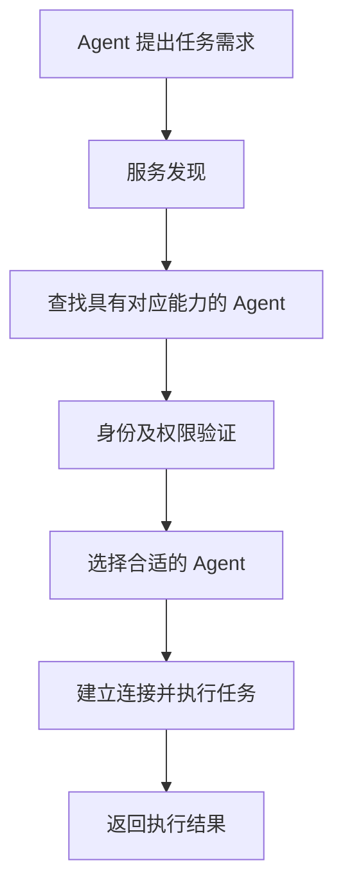

## 智能体系统如何串起记忆、上下文与通信

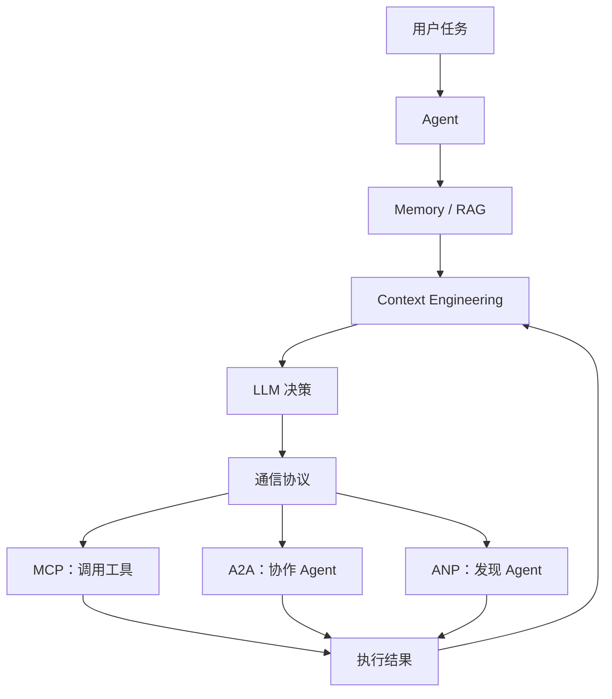

## Function Calling 与 MCP 的分工
+ Function Calling 约定模型如何表达工具名和参数。MCP 约定应用如何发现和调用服务端提供的工具。

<figure>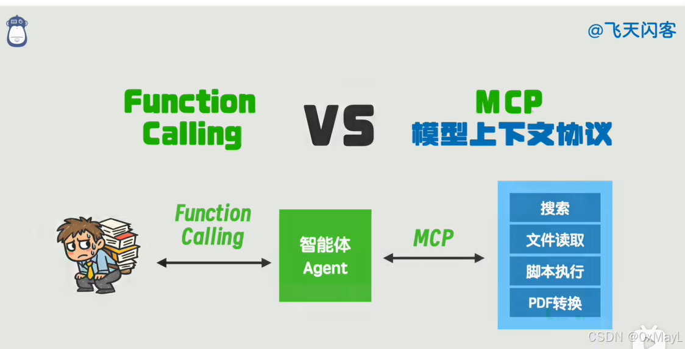<figcaption><p>函数调用与 MCP</p></figcaption></figure>

## SKILL：Tool+说明文档
+ Skill 将任务说明保存为可复用的文档，也可附带脚本。
+ 智能体按需读取说明，并根据任务使用配套脚本或工具。

<figure>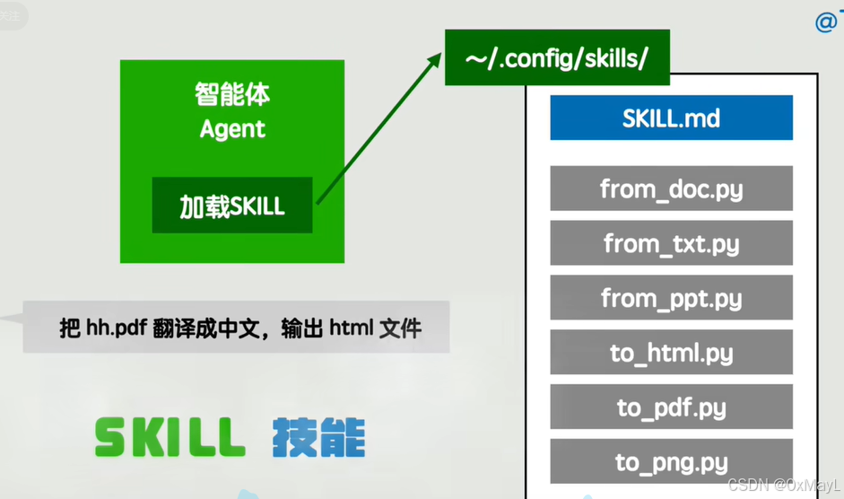<figcaption><p>技能目录与脚本</p></figcaption></figure>

---

## uv 的工具环境
+ `uvx`（等价于 `uv tool run`）：临时将某个tool加载到**隔离的虚拟环境**中并且运行。
+ `uv tool install`：将tool及其依赖安装到**隔离的环境**中，与pip install不同。

## OpenClaw 安装准备

### 系统环境
+ Ubuntu 22.04
+ 公共服务器：**无sudo权限**。

### 安装 Node.js
+ 用 `wget` 下载 Node.js 24 预编译包，解压到用户目录后即可运行。

<figure>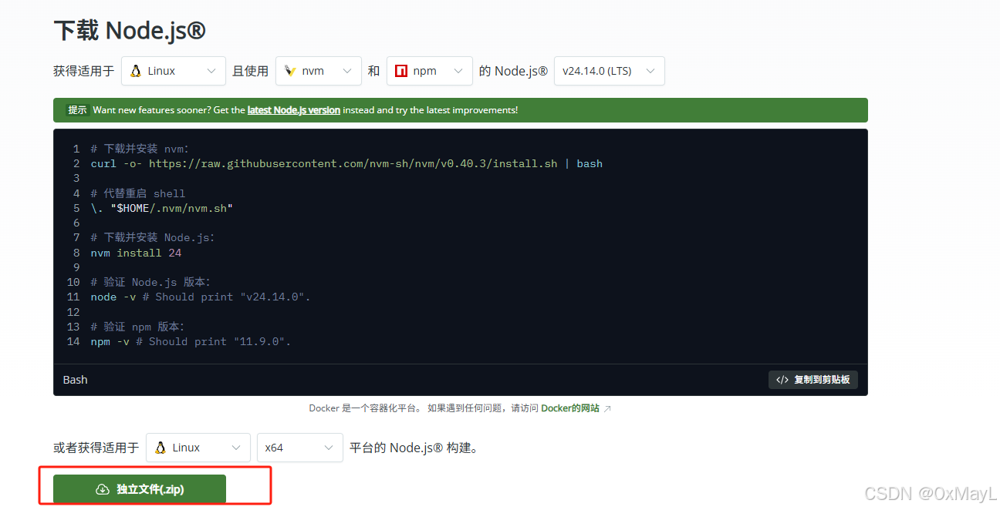<figcaption><p>Node.js 下载页面</p></figcaption></figure>

+ 将解压目录下的 `bin` 加入 `PATH`，并在 `~/.bashrc` 中保存设置。下方路径来自示例环境。
```bash
export PATH=/home/a2023102747/node-v24.14.0-linux-x64/bin:$PATH
```
