## 网络与部署基础

### 私有 IP、公网 IP 与 NAT

要准确理解这个问题，需要区分三个概念：

1. 私有 IP 地址（Private IP）
2. 公网 IP 地址（Public IP）
3. NAT（Network Address Translation，网络地址转换）

#### 私有 IP 地址

在 IPv4 网络中，RFC 1918 规定了三个专门用于私有网络的地址范围：

| 地址范围 | CIDR 表示 | 常见使用场景 |
| --- | --- | --- |
| 10.0.0.0 ~ 10.255.255.255 | 10.0.0.0/8 | 企业内部网络 |
| 172.16.0.0 ~ 172.31.255.255 | 172.16.0.0/12 | 企业网络、云计算 |
| 192.168.0.0 ~ 192.168.255.255 | 192.168.0.0/16 | 家庭 WiFi、局域网 |

例如：

```text
192.168.1.5
192.168.1.100
10.0.0.15
172.16.0.20
```

都是私有 IPv4 地址。

它们有一个重要特点：

<span style="color:red">私有 IP 地址不会在公共互联网中作为普通的全球可路由地址使用</span>。

例如，你家电脑的 IP 是：

```text
192.168.1.5
```

而我家电脑也可能是：

```text
192.168.1.5
```

这完全合法。

因为**私有 IP 地址只需要在各自的网络环境中保持地址分配合理**，不要求在全球范围内唯一。

而公网 IP 地址通常要求在全球互联网路由体系中具有唯一性。

#### NAT 如何帮助内网访问互联网

关键技术是 NAT（网络地址转换）。

假设你的家庭网络结构如下：

```text
              互联网
                 |
                 |
        公网 IP：203.0.113.10
                 |
          +-------------+
          | 家庭路由器   |
          |    NAT      |
          +-------------+
                 |
       家庭内部局域网
                 |
       +---------+---------+
       |         |         |
       v         v         v
     电脑       手机       平板
192.168.1.5 192.168.1.6 192.168.1.7
```

注：203.0.113.10 是用于文档示例的 IP 地址。

假设你的电脑访问：
https://www.example.com

实际上会发生以下过程。
**第一步，电脑发送请求。**
你的电脑向目标服务器发送数据包。

例如：

```text
源 IP：192.168.1.5
源端口：50000

目标 IP：93.184.215.14
目标端口：443
```

**第二步，路由器执行 NAT。**
家庭路由器通常使用 NAPT（网络地址与端口转换），将**私有 IP 和端口映射为公网 IP 和端口**。

例如：

```text
转换前：

192.168.1.5:50000
        |
        v
转换后：

203.0.113.10:62000
```

路由器会记录一条映射关系：

| 内部地址 | 外部映射地址 |
| --- | --- |
| 192.168.1.5:50000 | 203.0.113.10:62000 |

随后，路由器把转换后的数据包发送到互联网。
**第三步，服务器返回数据。**
服务器收到请求后，看到的来源通常是：

```text
203.0.113.10:62000
```

因此，它会把响应发送到这个地址和端口。
**第四步，路由器将数据交给电脑。**
路由器收到响应后，查询 NAT 映射表：

```text
203.0.113.10:62000
         |
         v
192.168.1.5:50000
```

于是将数据转发给你的电脑。

#### 示例——消息如何抵达内网设备

以即时通信应用为例，客户端通常会先主动连接服务端，并维护连接或在断线后重连。

朋友发送的消息先到服务端，再经客户端已经建立的连接传回设备。

客户端先建立通信通道，服务端随后沿这条通道推送消息。

外部设备若要主动访问内网主机，需要额外的路由、端口映射或穿透机制。

外部请求到达路由器后，需要有相应规则才能被转发给内网设备。

私有 IP 的可达范围限于相应网络。公网 IP 具备公共路由可达性，实际入站访问还受监听端口、防火墙和安全组规则限制。

### Nginx 提供网页服务

Nginx 可以持续监听 HTTP 端口，并根据请求返回网页文件或转发请求。

下文以 Ubuntu/Debian 常见的 Nginx 默认配置为例，监听 HTTP 标准端口 `80`。实际行为以安装后的配置为准。

从浏览器访问前，确认 Nginx 已启动，并且服务器防火墙及云平台安全组允许访问 `80` 端口。

做好之后，打开你自己电脑上的浏览器，访问下面这个地址，应该就可以看到 Nginx 的默认欢迎页：

```text
http://你的服务器公网IP
```

在服务器本机访问 `http://localhost:80`，则连接该服务器自身。

<figure>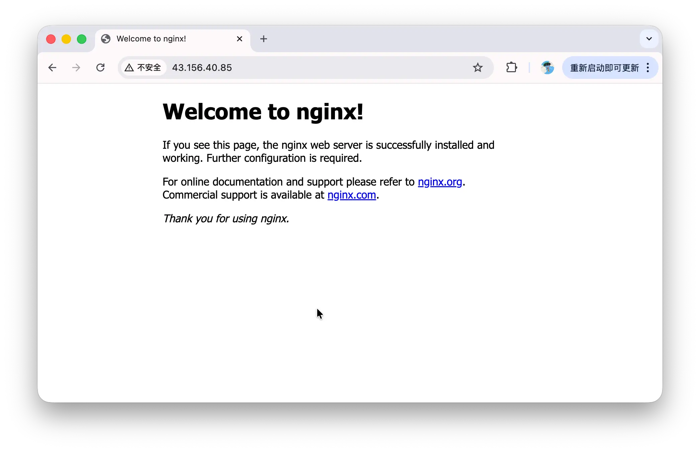<figcaption><p>服务器欢迎页</p></figcaption></figure>

#### 默认页面目录

上一步我们访问到的浏览器里那个 Nginx 默认页面，背后也是**对应着服务器上的一个 HTML 文件**。

默认页面的路径可以从站点配置中确认。

```bash
cat /etc/nginx/sites-available/default
```

终端会打印出一大段配置。不需要全看懂，只需要找到这一行：

```nginx
root /var/www/html;
```

这行配置的意思就是：

**Nginx 会去 /var/www/html 这个目录里找网页文件来提供给浏览器**。

顺着这个路径，进去看看：

```bash
cd /var/www/html
ls
```

你会看到一个文件，通常叫：

```text
index.nginx-debian.html
```

这就是刚才浏览器里默认页面对应的源文件。

用 cat 看一眼它的内容：

```bash
cat index.nginx-debian.html
```

## 前端开发

### HTML 定义页面结构

HTML 文档用 `<!DOCTYPE html>` 声明文档类型。

`<head>` 保存网页元信息。

+ 字符编码：`<meta charset="UTF-8">`

+ 网页的标题 (标签页上的标题)：`<title>`

`<body>` 包含页面正文。

+ 小标题：`<h1>`

+ 段落：`<p>`

> `<head>` 中的内容属于页面元信息，例如字符编码和标签页标题。页面中可见的标题、段落等正文放在 `<body>` 中。

<figure>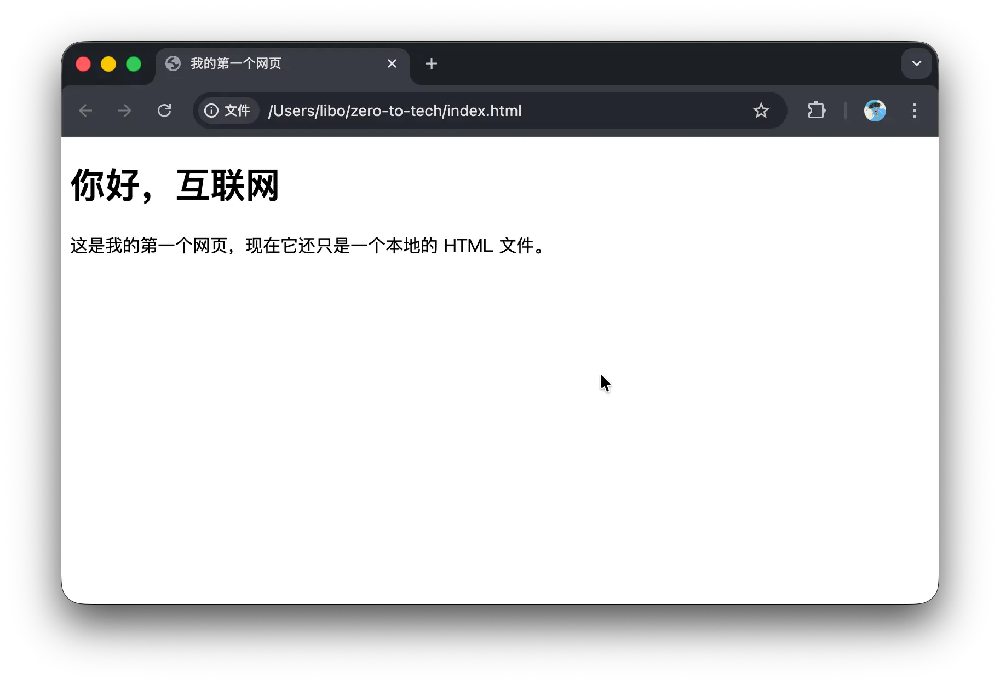<figcaption><p>本地网页预览</p></figcaption></figure>

```html
<!DOCTYPE html>
<html lang="zh-CN">
  <head>
    <meta charset="UTF-8">
    <title>我的第一个网页</title>
  </head>
  <body>
    <h1>你好，互联网</h1>
    <p>这是我的第一个网页，现在它还只是一个本地的 HTML 文件。</p>
  </body>
</html>
```

`sites-available` 保存站点配置，`sites-enabled` 通常通过软链接启用其中的配置。网页 HTML 存放在 `root` 指向的目录中。

#### 用内嵌 CSS 定义样式

解释：

+ 使用`<style>`进行包裹。

+ body：与html定义标签一致，表示作用于该类型`<body>`标签

+ .card：针对class="card"的标签。

例如：`<div class="card">`

```html
<style>
    body {
    background-color: #f0f4f8;
    display: flex;
    justify-content: center;
    align-items: center;
    height: 100vh;
    margin: 0;
    font-family: sans-serif;
    }

    .card {
    background: white;
    padding: 40px;
    border-radius: 12px;
    text-align: center;
    box-shadow: 0 4px 12px rgba(0, 0, 0, 0.1);
    }

    h1 {
    color: #2c3e50;
    margin-bottom: 12px;
    }

    p {
    color: #666;
    }

    button {
    margin-top: 20px;
    padding: 10px 24px;
    background-color: #3498db;
    color: white;
    border: none;
    border-radius: 6px;
    cursor: pointer;
    font-size: 16px;
    }

    button:hover {
    background-color: #2980b9;
    }
</style>
```

#### 用内嵌 JavaScript 实现交互

解释:

+ 使用`<script>`包裹

+ function changeText() ...：javascript类型的函数定义。

+ 含义：根据前面定义的`id="msg"`来决定**作用对象**。

```html
<div class="card">
    <h1>你好，互联网</h1>
    <p id="msg">这是我的第一个网页，现在它有了一点样式。</p>

    <button onclick="changeText()">点我试试</button>

</div>


<script>
    function changeText() {
    document.getElementById('msg').textContent = '你刚刚触发了一段 JavaScript。';
    }
</script>
```

### 将 CSS 分离到独立文件

把 index.html 里 `<style>` 标签之间的内容，完整复制到 style.css 里：

注意：复制的是 `<style>` 和 `</style>` 之间的内容，不包括这两个标签本身。

style.css 里的内容应该是这样的：

```css
body {
  background-color: #f0f4f8;
  display: flex;
  justify-content: center;
  align-items: center;
  height: 100vh;
  margin: 0;
  font-family: sans-serif;
}

.card {
  background: white;
  padding: 40px;
  border-radius: 12px;
  text-align: center;
  box-shadow: 0 4px 12px rgba(0, 0, 0, 0.1);
}

h1 {
  color: #2c3e50;
  margin-bottom: 12px;
}

p {
  color: #666;
}

button {
  margin-top: 20px;
  padding: 10px 24px;
  background-color: #3498db;
  color: white;
  border: none;
  border-radius: 6px;
  cursor: pointer;
  font-size: 16px;
}

button:hover {
```

  background-color: #2980b9;
}
保存 style.css。

然后，回到 index.html，把整个 `<style>`...`</style>` 块删掉，替换成下面这一行，放在同样的位置（`</head>` 之前）：

```html
    <link rel="stylesheet" href="style.css">
```

### 将 JavaScript 分离到独立文件

在同一个文件夹里，再新建一个文件，命名为 script.js：

把 index.html 里 `<script>` 标签之间的内容，复制到 script.js 里：

同样，复制的是标签之间的内容，不包括 `<script>` 和 `</script>` 本身。

script.js 里的内容应该是这样的：

```javascript
function changeText() {
  document.getElementById('msg').textContent = '你刚刚触发了一段 JavaScript。';
}
```

保存 script.js。

然后回到 index.html，把整个 `<script>`...`</script>` 块删掉，替换成：

```html
    <script src="script.js"></script>
```

### 分离后的项目结构

HTML 用 `<link>` 引用样式表，用 `<script>` 引用脚本，使页面结构、样式和交互逻辑分别维护。

```html
<!DOCTYPE html>
<html lang="zh-CN">
  <head>
    <meta charset="UTF-8">
    <title>我的第一个网页</title>
    <link rel="stylesheet" href="style.css">
  </head>
  <body>
    <div class="card">
      <h1>你好，互联网</h1>
      <p id="msg">这是我的第一个网页，现在它有了一点样式。</p>
      <button onclick="changeText()">点我试试</button>
    </div>

    <script src="script.js"></script>
  </body>
</html>
```

```text
index.html    ← 页面结构
style.css     ← 样式
script.js     ← 交互逻辑
```

### 将页面部署到 Nginx

代码已经在服务器上了，但 Nginx 还不知道——**它现在还指着默认欢迎页**。

接下来修改 Nginx 的站点配置，让它从项目目录读取网页。先确认配置入口与站点目录的关系，再修改具体参数。

#### 查找配置文件

先到 Nginx 的配置目录看一眼。在终端里：

```bash
cd /etc/nginx/
ls
```

会看到这样一片东西：

```text
conf.d          koi-win            nginx.conf       sites-enabled
fastcgi.conf    mime.types         proxy_params     snippets
fastcgi_params  modules-available  scgi_params      uwsgi_params
koi-utf         modules-enabled    sites-available  win-utf
```

真正的配置入口是 nginx.conf。

#### 配置入口 `nginx.conf`

Nginx 从主配置文件读取设置，再通过 `include` 加载其他配置。下方是 Ubuntu/Debian 常见配置的节选，路径和参数会随发行版及安装方式变化。

```nginx
user www-data;
worker_processes auto;
pid /run/nginx.pid;
error_log /var/log/nginx/error.log;
include /etc/nginx/modules-enabled/*.conf;

events {
    worker_connections 768;
}

http {
    sendfile on;
    tcp_nopush on;
    types_hash_max_size 2048;

    include /etc/nginx/mime.types;
    default_type application/octet-stream;

    ssl_protocols TLSv1 TLSv1.1 TLSv1.2 TLSv1.3;
    ssl_prefer_server_ciphers on;

    access_log /var/log/nginx/access.log;

    gzip on;

    include /etc/nginx/conf.d/*.conf;
    include /etc/nginx/sites-enabled/*;
}
```

#### `http` 块与站点配置

http { ... } 块最关键的最后两句：

```nginx
include /etc/nginx/conf.d/*.conf;
include /etc/nginx/sites-enabled/*;
```

这两条 `include` 将额外的 HTTP 配置和已启用的站点配置加载进来。修改 `sites-enabled/default` 后，主配置就会间接读到相应内容。

配置文件的包含关系如下。

```text
nginx.conf  (Nginx 启动只读这一个)
  ├─ 顶层：user / worker / pid / error_log
  ├─ events { ... }      并发参数
  └─ http { ... }        HTTP 服务全配置
      ├─ include mime.types
      ├─ include conf.d/*.conf
      └─ include sites-enabled/*   ←  我们要改的网站配置就是从这里被串进来的
```

这一节我们只关心这两个：

```text
/etc/nginx/sites-available/   ← 所有"写出来"的网站配置
/etc/nginx/sites-enabled/     ← 当前"启用中"的网站配置
```

这两个目录把站点配置的保存与启用分开管理。

sites-available/ 里放的是你**写过的所有网站配置**，不管启不启用，都在这里留底
sites-enabled/ 里只放当前要让 Nginx **真正读到的那几个配置**
但是 sites-enabled/ 里的"文件"其实不是真正的文件，而是指向 sites-available/ 里某个文件的**软链接（symlink）**——你可以理解为 Windows 里的"快捷方式"。换句话说：

> 当 `sites-enabled/default` 是指向 `sites-available/default` 的软链接时，从任一入口编辑都会修改同一份配置。

这样设计的好处是：

想临时停掉一个网站，不用删配置，只要把 sites-enabled/ 里的快捷方式删掉就行
以后想恢复，再把软链接挂回去就好

如果你想看清这个软链接的结构，可以执行：

```bash
ls -l /etc/nginx/sites-enabled/
```

输出大概长这样：

```text
default -> /etc/nginx/sites-available/default
```

那个箭头 -> 就告诉你：**sites-enabled/default 实际指向的是 sites-available/default**。

#### /etc/nginx/sites-available/default

刚装好的 Nginx 里只挂了 default 这一个，对应那个"Welcome to nginx!“欢迎页。看一眼它的内容：

```bash
cat /etc/nginx/sites-enabled/default
```

```nginx
server {
    listen 80 default_server;
    listen [::]:80 default_server;

    root /var/www/html;
    index index.html index.htm index.nginx-debian.html;

    server_name _;

    location / {
        try_files $uri $uri/ =404;
    }
}
```

#### `root` 指定静态文件根目录

`root` 指定当前配置作用域内的静态文件根目录。Nginx 通常将请求 URI 拼接到这个目录后查找文件。

它告诉 Nginx：当有人来访问时，去 /var/www/html 这个目录里找文件返回。

举几个例子：

用户访问 http://你的IP/about.html → Nginx 去找 /var/www/html/about.html
用户访问 http://你的IP/css/main.css → Nginx 去找 /var/www/html/css/main.css
在这个站点配置中，`root` 提供静态资源路径的起点。其他 `location` 或 `alias` 配置可能改变具体的映射方式。

这节课要做的修改，全部就在这一行上：把它从 /var/www/html 改成 /home/ubuntu/zero-to-tech，让 Nginx 改去我们 clone 下来的目录里找文件。

#### `index` 指定目录入口

`index index.html index.htm index.nginx-debian.html;` 设置默认入口文件的查找顺序。

这一行告诉 Nginx：当用户访问的是一个**目录**而不是一个具体的**文件**时，用哪个文件代替。

举个例子：

用户访问 http://你的IP/（最后是斜杠，访问的是根目录）

Nginx 没办法返回一个目录，它必须返回一个文件
于是按这一行的顺序去找：先看有没有 index.html，没有再找 index.htm，再没有就找 index.nginx-debian.html

我们的项目里有 index.html，所以第一个就命中。

那个 index.nginx-debian.html，就是 Nginx 默认欢迎页的文件名——到这里你应该能完整地理解为什么之前打开公网 IP 看到的是欢迎页了：**root 指向 /var/www/html，那个目录里恰好有 index.nginx-debian.html**，Nginx 就把它返回了。

#### 修改工作目录

把 root 改成我们自己的目录
用 vim 打开配置文件：

```bash
sudo vim /etc/nginx/sites-enabled/default
```

必须加 sudo，因为这个文件归 root 所有。

进入 vim 之后：

按 / 进入搜索模式
输入 root /var，回车
光标会定位到 root /var/www/html; 那一行
按 i 进入插入模式
**把 /var/www/html 改成 /home/ubuntu/zero-to-tech**
改完之后这一行应该是：root /home/ubuntu/zero-to-tech;
按 Esc 退出插入模式
输入 :wq，回车，保存并退出

#### 检查并重新加载配置

第一步：语法检查

```bash
sudo nginx -t
```

正常情况下，你会看到：

```text
nginx: the configuration file /etc/nginx/nginx.conf syntax is ok
nginx: configuration file /etc/nginx/nginx.conf test is successful
```

如果看到 syntax is ok 和 test is successful，就说明配置文件没写错。

检查失败时，根据提示修正配置并再次校验。确认检查通过后，再执行重新加载。

第二步：重新加载

```bash
sudo systemctl reload nginx
```

reload 和 restart 不一样：reload 是平滑加载新配置，不中断正在处理的连接；restart 是完全重启进程。我们这种情况用 reload 就够了。

命令成功时通常没有输出，可结合退出状态和服务日志确认结果。

#### 检查网页目录的访问权限

打开浏览器，地址栏输入：

```text
http://你的公网IP
```

注意是 http:// 不是 https://。我们还没有配 SSL 证书，那是后面模块的事。

如果网页没有显示，应结合 Nginx 错误日志检查路径和权限。权限问题可能表现为 `403`，也可能在 `try_files` 等配置下最终返回 `404`。

示例中的 `user www-data` 指定了工作进程用户。读取静态文件时，应检查该用户是否具有所需权限。

而 www-data 要读到我们的 /home/ubuntu/zero-to-tech/index.html，它必须能逐层走进这条路径上的每一级文件夹：

```text
/  →  home  →  ubuntu  →  zero-to-tech  →  index.html
```

我们来查一下是哪一层卡住了。在服务器上运行：

```bash
ls -ld /home/ubuntu
```

你大概率会看到类似这样的输出：

```text
drwxr-x--- 5 ubuntu ubuntu 4096 Jun  1 12:00 /home/ubuntu
```

留意开头那串权限里，最后三位是 ---——这代表"其他人"（others）对**这个目录没有任何权限**。这就是案发现场：

> 家目录权限因系统配置而异。示例中的 `/home/ubuntu` 未给其他用户目录执行权限，`www-data` 因而无法穿过这一层。

在这组权限下，`www-data` 若既不是目录属主也不属于目录所属组，就无法进入 `/home/ubuntu`，进而无法读取项目文件。

还要逐层确认项目目录的执行权限和网页文件的读取权限，不能只检查最外层目录。

为目录增加穿越权限的示例命令如下。

```bash
sudo chmod o+x /home/ubuntu
```

这条命令拆开看：

o 指 others——“既不是属主、也不在属主组"的用户，Nginx 的 www-data 就属于这一类
x 给的是”能进入这个目录"的权限（注意：是"能穿过"，不是"能列出里面有什么"）
这条命令会给所有其他用户增加目录执行权限，使其可以沿已知路径穿过该目录。它没有增加目录读取权限，列出目录内容仍取决于读取权限。

这一步只需要做一次。以后你更新代码、git pull，都不用再碰它了。

改完之后，回到浏览器，刷新一下。

这次，你的页面出来了：浅灰色背景、屏幕正中的白色卡片、标题、段落、还有那个蓝色的"点我试试"按钮。点一下按钮，文字会变成"你刚刚触发了一段 JavaScript。"

这意味着：你在自己电脑上写的代码，经过 GitHub 中转，跑到了一台远在云端的 Ubuntu 服务器上，再通过 Nginx 用 80 端口暴露给整个公网。世界上任何一个人，只要拿到这个 IP 地址，都能在他自己的浏览器里看到这个页面、点击这个按钮。

这就是"上线"。

## 模块化与前端构建

### 引用第三方 JavaScript 库

下面通过 CDN 加载 Anime.js 4.1.4，并在其后加载项目脚本。动画库提供能力，项目脚本负责将动画应用到页面元素。

```html
<script src="https://cdn.jsdelivr.net/npm/animejs@4.1.4/lib/anime.iife.min.js"></script>
<script src="js/cards.js"></script>
<script src="js/score.js"></script>
<script src="js/nav.js"></script>
```

HTML 的 `<script>` 标签不仅仅可以引用本地路径的 .js 文件，还可以**使用别人发布在互联网上的其他 .js 文件**

anime.js 被引进来之后，它并不知道应该把什么类型的动画，应用在哪个元素上——它只是提供了一些动画的参数和计算方法，至于这些动画在我们的页面中怎么用，还需要我们再提供应用的脚本。

这就是 cards.js 文件做的事情——**把第三方库里面声明的动画方法应用到具体的 html 页面元素中**。

我们的 cards.js 怎么用它？打开 js/cards.js：

```javascript
anime.animate(".card", {
  delay: anime.stagger(120),
  ease: "outBack",
  // …
});
```

#### 问题：依赖关系和全局污染

传统脚本的执行存在顺序依赖。
回忆一下我们刚说的**那条暗依赖**——cards.js 默默依赖 anime.js，所以在浏览器执行 cards.js 的时候，需要 anime.js 已经加载好。

这条依赖没写在任何代码里，它只藏在 HTML 这四行 `<script>` 的先后顺序里。

也就是说：anime.iife.min.js 必须排在 cards.js 之前。一旦顺序错了，cards.js 跑的时候 anime.js 中定义的内容在浏览器里还不存在，相关调用就会报错。

回忆一下：cards.js 之所以能跑，是靠 anime.animate、anime.stagger 这些名字。这就是传统 `<script>` 的"约定"——库往当前页面全局提供自己的名字，使用者从全局拿。

你引的库就不只 anime.js 了——再加一个图表库、一个日期处理库、一个 ajax 工具库……每个库都靠"往页面上挂自己的名字"的方式提供功能。

那么——万一两个库都挂了同名的东西，会怎么样？

你大概能猜到答案：会撞名。而 JavaScript 全局空间里，一个名字只能存一个值——后来挂上去的，会悄悄盖掉先挂上去的，没人通知你。

### ES 模块

传统脚本可通过全局对象共享变量和函数。顶层声明的具体行为随声明形式而异，多个脚本仍可能产生名称冲突。

ES 模块拥有独立的模块作用域，通过 `export` 暴露成员，再通过 `import` 引入依赖。

export 和 import 就是模块化的两个新词。它们做的事都很简单：

export：在文件里给某个东西打上"对外可用"的标记——没标的，外面拿不到。
import：在文件顶部明文写"我要用某个文件里的某个东西"——不写的，你就用不到。

ES 是 ECMAScript 的缩写，它是 JavaScript 这门语言的**"官方标准规范”**。 所有浏览器、所有 JS 引擎，都得按照这份规范来实现 JavaScript。 你也可以这样理解：我们日常说的"JavaScript"，本质上就是"按 ECMAScript 规范做出来的那套东西"。

首先，我们重写 cards.js：

```javascript
import { animate, stagger } from "https://cdn.jsdelivr.net/npm/animejs@4/+esm";

export function initCardsAnim() {
  animate(".card", {
    opacity: [0, 1],
    translateY: [24, 0],
    delay: stagger(120), // 每张卡错开 120ms，自动排好节奏
    duration: 700,
    ease: "outBack", // 弹性收尾，落地像有重量
  });
}
```

+ 模块通过 `import` 声明动画库依赖，导入的名称保留在模块作用域中。

+ 用 `export` 暴露初始化函数，供入口模块调用。

接下来我们给 score.js 也改了，把原有的代码删掉，换成：

```javascript
import { animate, scrambleText } from "https://cdn.jsdelivr.net/npm/animejs@4/+esm";

export function initScoreAnim() {
  var btn = document.querySelector(".primary-button");
  var scoreEl = document.querySelector("[data-score]");
  if (!btn || !scoreEl) return; // 个人主页没这俩元素

  btn.addEventListener("click", function () {
    animate(scoreEl, {
      innerHTML: scrambleText({ chars: "0-9" }),
      duration: 1500,
    });
  });
}
```

数字动画也改为调用 Anime.js。URL 末尾的 `+esm` 表示从 jsDelivr 获取可供浏览器导入的 ES 模块版本。

接下来，我们给 nav.js 也改成模块化版本。它是给顶部导航栏做高亮的，这个文件没用任何外部东西——但它和 cards.js / score.js 一起，都挤在同一个"全局空间"里，谁要在顶层定义同名变量都会撞车。所以我们也给它做模块化改造。改造之前它的内容是：

```javascript
(function () {
  var path = location.pathname.split("/").pop() || "index.html";
  var links = document.querySelectorAll(".nav-link");
  for (var i = 0; i < links.length; i++) {
    var href = links[i].getAttribute("href");
    if (href === path) links[i].classList.add("active");
    else links[i].classList.remove("active");
  }
})();
```

改造之后，它变成了：

```javascript
export function initNav() {
  var path = location.pathname.split("/").pop() || "index.html";
  var links = document.querySelectorAll(".nav-link");
  for (var i = 0; i < links.length; i++) {
    var href = links[i].getAttribute("href");
    if (href === path) links[i].classList.add("active");
    else links[i].classList.remove("active");
  }
}
```

注意，改造前后只有头尾两处不一样：外层的 (function () { ... })(); 自调用包裹变成了 export function initNav() { ... }，中间的逻辑一字未改。这就是模块化要的全部：把这块代码从"立即跑"改成"对外暴露一个能被别人调用的函数"。

最后，我们再在 js 目录下，新建一个 main.js 文件，写入如下内容：

```javascript
import { initNav } from "./nav.js";
import { initCardsAnim } from "./cards.js";
import { initScoreAnim } from "./score.js";

initNav();
initCardsAnim();
initScoreAnim();
```

最后，我们分别编辑 index.html 和 text-lab.html，把这两个文件底部的多个 `<script>` 标签：

改为一行：

```html
<script type="module" src="js/main.js"></script>
```

至此，我们已经完成了模块化改造。改造完成后，项目的文件结构看起来差不多，**但本质已经完全变了**：

+ 所有的依赖都只存在于某个局部js文件。

+ html中只依赖main.js，通**过其调用其他js文件**，理论上只依赖main.js这一个模块

+ type="module"是新的用法。

```text
index.html       ← 注意：只引一行 <script>
text-lab.html
css/             ……还是那 8 个 css
js/
  cards.js       ← import { animate, stagger } from "…anime.js"
  score.js       ← import { animate, scrambleText } from "…anime.js"
  nav.js         ← 不依赖任何外部库
  main.js        ← 入口：import 上面三个，调用它们
```

#### ES 模块化改造后：严格访问

改完之后，你大概会迫不及待地刷新浏览器、看看新版本跑不跑——可你很快会撞上一个意外：

页面是白的，F12 控制台一行跟 CORS 有关的错误。

浏览器按模块加载规则处理这些资源。

ES 模块文件必须通过"服务器"提供出来才能加载——浏览器不允许直接从 file:// 读取。

也就是说，从这一刻起，**双击 index.html 直接打开这种我们从模块 3 一路用过来的方式，对模块化的代码不再适用了**。

为什么这么严格？

简单说，ES 模块走的是浏览器加载网络资源的那一套机制——每个模块文件都得被"正式请求"，有"来源"（origin）才行。而 file:// 这种"本地直接打开"，没有真正意义上的来源——浏览器干脆不许。

### Vite 提供开发服务与生产构建

难受一：想看一眼效果，太麻烦了。 模块化之后，**代码不能再双击 index.html 打开（ES 模块必须走服务器）**。所以在 4.1 里，每改一行、想看效果，都得 push、上服务器 pull、再刷新——一整轮折腾下来，黄花菜都凉了。

难受二：打开一个页面，浏览器要拉一大堆文件。 按 F12 看一眼 Network——十几个请求排成一长队。**光 css 就有 8 个文件**，每个都单独走一趟网络，再加上几个 js 和 anime.js……浏览器要一个个去取，慢。

难受三：改了 css，刷新却没变。 改完某个 css、保存、刷新，页面却没有动静。你以为是自己改错了，排查半天——**其实是浏览器把旧文件缓存住了**，根本没去取新的。这个坑，在模块 3.5 部署时就隐约碰到过。

有一类工具，专门收拾这些：构建工具
先往深一层看：刚才那三件难受，背后其实是一组矛盾——工程治理、开发体验、用户体验，这三方在互相拉扯。

工程治理：希望项目规范、安全、好维护、好扩展（模块化、拆文件，都是为它）；
开发者：希望写得简单、顺手、舒服；
浏览器与最终用户：希望加载更快、资源更少、性能更高。
这三方常常彼此冲突：为了规范，牺牲了开发便利；为了开发便利，又影响运行效率……很难同时满意。那么，有没有办法让三方都尽量满意？

有——让一类工具夹在中间做"翻译"：工程的规矩照守；开发者按自己舒服的方式写；最后由它把开发者写的源码，转换成浏览器想要的样子。这个转换过程就叫前端构建，这类工具就叫 构建工具（build tool）。

它具体替你做三件事，恰好一一对上那三件难受：

在本地起一个服务器——改完一保存，**浏览器自动更新（这叫热更新）**，不必再走 push、pull、刷新那一整轮；→ 治难受一
把一堆碎文件合并成一个——8 个 css 合成 1 个，请求数从十几个降到几个；→ 治难受二
**给文件名加一段"指纹"（hash）**——内容一变，名字就变，浏览器立刻知道需要重新取，缓存便失效了。→ 治难受三

前端构建工具包括 webpack、Vite 等，本例采用 Vite。

Vite 是法语词，意为“快”，读音为 /viːt/。它提供开发服务器，以及面向生产环境的构建命令。

接下来要做的，就是把 Vite 请进我们的项目。但在此之前，得先铺一点底——因为 Vite 自己，也是需要"被运行"的。

### Node.js 运行命令行工具

Vite 是在 Node.js 环境中运行的开发工具。安装前按所选 Vite 版本确认 Node.js 的版本要求。

而此前我们接触的 JavaScript 都在浏览器里运行。Vite 不是网页，它是一个命令行工具，**需要在浏览器之外、在你的电脑上运行**。那么，由谁来运行它？

Node.js 就是"让 JavaScript 跳出浏览器、在你电脑上直接运行"的运行环境。 装了它，Vite 这类用 js 写成的命令行工具才跑得起来。

#### npm 管理项目依赖

此外，Node 还附赠了一个非常重要的东西——一个包管理工具，叫 npm。

这个 npm，你先可以理解成一个"JavaScript 的应用商店"——与模块 2、3 里在 Ubuntu 上用过的 apt 是一个意思。apt 帮你装 nginx、装 git；npm 帮你装各种现成的 js 工具和库。待会儿要的 Vite，就用 npm 来装。（之所以说"先"，是因为它其实还不止是个商店——这一点等用到时再说。）

npm 默认给"当前这一个项目"装东西——这个项目用 anime.js 4.4，那个项目用 anime.js 3.0，两边各装各的、互不干扰。
正因为是"按项目来管"，使用前得先明确告诉它：这里有一个项目。这个动作叫初始化。进入上一节做过模块化改造的那份项目的根目录（与 index.html 同级），运行：

```bash
npm init -y
```

运行完，**目录里会多出一个文件 package.json**，大致如下（你的内容会与此略有出入，下面会解释原因）：

```json
{
  "name": "zero-to-tech",
  "version": "1.0.0",
  "description": "> 这是 零到全栈 · 模块 4.1 …… 的配套代码—— > 网站模块化改造之前的起点版本。",
  "main": "index.js",
  "scripts": {
    "test": "echo \"Error: no test specified\" && exit 1"
  },
  "keywords": [],
  "author": "",
  "license": "ISC",
  "type": "commonjs"
}
```

这个 package.json，就是项目的**“npm 档案”**——npm 以后给它装了什么、它能运行哪些命令，都记在这里。

`npm init -y` 用默认值生成 `package.json`。也可以手动创建这个 JSON 文件，再按项目需要填写元信息、脚本和依赖。

现在真正要管的，就这两个：

name：项目叫什么。默认取你的文件夹名——所以你看到的多半是 zero-to-tech。它只是个名字，对我们的项目并不关键。
version：项目自己的版本号，默认 1.0.0，可改可不改，也不关键。

#### 安装 Vite

有了 npm、有了 package.json 这本档案，安装 Vite 只需一行命令。在项目根目录（与 index.html、package.json 同级）运行：

```bash
npm install -D vite
```

命令运行完，发生了两件事——

##### `node_modules` 保存依赖包

第一，目录里多出一个 node_modules 文件夹。 **Vite（连同它依赖的一大堆包）都被下载、堆放在这里**。这个文件夹通常很大、文件极多——一般不必去翻它，知道"用 npm 装的东西都在这儿"即可。

你可能会疑惑：只装了一个 Vite，为什么这么多文件？**因为 Vite 自己也依赖别的包，那些包又依赖别的包**……一层层牵连进来一大串，全都会被装进 node_modules。你可以在 npmgraph.js.org 输入 vite 看一看它的依赖网，就能理解 node_modules 为何这么大了。

第二，package.json 有了变化，同时还多出一个 package-lock.json。

##### 依赖分类与锁文件

你的 package.json 现在多了一段 devDependencies：

```json
{
  "devDependencies": {
    "vite": "^7.0.0"
  }
}
```

这一段是 npm 自动加上的——含义是"这个项目用了 vite，版本 ^7.0.0"（^ 表示"7 这个大版本里的最新，但不跳到 8"，相当于帮你锁住版本范围）。这就是那本账开始记账了。

> `devDependencies` 声明项目的直接开发依赖，各依赖包还会声明自身依赖。项目中通过 npm 安装的工具和库由同一套依赖解析与锁文件管理。

`package-lock.json` 记录解析后的依赖树和精确版本，应随项目提交到 Git。在锁文件与 `package.json` 一致时，可用 `npm ci` 按锁文件安装依赖。

##### Vite 的命令入口

我们说 Vite 装进了 node_modules。但若去翻，你会发现那里有两个与 vite 相关的东西，二者别混淆：

node_modules/vite/ —— 一个文件夹，是 vite 的代码本体，即"vite 这个库住在哪儿"。
node_modules/.bin/vite —— 一条可执行命令，即"把 vite 运行起来的那个开关"。
为什么有这两个？因为有些 npm 包（如 vite）不只是"供你 import 的代码"，它还对外提供一条命令行命令。**这类包会在自己的 package.json 里声明一个 bin 字段**；npm 见到后，安装时就在 node_modules/.bin/ 下放一个指向命令入口的快捷方式（专业说法叫"符号链接"），并标记为可执行。所以：

想看 Vite 的代码，可打开 `node_modules/vite/`。

想运行 vite 这条命令 → node_modules/.bin/vite。

##### 用 npm scripts 简化命令

> `npm run` 根据 `scripts` 调用命令，这里的实际开发和构建工作由 Vite 执行。

./node_modules/.bin/vite 太长了：npm run 来帮忙
每次都敲 ./node_modules/.bin/vite 这一长串，实在啰嗦。

还记得 package.json 里那个 **scripts 吗？它正是为此而生——给常用命令登记一个简短别名**。把它改成这样：

```json
{
  "scripts": {
    "dev": "vite",
    "build": "vite build",
    "preview": "vite preview"
  }
}
```

以后就不必敲那一长串了，直接：

```bash
npm run dev       # = ./node_modules/.bin/vite
npm run build     # = ./node_modules/.bin/vite build
npm run preview   # = ./node_modules/.bin/vite preview
```

npm run xxx 的意思是"运行 scripts 里那个叫 xxx 的命令"。运行时，它会先去 node_modules/.bin 里查找有没有对应的命令——因为那里正好有 vite，所以这里写 vite 就行，不必写全路径。

##### 从 npm 安装 Anime.js

到这里，构建这套东西你已经全部见过了。但还记得前面留的那条尾巴吗——anime.js 至今仍是**从一个 CDN 网址拉取的。**

以 `cards.js` 中的 CDN 导入为例。

```javascript
import { animate, stagger } from "https://cdn.jsdelivr.net/npm/animejs@4/+esm";
```

这是 4.1 留下的写法。后续改为从 npm 安装，并交给 Vite 处理模块依赖。

现在情况不同了——我们有 npm 了。 既然 npm **能把库装到本地、还能锁版本**，那 anime 也没必要再拴在别人的网址上。安装它：

```bash
npm install animejs
```

注意这条命令——它与前面装 Vite 那条几乎一模一样，但角色截然不同。 看一眼 package.json，anime 落进的是 dependencies，而非 vite 所在的 devDependencies：

```json
{
  "dependencies": {
    "animejs": "^4.4.1"
  },
  "devDependencies": {
    "vite": "^7.0.0"
  }
}
```

这两段的区别，正是本节最值得带走的一个直觉——devDependencies 是"脚手架"（Vite 帮你把房子盖好，盖完即撤，上线的网站里没有 Vite）；

dependencies 是"房子的砖"（anime 会被打进最终产物、随之上线，网站运行时确实在用它）。我们特意把这两个安装动作隔了大半节课，就是想说明：它俩看着像，实则一个是工具、一个是库。

安装后，将 `cards.js` 的导入来源改为包名。

```javascript
import { animate, stagger } from "animejs";
```

`score.js` 同样修改导入来源，并保留它需要的 `scrambleText`。

```javascript
import { animate, scrambleText } from "animejs";
```

这个 "animejs" 是个"光秃秃的名字"，浏览器原本并不认——但 Vite 会在背后把它翻译成 node_modules 里的真实位置。（这一步千万别漏：只 npm install 而不改 import，代码用的仍是 CDN 那一份，装到本地的等于白装。）

改完，再 npm run build 一次，此时 dist 里那个 js 已经不一样了——anime.js 也被打了进去。于是：

那条单独连 CDN 的请求，消失了；
构建后的相关动画代码随网站资源一起提供，具体依赖版本记录在锁文件中。

### Vite 的三个使用阶段

#### dev 启动开发服务器

dev：随改随看
Vite 这条命令在 node_modules/.bin/vite，直接用这个路径运行它：

```bash
./node_modules/.bin/vite
```

Vite 当场在本地起了一个服务器，并给出一个地址 http://localhost:5173。

顺带认识一个词：localhost。它看着像域名，**其实代表的就是你自己这台电脑——所以这个地址的意思**是"用 http 访问本机的 5173 端口"，并未走出本机。

打开它——网站跑起来了（点导航在两个页面之间切换，也都正常）。更重要的是：改一行代码、一保存，浏览器自动就刷新了，不必手动、更不必部署。这就是热更新。

难受一，解决了。 4.1 里看一眼效果要 push、pull、刷新一整轮；现在改完转眼就能看到。开发反馈从"以分钟计"变成"以秒计"。

#### build 生成部署产物

build：打包成上线版本
“合并文件、加 hash"这两件，则是在上线打包时完成的。先用 Control + C（macOS）停掉开发服务器。

在 macOS、Windows cmd 或 PowerShell 终端中，通常都可用 `Ctrl+C` 停止前台开发服务器。

```bash
./node_modules/.bin/vite build
```

运行完，多出一个 dist 文件夹：

```text
dist/
├── index.html
└── assets/
    ├── main-Beya6efK.css     ← 你那 8 个 css，合并成了这 1 个
    └── main-_go62SDo.js      ← 你那几个 js 模块，合并成了这 1 个
```

构建工具会按依赖关系合并或拆分资源，实际产物数量取决于入口和配置。上面的目录仅展示一个示例。
产物名中的 `Beya6efK` 是内容哈希。资源变化后文件名随之变化，更新后的 HTML 会引用新资源。

多个 HTML 页面需在 Vite 构建配置中显式声明入口，例如同时包含 `index.html` 和 `text-lab.html`。仅启动开发服务器能访问两个页面，并不能证明默认构建已包含它们。

#### preview 检查构建产物

dist 是打包好的产物，但不要双击 dist/index.html——它里头仍是 `<script type="module">`，依然不能用 file:// 双击打开（与 4.1 同理，模块必须走服务器）。要在本地查看打包结果是否正确，用：

```bash
./node_modules/.bin/vite preview
```

它会起一个服务器，专门伺服 dist。打开后按 F12 看 Network——干净利落，只有几个请求。

## 后端与 API

API 全称为 Application Programming Interface，即应用程序编程接口。程序通过约定的入口暴露能力，让其他程序按规定的方式调用。

### 请求、处理与响应

+ 向一个 URL 地址发起请求（https://api.ipify.org/...、https://api.deepseek.com/...）；

+ 发请求时按照对方的要求带上该带的信息（如果没有要求可以不带）；

+ 对方在它自己那边处理（我们看不见、也不用管）；

+ 它回给我们**一段数据**（一般是 JSON）。

### 前端开发与后端通信：通过API

以“根据输入文字计算情感分数与拼音”为例，可以把处理逻辑放在后端，由前端提交输入并展示结果。

那前端怎么**把“用户输入的文字”交给后端、又怎么把“算出的分数”拿回**来？

答案就是：我们给自己的网站，**也做一个 API**——就像 DeepSeek 那个 /chat/completions 一样，只不过这个 API 是我们自己写的、专门算拼音和情感分数的。到时候前端会向我们自己写的这个 API 发一个请求（带上用户输入的文字），**后端算完回一段 JSON**，JSON 里面既可以包含拼音，也可以包含情感分数。

### 前端开发-展示与交互，后端-等待请求与提供服务

+ 前端：跑在用户的浏览器里，负责看得见的展示和交互。

+ 后端：是一个一直运行、守在**服务器**上、等着**接收请求**的程序，负责看不见的计算、处理，以及把数据存下来。

## HTTP 请求与响应

### 报文的基本结构

一次 HTTP 交互包含请求与响应。HTTP/1.1 可用下面的文本结构理解。HTTP/2 和 HTTP/3 使用二进制帧，curl 仍会把相关信息显示为便于阅读的文本日志。

```text
请求（去）                 响应（回）
├─ 请求行                 ├─ 状态行
├─ 请求头（若干行）         ├─ 响应头（若干行）
├─ （一个空行）            ├─ （一个空行）
└─ 请求体                 └─ 响应体
```

<figure>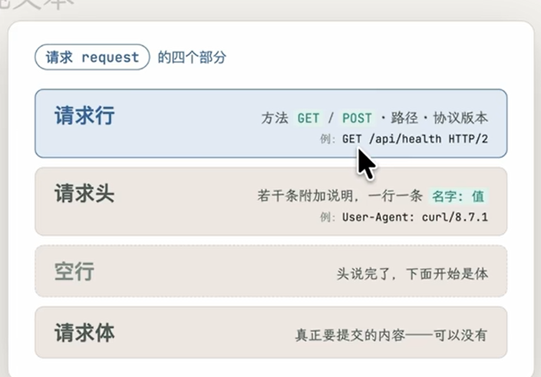<figcaption><p>请求报文结构</p></figcaption></figure>

① 请求行——整个请求的第一行，永远只有一行，说清三件事：方法、路径、协议版本。

+ **方法**：这次是来干什么的。GET 用于获取资源，POST 用于提交内容并交由服务端处理。

+ 路径：要访问对方的哪个资源；

+ 协议版本：先不用管，这一节稍后会交代。

② 请求头——若干行“**附加说明**”，一行一条，格式统一是 名字: 值——“我要找哪台服务器”“我是谁”“我提交的内容是什么格式”……都写在这里。

③ 一个空行——分界线，意思是“头说完了，下面是体”。

④ 请求体——真正要提交的内容。**不是必须有——取数据的请求，一般就没有体**。

再看响应这一侧。它的四个部分——状态行、响应头、一个空行、响应体——和请求几乎对称，唯一的结构差别在第一行：请求的第一行叫请求行，响应的第一行叫状态行。

① 状态行——一行说清三件事：协议版本、状态码、简短说明。最重要的是中间那个状态码：一个数字，表态“这次处理得怎么样”，后面跟着一句人类友好的简短说明（OK、Not Found）。

+ 200：成功；

+ 404：未找到请求的资源。

+ 5xx：服务器问题

② 响应头——同样是一行一条的**“附加说明”**。最重要的一条是 `Content-Type`：<span style="color:red">我给你的这段内容，是什么格式</span>——`application/json` 就是在说“按 JSON 来解析它”。它有多大威力，一会儿动手实验。

③ 空行 ＋ ④ 响应体——和请求侧一样：空行分界，体是正文。

我们平时在终端、在浏览器页面上“看到”的，**基本都只是响应体**—那行 {"ip": …} 是一段响应体，DeepSeek 回的那段 choices JSON 也是；它们上面顶着的状态行和一排头，当时全被工具省略了。

### 请求和响应的格式示例

curl 下方的输出为解释结构的日志示意，其中 `HTTP/2` 行是工具的可读展示。

```text
> GET /?format=json HTTP/2          ← 请求行：方法 + 路径 + 协议版本
> Host: api.ipify.org               ← 请求头，从这行开始
> User-Agent: curl/8.7.1
> Accept: */*
>                                   ← 空行：请求头完；⚠️ 注意！GET 没有请求体
< HTTP/2 200                        ← 状态行：协议版本 + 状态码
< date: Mon, 13 Jul 2026 05:38:00 GMT
< content-type: application/json    ← 响应头：内容是 JSON 格式
< content-length: 22
< server: cloudflare
（还有几条，略）
<                                   ← 空行：响应头完
{"ip":"114.86.123.45"}              ← 响应体——5.1 我们看到的，只有这一行

> POST /chat/completions HTTP/2     ← 请求行：方法换成了 POST
> Host: api.deepseek.com            ← URL 拆出来的
> User-Agent: curl/8.7.1
> Accept: */*
> Content-Type: application/json    ← 我们用 -H 写的那行，原样成为一行请求头
> Authorization: [已隐藏]           ← 认证头，日志中隐藏其值
> Content-Length: 333               ← curl 自动算好：请求体有多长
>                                   ← 空行：头到此为止
```

#### 分析思路

先找方向符号：**> 是客户端发出**，**< 是服务端返回**，*** 是 curl 本地日志（连接、TLS 等，不是 HTTP 报文）** (理解为日志/注释)。

+ 定位报文边界：每个 HTTP 报文 = 起始行 + 头部 + 空行 + body。看到空行就说明头部结束。

+ 请求看起始行：方法（GET/POST/CONNECT…）+ 路径 + 版本。

+ 响应看起始行：版本 + 状态码（2xx 成功、3xx 重定向、4xx 客户端错、5xx 服务端错）。

+ 头部抓关键字段：Host（目标）、Content-Type（body 类型）、Content-Length（body 长度）、User-Agent、Server、Date。

### 请求方法、头部与请求体

#### 请求方法的类型

| 方法 | 意图（一句话直觉） |
| --- | --- |
| GET | 把某样东西给我 |
| POST | 我提交一段内容，请你处理 |
| PUT | 用我给的内容，把某样东西整个换掉 |
| PATCH | 把某样东西改一部分 |
| DELETE | 把某样东西删掉 |
| HEAD | 跟 GET 一样，但只要头、不要体——探路用 |
| OPTIONS | 询问：我能对这个资源做什么？ |

<figure>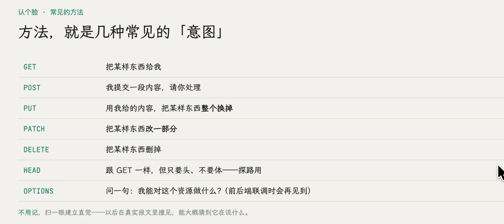<figcaption><p>常见请求方法</p></figcaption></figure>

#### 请求头和响应头的类型

| 请求头 | 在说什么 |
| --- | --- |
| Host | 我要找哪台服务器 |
| User-Agent | 我是谁（什么工具、什么浏览器） |
| Accept | 我能接受什么格式的回应 |
| Accept-Language | 我偏好什么语言 |
| Content-Type | 我提交的请求体是什么格式 |
| Content-Length | 我提交的请求体有多长 |
| Authorization | 我的身份凭证（5.1 的 Bearer sk-… 就放这儿） |
| Cookie | 我随身带的“小纸条” |

常见的响应头——服务方对内容的交代：

| 响应头 | 在说什么 |
| --- | --- |
| Content-Type | 我回的体是什么格式（本节的主角） |
| Content-Length | 我回的体有多长 |
| Server | 我是什么服务器软件 |
| Date | 我是什么时间处理的 |
| Cache-Control | 这份内容可以缓存、能存多久 |
| Set-Cookie | 给调用方发一张“小纸条”，下次来记得带上 |
| Location | 内容搬家了，去这个新地址找（配合 3xx 跳转用） |
| Access-Control-Allow-Origin | 允许哪些来源的网页调用我 |

<figure>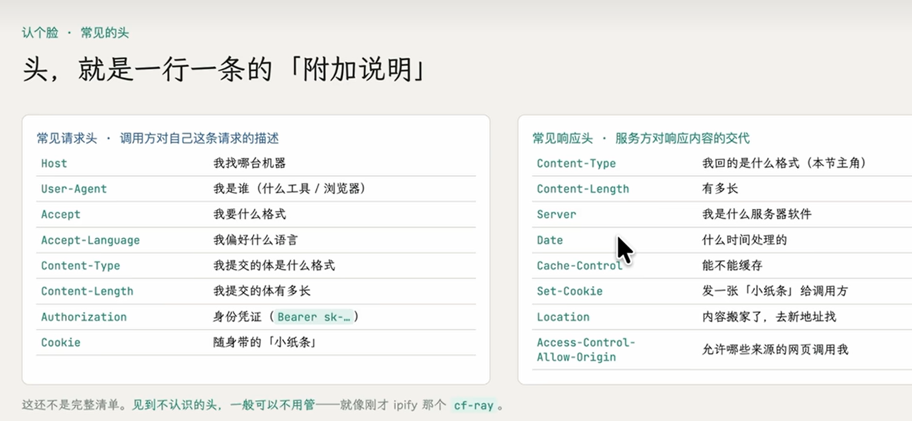<figcaption><p>请求头与响应头</p></figcaption></figure>

#### curl 的 `-d` 参数与请求方法

<figure>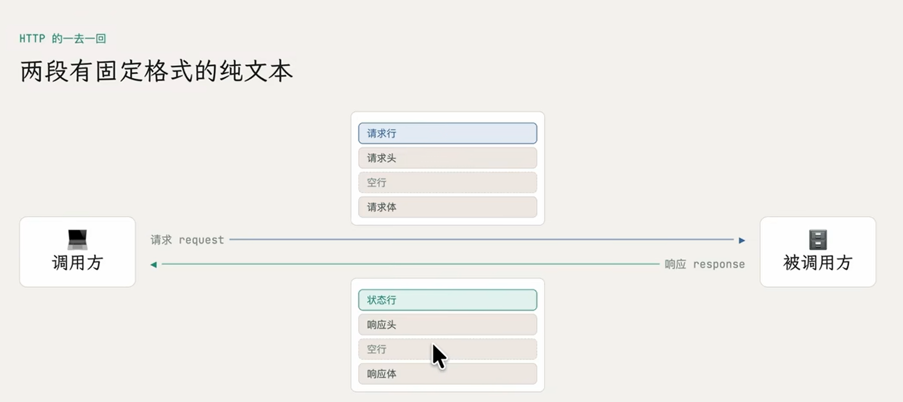<figcaption><p>请求与响应流程</p></figcaption></figure>

普通 curl HTTP 请求默认使用 GET，`-d` 会携带数据并默认切换为 POST。请求方法也可由其他选项控制，判断报文时应以实际方法和请求体为准。

GET 示例命令为 `curl 'https://api.ipify.org?format=json'`。

```text

> GET /?format=json HTTP/2          ← 请求行：方法 路径 协议版本
> Host: api.ipify.org               ← 请求头
> User-Agent: curl/8.18.0
> Accept: */*
>                                   ← 空行（后面本来可有 body，GET 没有）
>
```

> 没有请求体

POST 示例使用 Bash 续行语法，先在环境中设置 `DEEPSEEK_API_KEY`。模型名和参数以服务商当前接口支持范围为准。

```bash
curl https://api.deepseek.com/chat/completions \
  -H "Content-Type: application/json" \
  --oauth2-bearer "${DEEPSEEK_API_KEY}" \
  -d '{
        "model": "deepseek-flash",
        "messages": [
          {"role": "system", "content": "You are a helpful assistant."},
          {"role": "user", "content": "你好，请你介绍一下自己"}
        ],
        "thinking": {"type": "enabled"},
        "reasoning_effort": "high",
        "stream": false
      }'
```

#### 响应日志示例

<figure>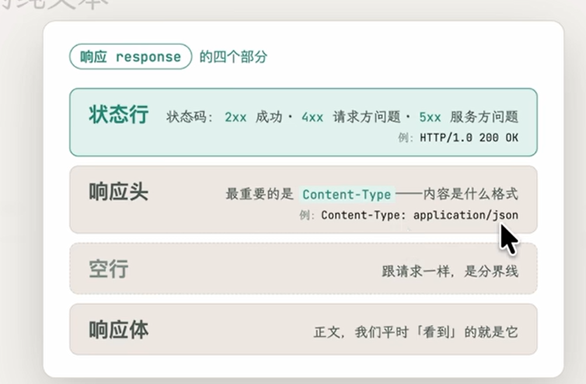<figcaption><p>响应报文结构</p></figcaption></figure>

示例：

```text
< HTTP/2 200                        ← 状态行：协议 状态码 [原因短语]
< date: Tue, 03 Nov 2026 ...
< content-type: application/json
< content-length: 20
< server: cloudflare
< cf-ray: ...
<                                   ← 空行
{ "ip": "..." }                     ← 响应体（20 字节）
```

### 用 Python 标准库实现 HTTP API

思路：遵循HTTP的通信步骤，手动处理好GET/POST和RESPONSE等业务的内容。

<figure>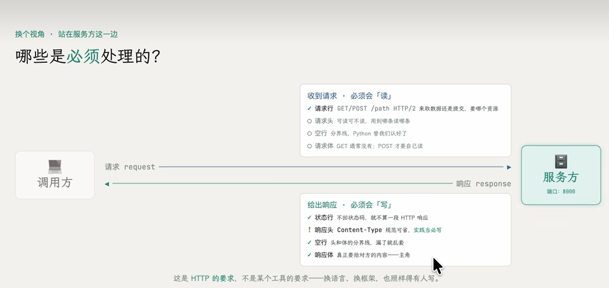<figcaption><p>服务端报文处理</p></figcaption></figure>

#### 服务端代码示例

```python
from http.server import BaseHTTPRequestHandler, HTTPServer
import json

rt = {
    "test1": "测试1",
    "test2": "测试2"
}

class Handler(BaseHTTPRequestHandler):
    """
    必须为每一个API接口都写一个GET/POST
    """
    def do_GET(self):
        if self.path == "/test1":
            # 返回json，需要按照状态行，响应头-响应体的方式来回复
            self.send_response(200)
            self.send_header("Content-type", "application/json")
            self.end_headers()
            body = json.dumps(rt,ensure_ascii=False)
            self.wfile.write(body.encode("utf-8"))
        elif self.path == "/test2":
            # 返回
            self.send_response(200)
            self.send_header("Content-type", "text/plain; charset=utf-8")
            self.end_headers()
            body = "文字测试2"
            self.wfile.write(body.encode("utf-8"))
        else:
            self.send_response(404)
            self.end_headers()

    def do_POST(self):
        pass

print("后端已启动：http://localhost:8999")
HTTPServer(("", 8999), Handler).serve_forever()
```

#### 代码说明

依赖：使用BaseHTTPRequestHandler手动实现

```python
from http.server import BaseHTTPRequestHandler, HTTPServer
import json
```

定义接口：遇到GET/POST请求时，**手动构建HTTP响应**。包括状态码，响应头和响应体。其中响应体才是我们关注的业务目标。

+ 需要手动给出客户的访问路径 (访问根目录/，还是访问/test1目录)

+ 处理路由逻辑 (例如，路径是否有效)

+ **手动构建响应结果** (状态，响应头和响应体)

>其中**路由选择和构建响应格式的过程非常冗余和重复**。

```python
def do_GET(self):
        if self.path == "/test1":
            # 返回json，需要按照状态行，响应头-响应体的方式来回复
            self.send_response(200)
            self.send_header("Content-type", "application/json")
            self.end_headers()
            body = json.dumps(rt,ensure_ascii=False)
            self.wfile.write(body.encode("utf-8"))
        elif self.path == "/test2":
            # 返回
            self.send_response(200)
            self.send_header("Content-type", "text/plain; charset=utf-8")
            self.end_headers()
            body = "文字测试2"
            self.wfile.write(body.encode("utf-8"))
        else:
            self.send_response(404)
            self.end_headers()
```

服务器运行：HTTPServer(("", 8999), Handler).serve_forever()，无限期运行，<span style="color:red">但是不能及时更新，必须重启才能生效</span>。

### 用 FastAPI 声明路由与数据模型

Python 常见 Web 框架包括 Flask、Django 和 FastAPI。这里用 FastAPI 简化路由声明、输入验证与响应构造。

<figure>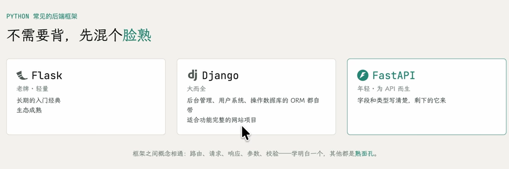<figcaption><p>后端框架对比</p></figcaption></figure>

#### 服务端代码示例

特点：**基本只保留了响应体，业务部分的代码**。

><span style="color:red">状态码和响应头，fastapi框架会自动帮我们处理</span>。

```python
from fastapi import FastAPI
from pydantic import BaseModel

app = FastAPI()

response = {
    "test1": "测试1",
    "test2": "测试2"
}


@app.get("/test1")
def get():
    # 返回HTTP状态码200和JSON格式的响应体，不需要手动构建
    return response
```

#### 代码说明

#### GET

使用@app.get("/test1")进行修饰，自动组装状态码和响应头。

```python
@app.get("/test1")
def get():
    # 返回HTTP状态码200和JSON格式的响应体，不需要手动构建
    return response
```

#### POST：使用`pydantic`进行输入验证

+ 将请求体声明为继承 `BaseModel` 的 Pydantic 模型。

+ Pydantic 在构建模型实例时，根据字段声明验证输入，并在允许的情况下进行类型转换。

+ 请求体不符合模型要求时，FastAPI 默认返回 `422` 校验错误。

示例：实际上可以使用pydantic的Field对字段进行数据格式限制。当前只提供实例属性的限制。

```python
class PostModel(BaseModel):
    name: str
    age: int

@app.post("/test2")
def post(post_data: PostModel):
    # fastapi通过pydantic自动校验返回结果
    return {
        "name": post_data.name,
        "age": post_data.age,
        "extra": "成功解析内容"
    }
```

#### 用 Uvicorn 运行应用

在 `main.py` 所在目录运行 `uvicorn main:app --reload`。

| uvicorn | 启动 Uvicorn 服务器 |
| --- | --- |
| main | Python 模块名，对应 main.py |
| app | 模块中的 FastAPI 应用对象 |
| --reload | 检测代码修改并自动重启，适合开发环境 |

或者通过：

```python
import uvicorn

if __name__ == "__main__":
    uvicorn.run(
        "main:app",
        host="127.0.0.1",
        port=8000,
        reload=True
    )
```

#### Uvicorn 运行 ASGI 应用

Uvicorn **是一个 Python Web 服务器**，负责启动服务器、监听端口、接收网络请求，并将请求交给 FastAPI 处理

FastAPI <span style="color:red">本身并不会自动启动一个监听网络端口的服务器</span>。

如果直接执行：

```bash
python main.py
```

这段代码**只会创建**一个 FastAPI 应用对象并**注册路由**，然后程序就结束了。

因为它没有做这些事情：

1. 监听 TCP 端口，例如 8000。
2. 接收客户端发送的 HTTP 请求。
3. 解析 HTTP 请求。
4. 调用对应的 FastAPI 应用。
5. 将 FastAPI 的响应通过网络返回给客户端。

这些事情需要由 Uvicorn 完成。

#### ASGI 规定服务器与应用的接口

理解 FastAPI 和 Uvicorn 的关系，最关键的概念就是 ASGI。

ASGI 全称：

Asynchronous Server Gateway Interface（异步服务器网关接口）

它定义了 Python Web 应用与服务器之间如何通信。

需要区分三个概念：

| 组件 | 类型 | 主要职责 |
| --- | --- | --- |
| FastAPI | Web 框架 | 定义路由、验证参数、处理业务逻辑 |
| ASGI | 通信接口规范 | 规定服务器和应用如何交互 |
| Uvicorn | ASGI 服务器 | 处理网络连接并运行 ASGI 应用 |

ASGI 并不是一个独立运行的服务器，也不是 FastAPI 专属的协议。

例如，Starlette、Django 的 ASGI 应用也可以使用 Uvicorn。
**ASGI 的核心接口**
一个简单的 ASGI 应用可以这样写：

```python
async def app(scope, receive, send):
    await send({
        "type": "http.response.start",
        "status": 200,
        "headers": [(b"content-type", b"text/plain")]
    })
    await send({
        "type": "http.response.body",
        "body": b"Hello World"
    })
```

这里有三个关键参数：

| 参数 | 作用 |
| --- | --- |
| scope | 描述当前连接，例如请求路径、HTTP 方法 |
| receive | 异步接收客户端发送的事件 |
| send | 异步发送响应事件 |

实际上，FastAPI 创建的 app 对象就是一个**符合 ASGI 接口的应用**。

因此：

```python
app = FastAPI()
```

产生的对象能够被 Uvicorn 调用。

Uvicorn 不需要知道 FastAPI 内部如何实现路由，只需要按照 ASGI 规范与它通信。

> **其他支持ASGI的服务器也能部署fastapi应用**。

| 服务器 | ASGI 支持 | 主要特点 | 适用场景 |
| --- | --- | --- | --- |
| Uvicorn | 原生支持 | 轻量、高性能、支持异步 HTTP 和 WebSocket | 大多数 FastAPI 项目 |
| Hypercorn | 原生支持 | 支持 ASGI、WSGI、HTTP/2，协议支持更丰富 | 有 HTTP/2 等特殊需求 |
| Daphne | 原生支持 | 支持 HTTP、WebSocket，与 Django Channels 生态结合紧密 | Django Channels 项目 |
| Gunicorn | 通过 ASGI Worker | 成熟的多进程管理，支持 Worker 监控与重启 | Linux 生产环境部署 |
| Waitress | 不原生支持 | 主要运行 WSGI 应用，简单稳定 | Flask 等 WSGI 应用 |

需要注意，Gunicorn 本身并不是 ASGI 协议服务器。运行 FastAPI 时，需要配合 ASGI Worker，例如 uvicorn-worker。

#### 用 `/docs` 调试接口

可以在这里**不通过curl等命令，就直接调试接口**，测试返回结果和逻辑。

<figure>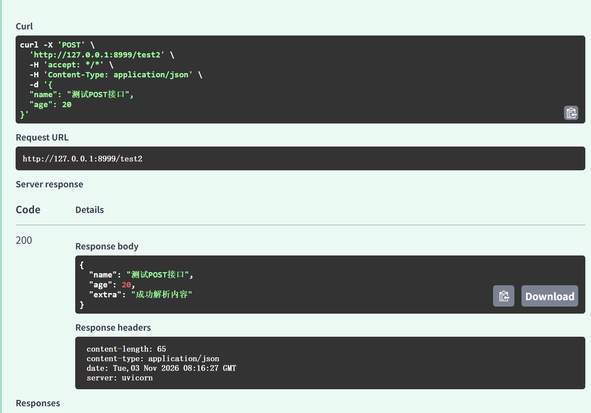<figcaption><p>接口调试结果</p></figcaption></figure>

<figure>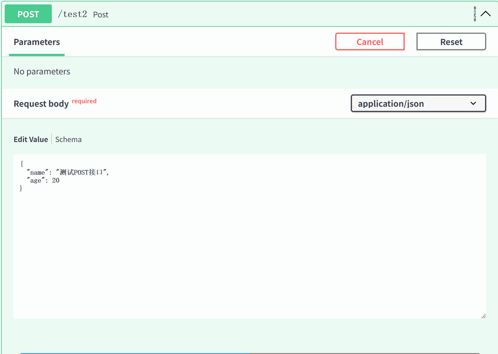<figcaption><p>接口请求体编辑</p></figcaption></figure>

## 参考资料

[零到全栈课程](https://xn--ygr25xpohxwz.com/zero-to-fullstack/)

[JavaScript 模块文档](https://developer.mozilla.org/en-US/docs/Web/JavaScript/Guide/Modules)

[Vite 使用指南](https://vite.dev/guide/)

[curl 命令手册](https://curl.se/docs/manpage.html)

[FastAPI 请求体文档](https://fastapi.tiangolo.com/tutorial/body/)

[Anime.js 文本动画文档](https://animejs.com/documentation/text/scrambletext)
