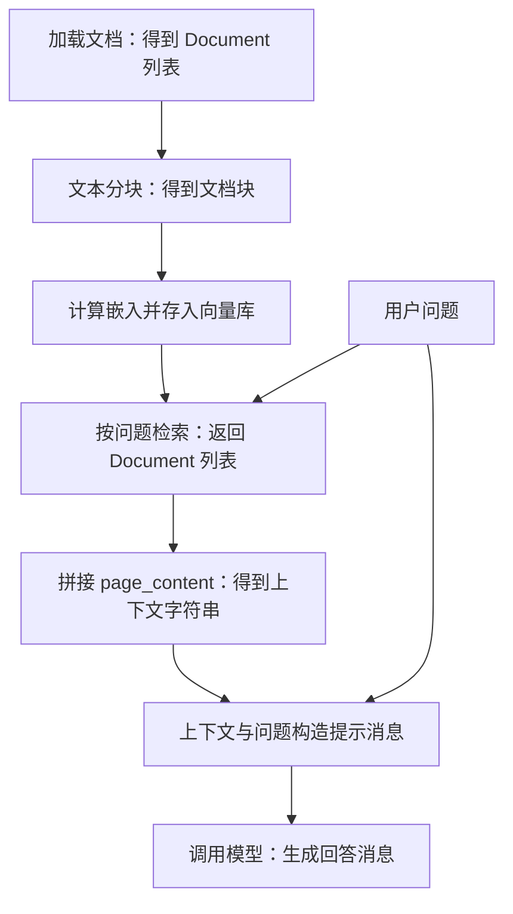
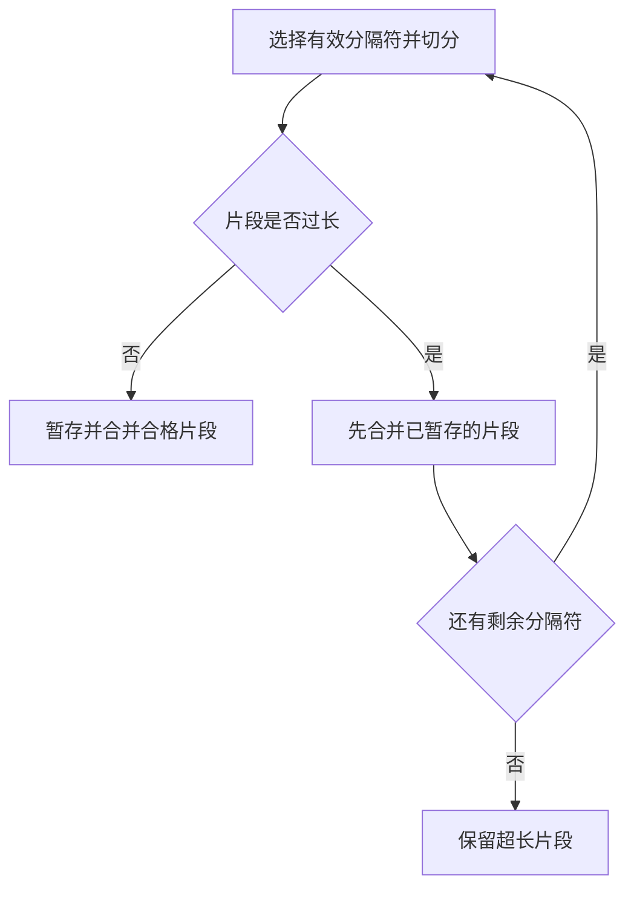
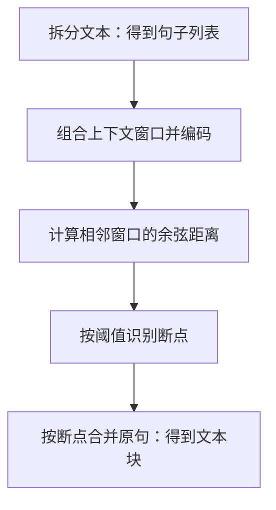
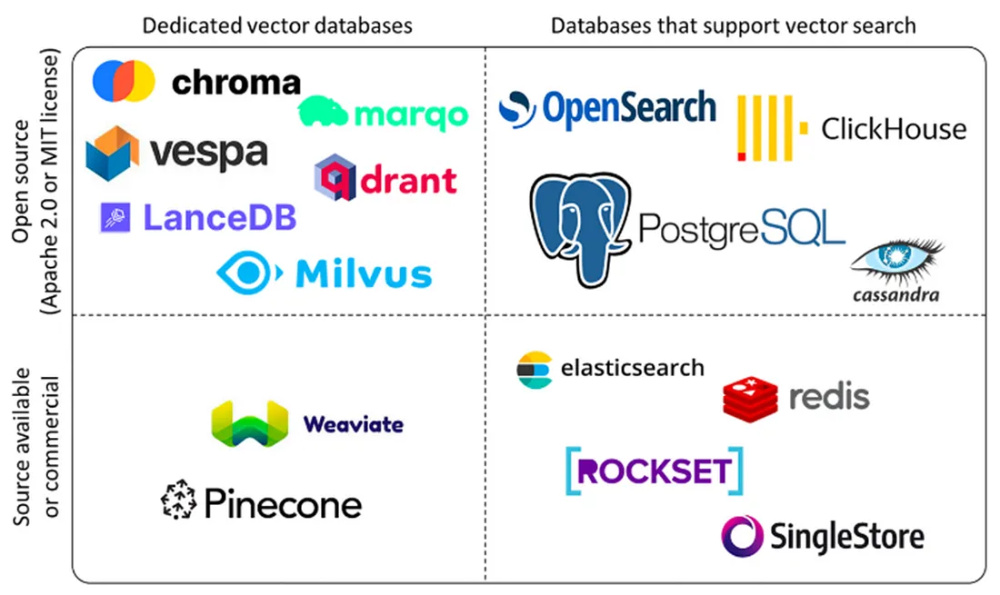
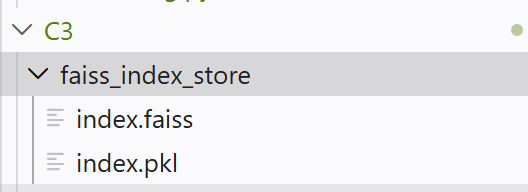
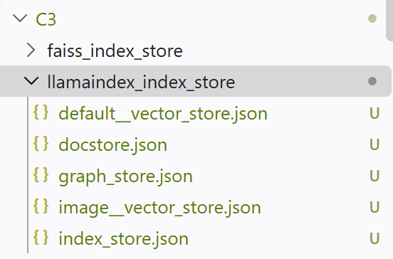
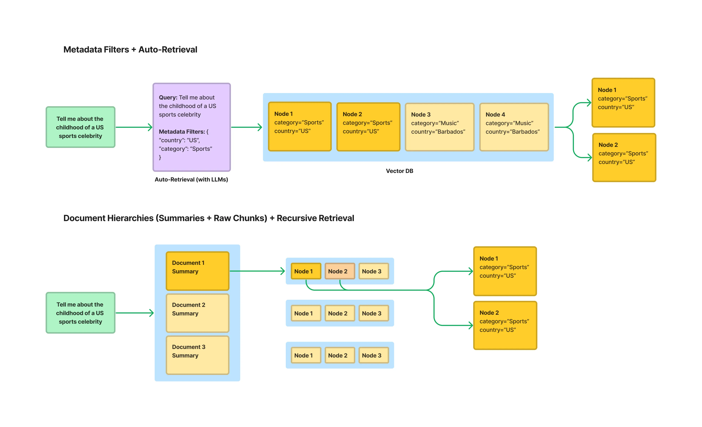

本文记录基于 LangChain 的 RAG 代码示例，依次整理文档加载、文本分块、嵌入与向量库、检索、上下文拼接和模型问答。

示例保留了 Notebook 中的代码片段与部分输出，并非可直接独立运行的脚本；`markdown_path`、`embedding_model_path` 以及相关类的导入需在运行环境中准备。截断的输出均作为文本展示。

# RAG 数据流

加载器将文档读为 `list[Document]`，分块后仍为 `list[Document]`；文档块经嵌入计算后存入向量库。查询得到的文档块拼接为上下文，再与问题一起构造提示消息，交给模型生成回答。



RAG 文档处理与问答流程。

## 模型配置

模型名称、接口地址和 API 密钥从环境变量读取；下文使用这些配置创建 `ChatOpenAI` 对象。

```python
model = os.getenv("LLM_MODEL_ID", "glm-4.7-flash-free")
base_url = os.getenv("LLM_BASE_URL", "https://aihubmix.com/v1")
api_key = os.getenv("LLM_API_KEY")
temperature = 0.7
max_tokens = 4096
```

## Document：文档数据结构

本例中文档加载、分块和检索都以 `Document` 为基本对象，主要关注两个属性：

- `doc.page_content`：文本内容。
- `doc.metadata`：来源等附加信息。

```python
from langchain_core.documents import Document
doc_example = Document(
    page_content="这是一个示例文档内容。",
    metadata={"source": "示例来源", "author": "示例作者"}
)
doc_example
```

输出示例：

```text
Document(metadata={'source': '示例来源', 'author': '示例作者'}, page_content='这是一个示例文档内容。')
```

## 加载文档

文档加载器用于读取 Markdown、PDF、DOCX 等格式的文档。这里使用 `UnstructuredMarkdownLoader` 加载 Markdown，返回 `list[Document]`。

```python
# 文档加载器：加载md，pdf和docx等格式的文档
loader = UnstructuredMarkdownLoader(markdown_path) # 加载器对象
docs: list[Document] = loader.load() # 默认返回Document格式
```

```python
docs[0].metadata
```

输出示例：

```text
{'source': '/home/xxx/project/all-in-rag/data/C1/markdown/easy-rl-chapter1.md'}
```

## 文本分块

- 把整篇文档切分为检索单元。
- 分块后，每个片段都能单独被检索。这里的“递归”大致指先尝试段落等较大的边界；如果片段仍然过长，再尝试换行、空格等更细的边界。

```python
chunk_size = 4000
chunk_overlap = 100
text_splitter = RecursiveCharacterTextSplitter(
    separators=["\n\n", "\n", " ", ""],
    chunk_size=chunk_size,
    chunk_overlap=chunk_overlap,
)
```

| 参数 | 含义 |
| --- | --- |
| `chunk_size` | 每块的目标最大长度 |
| `chunk_overlap` | 相邻块保留部分重叠，缓解知识在边界处被截断 |
| `separators` | 优先尝试的切分边界 |

`split_text` 接收 `str`，返回 `list[str]`；`split_documents` 接收 `list[Document]`，返回 `list[Document]`，保留文档内容及元数据。

> 这里的接口约定是：输入与输出尽量保留相似的数据结构。

```python
text_chunks = text_splitter.split_text(docs[0].page_content)       # str → list[str]
chunks = text_splitter.split_documents(docs) # list[Document] → list[Document]
text_chunks[0][:100], chunks[0].page_content[:100], chunks[0].metadata
```

输出示例：

```text
('第1章 强化学习基础\n\n1.1 强化学习概述\n\n强化学习（reinforcement learning，RL）讨论的问题是智能体（agent）怎么在复杂、不确定的环境（environment）中最大化',
 '第1章 强化学习基础\n\n1.1 强化学习概述\n\n强化学习（reinforcement learning，RL）讨论的问题是智能体（agent）怎么在复杂、不确定的环境（environment）中最大化',
 {'source': '/home/shared/ml/project/all-in-rag/data/C1/markdown/easy-rl-chapter1.md'})
```

## 嵌入模型：HuggingFaceEmbeddings

`HuggingFaceEmbeddings` 是适配器，将底层嵌入模型包装为 LangChain 可以统一调用的接口。创建 `embeddings` 对象主要是在加载模型；对文档进行编码则发生在调用嵌入接口或向量库添加文档时。

> 本例中的 `embeddings` 是封装了嵌入模型的对象。

```python
# embedding模型
embeddings = HuggingFaceEmbeddings(
    model_name=str(embedding_model_path),
    model_kwargs={
        'device': 'cuda:0',
        'local_files_only': True,
    },
    encode_kwargs={
        'normalize_embeddings': True,
    },
)
```

各参数的作用：

- `model_name`：这里传入本地模型目录。
- `model_kwargs`：传给底层模型加载过程。
- `device='cuda:0'`：本例使用第一个 CUDA 设备；使用 CPU 时可设置为 `device='cpu'`。
- `local_files_only=True`：只使用本地文件。
- `encode_kwargs`：传给向量编码过程。
- `normalize_embeddings=True`：将向量归一化为单位长度。

Python 中的 `{...}` 是字典，上述配置以“名称 → 值”的形式传递。

### 文档嵌入与查询嵌入

`embed_documents` 接收 `list[str]`，返回 `list[list[float]]`；`embed_query` 接收单个 `str`，返回 `list[float]`。

```python
vectors = embeddings.embed_documents( # 针对一组查询list[str]，得到使用list表示的向量：list[str] → list[list[float]]
    [
    "强化学习通过奖励学习策略。",
    "监督学习使用带标签的数据。",
    ]
)
vectors
```

```python
query_vector = embeddings.embed_query("什么是强化学习？") # 只针对单一查询str，得到使用list表示的向量：str → list[float]
len(query_vector), query_vector
```

原始输出节选：向量长度为 `512`，下方只展示其中三个分量。

```text
(512,
 [-0.06012639030814171,
  -0.015196173451840878,
  0.020946329459547997,]
)
```

## 构建向量库

创建 `InMemoryVectorStore` 时传入嵌入对象；调用 `add_documents(chunks)` 时，对文档块执行嵌入计算并存入向量库。

```python
vectorstore = InMemoryVectorStore(embedding=embeddings)
vectorstore.add_documents(chunks) # 作用对象是documents：list[Document]
```

## 检索向量库

- 本例使用 `InMemoryVectorStore` 按余弦相似度检索，返回 `list[Document]`。
- `k=3` 表示最多返回三个文档块，不代表找到三个例子，也不代表覆盖全文中的所有例子。

```python
question = "DeepMind 研发的走路的智能体是什么?"
results = vectorstore.similarity_search(question, k=3) # 作用对象是query：str
```

加入向量库的单位是 `Document`，查询后**返回的单位也是 `Document`**。以下是原始输出的截断节选：

```text
[Document(id='366eba3b-bc90-4a44-8a99-c77bff29ba63',Document(id='a2b13cd6-1947-4917-9b45-19227754673c',Document(id='1688693a-ad64-4a4f -9b02-f598a7daf223',]
```

查看第一个结果的前 100 个字符：

```python
results[0].page_content[:100]
```

也可以将向量库转为 `retriever`，通过 `invoke(question)` 查询：

```python
# 其他做法，使用retriever查询
retriever = vectorstore.as_retriever(
    search_kwargs={"k": 3}
)

retrieved_docs = retriever.invoke(question)
```

## 将检索结果转换为上下文

- 检索结果仍然是 `Document` 对象。
- 将多个文档的 `page_content` 拼接为一个完整的 `str`，作为提示词中的上下文。

```python
docs_content = "\n\n".join([doc.page_content for doc in results])
docs_content
```

## ChatPromptTemplate：构建提示消息

使用 `ChatPromptTemplate` 定义模板，通过 `context` 和 `question` 填入上下文与问题。

```python
prompt = ChatPromptTemplate.from_template("""
请根据下面提供的上下文信息来回答问题。

上下文:
{context}

问题: {question}

回答:
""")

# # 聊天格式：类似transformers库
# prompt = ChatPromptTemplate.from_messages([
#     ("system", "根据参考资料回答；资料不足时说明无法确定。"),
#     ("human", "参考资料：\n{context}\n\n问题：{question}"),
# ])

prompt
```

```python
messages = prompt.format_messages(
    context=docs_content,
    question=question,
)

# 自动成为 list[Message]格式，本质与transformers库的chat模式类似
messages
```

`format_messages` 得到消息对象列表，而非 `list[str]`，用法类似 Transformers 的聊天消息输入。原始输出节选：

```text
[HumanMessage(content="\n请根据下面提供的上下文信息来回答问题。\n\n上下文:\n图 1.8 可能的预演序列\n\n1.1.3 强化学...]
```

## 调用模型生成回答

将格式化后的 `messages` 传入 `llm.invoke`，得到回答消息。

```python
llm = ChatOpenAI(
    model=model,
    temperature=0.7,
    max_tokens=4096,
    api_key=api_key,
    base_url=base_url,
)

answer = llm.invoke(
    messages
)

# 上下文开销还是不小的，'completion_tokens': 214, 'prompt_tokens': 5917, 'total_tokens': 6131
```

返回值为 `AIMessage` 消息对象。原始回答节选如下，文本已截断：

```text
answer
AIMessage(content='DeepMind 研发的走路的智能体是一个通过强化学习训练的智能体：它每往前走一步就会获得奖励)
```

## Chain：连接提示词、模型与解析器

通过 `prompt | llm | parser` 连接提示模板、模型和 `StrOutputParser`。输入字典提供模板所需的字段；提示模板构造消息输入，模型返回消息，解析器再将输出转换为 `str`。

```python
from langchain_core.output_parsers import StrOutputParser

parser = StrOutputParser()
# ChatPromptTemplate
chain = prompt | llm | parser

input_dict = {
    "question": question,
    "context": docs_content,
}

answer = chain.invoke( # 需要填写 prompt对应的输入
    input_dict
)

# 其他输出方式：流式输出

# for text in chain.stream({
#     "question": question,
#     "context": docs_content,
# }):
#     print(text, end="", flush=True)

answer
```

# RAG 技术进阶

### 文档加载器

文档加载器将 PDF、Word、Markdown、HTML 等非结构化文件转为程序可处理的文档对象。加载质量会影响后续索引、检索与回答。

| 工具 | 主要用途 | 示例场景 |
| --- | --- | --- |
| PyMuPDF4LLM | PDF 转 Markdown | 科研文献、技术手册 |
| TextLoader | 加载纯文本 | 文本文件 |
| DirectoryLoader | 批量加载目录 | 混合格式文档库 |
| Unstructured | 解析多种文档格式 | PDF、Word、HTML |
| FireCrawlLoader | 抓取网页内容 | 在线文档、新闻 |
| LlamaParse | 文档结构解析 | 合同、学术论文 |
| Docling | 文档解析与转换 | 企业合同、报告 |
| Marker | PDF 转 Markdown | 科研文献、书籍 |
| MinerU | 文档解析与内容提取 | 学术文献、财务报表 |

文档加载工具示例，具体能力取决于版本、配置与输入文件。

#### 使用 Unstructured 解析文档

- `partition` 根据文档类型选择解析方法；下面的片段还需导入 `from unstructured.partition.auto import partition`。
- PDF 也可直接使用 `partition_pdf`；原笔记还列举了 PaddleOCR、MinerU 等解析工具。

```python
from unstructured.partition.pdf import partition_pdf

elements = partition(
    filename=pdf_path,
    content_type="application/pdf",
    languages=["eng", "chi_sim"]
)
```

原始解析输出节选：

```text
解析完成: 279 个元素, 7500 字符
元素类型: {'Header': 22, 'Title': 195, 'UncategorizedText': 41, 'NarrativeText': 3, 'Footer': 15, 'ListItem': 3}

所有元素:
Element 1 (Header):
网页
============================================================
Element 2 (Header):
新闻
============================================================
Element 3 (Header):
贴吧
============================================================
```

`strategy="ocr_only"` 指定 OCR 解析，`languages` 指定识别语言。参见 [Unstructured 分区说明](https://unstructured.readthedocs.io/en/latest/core/partition.html)。

```python
elements = partition_pdf(
    filename=pdf_path,
    strategy="ocr_only",
    languages=["eng", "chi_sim"]
)
```

### 分块策略

#### 基于分隔符

`CharacterTextSplitter` 先用分隔符拆分文本，再通过 `_merge_splits` 合并片段；`chunk_size` 控制目标长度，`chunk_overlap` 控制重叠。单个片段过长时仍可能保留，因此不能保证每块都不超过目标长度。

##### 普通分块

使用单个分隔符，默认是 `"\n\n"`。本例读取文本后按 `chunk_size=200` 分块；代码注释中的“100 个字符”为笔误。

```python
loader = TextLoader("../../data/C2/txt/蜂医.txt")
docs = loader.load()

text_splitter = CharacterTextSplitter(
    chunk_size=200,    # 每个块的目标大小为100个字符
    chunk_overlap=10   # 每个块之间重叠10个字符，以缓解语义割裂
)

chunks = text_splitter.split_documents(docs)
```

输出为 `list[Document]`。原始运行结果节选：

```text
文本被切分为 14 个块。

--- 前5个块内容示例 ---
============================================================
块 1 (长度: 72): "# 蜂医

游戏《三角洲行动》中的支援型干员
```

##### 递归分块

按顺序寻找文本中存在的分隔符，再切分与合并。片段过长时使用剩余分隔符继续递归；没有剩余分隔符时保留超长片段，最后合并暂存片段。

```python
text_splitter = RecursiveCharacterTextSplitter(
    separators=["\n\n", "\n", "。", "，", " ", ""],  # 分隔符优先级
    chunk_size=200,
    chunk_overlap=10,
)

chunks = text_splitter.split_documents(docs)
```



递归分块的片段处理路径。

默认分隔符为 `["\n\n", "\n", " ", ""]`；中文文本可像上例一样加入句号、逗号。下面的 `from_language` 则是**按编程语言结构分块**，不是中文等自然语言的配置：

```python
splitter = RecursiveCharacterTextSplitter.from_language(
    language=Language.PYTHON,  # 支持Python、Java、C++等
    chunk_size=500,
    chunk_overlap=50
)
```

#### 语义分块

`langchain_experimental.text_splitter.SemanticChunker` 利用嵌入模型识别语义变化，在相邻句子差异较大的位置切分。

先准备嵌入模型：

```python
embeddings = HuggingFaceEmbeddings(
    model_name=str(embedding_model_path),
    model_kwargs={'device': 'cuda:0', 'local_files_only': True},
    encode_kwargs={'normalize_embeddings': True}
)
```

`buffer_size=1` 将当前句子与前后各一句组合后编码；`breakpoint_threshold_type` 选择断点判断方法。

```python
text_splitter = SemanticChunker(
    embeddings,
    buffer_size = 1, # 捕捉上下文信息。对于列表中的每一个句子，这种方法会将其与前后各 buffer_size 个句子组合起来
    breakpoint_threshold_type="percentile" # 断点识别方法
)
```

处理顺序是先拆句，再编码上下文窗口、计算相邻窗口的余弦距离，按阈值找断点，最后合并各段原句。



语义分块的数据处理流程。

`breakpoint_threshold_amount` 配置阈值参数：

| `breakpoint_threshold_type` | 判断依据 | 默认参数 |
| --- | --- | --- |
| `percentile` | 距离超过指定百分位 | `95` |
| `standard_deviation` | 距离超过均值加上指定倍数的标准差 | `3` |
| `interquartile` | 距离超过均值加上指定倍数的四分位距 | `1.5` |
| `gradient` | 距离梯度超过指定百分位 | `95` |

这里的 `interquartile` 按该类[源码](https://github.com/langchain-ai/langchain-experimental/blob/main/libs/experimental/langchain_experimental/text_splitter.py)使用均值，并非原稿中的第三四分位数；不同版本应核对实现。

#### LlamaIndex 分块

LlamaIndex 的节点解析器将文档转换为 `Node`；具体类型包括 `TextNode`、`IndexNode` 等。

- 结构感知：`MarkdownNodeParser`、`JSONNodeParser`、`CodeSplitter` 按标题、JSON 结构或代码结构切分。
- 语义感知：`SemanticSplitterNodeParser` 利用嵌入识别语义断点；`SentenceWindowNodeParser` 为句子节点保存上下文窗口。
- 常规切分：`TokenTextSplitter`、`SentenceSplitter` 按 Token 或句子边界切分。

句子窗口策略先按单句检索，再取上下文送给模型；每个节点的元数据中，<span style="color:red">会存储其前后相邻的句子，组成窗口</span>。下面用借书规则模拟扩展过程：

```python
doc = Document(text=(
    "普通图书可借三十天。"
    "到期前可续借一次。"
    "续借后可再借三十天。"
    "已被预约的图书不能续借。"
))

parser = SentenceWindowNodeParser.from_defaults(
    sentence_splitter=split_sentences,
    window_size=1,  # 前后各保留一句
)
```

假设问题是“续借后还能借多久？”，手动选择第三个节点模拟命中。片段中的 `split_sentences` 和 `nodes` 需事先准备；此处不执行真实向量检索。

```python
hits = [
    NodeWithScore(
        node=nodes[2].model_copy(deep=True),
        score=1.0,
    )
]

processor = MetadataReplacementPostProcessor(
    target_metadata_key="window"
)
expanded = processor.postprocess_nodes(hits)

print("扩展后正文：", expanded[0].node.text)
```

`MetadataReplacementPostProcessor` 用 `window` 元数据替换命中节点的正文。输出如下：

```text
扩展后正文： 到期前可续借一次。 续借后可再借三十天。 已被预约的图书不能续借。
```

### 向量数据库

传统数据库（如 MySQL）擅长<span style="color:red">结构化数据</span>的精确查询，如 `WHERE age = 25`。向量数据库面向<span style="color:red">高维向量</span>的存储、索引与相似性检索，在 RAG 中用于检索知识库内容。

| 维度 | 向量数据库 | 传统关系数据库 |
| --- | --- | --- |
| 核心数据 | 高维向量与元数据 | 文本、数字、日期等结构化数据 |
| 典型查询 | 向量相似性搜索 | 条件匹配、关联与聚合 |
| 常见索引 | HNSW、IVF 等 | B-Tree、Hash 等 |
| 应用示例 | RAG、推荐、图像或语音检索 | 业务系统、交易、报表 |

两者可以互补；规模、延迟和一致性取决于具体产品、索引与部署，不能仅按数据库类别判断。传统数据库也可能通过扩展支持向量搜索。

向量是有序数值组成的表示，可由嵌入模型从文本、图像或音频中提取。向量库的核心任务是高效进行**相似性搜索**。

从功能上可区分存储、索引、查询和服务四层：存储层保存向量与元数据；索引层构建和维护检索结构；查询层执行请求与过滤；服务层管理连接、监控和日志。

常见技术包括随机投影树（如 Annoy）、局部敏感哈希（LSH）、邻近图（HNSW），以及倒排索引与量化（如 Faiss 的 IVF、PQ）。

<figure><figcaption><p>向量检索产品示意</p></figcaption></figure>

图中分类仅作示意，产品许可和能力以各自版本为准。原稿列举的产品包括：

| 产品 | 主要特点 |
| --- | --- |
| Pinecone | 托管向量数据库服务 |
| Milvus | 面向大规模向量检索的开源系统 |
| Qdrant | 基于 Rust 的向量检索引擎 |
| Weaviate | 支持向量检索与数据集成 |
| Chroma | 可用于本地原型与小规模实验 |

#### FAISS 本地索引

FAISS 是相似性搜索与密集向量聚类的算法库。本例通过 LangChain 封装构建索引，再用 `save_local` 保存、`load_local` 恢复；查询时仍使用同一个嵌入模型。

```python
texts = [
    "张三是法外狂徒",
    "FAISS是一个用于高效相似性搜索和密集向量聚类的库。",
    "LangChain是一个用于开发由语言模型驱动的应用程序的框架。"
]
docs = [Document(page_content=t) for t in texts]

embeddings = HuggingFaceEmbeddings(
    model_name=str(embedding_model_path),
    model_kwargs={'device': 'cuda:0', 'local_files_only': True},
    encode_kwargs={'normalize_embeddings': True}
)
```

```python
vectorstore = FAISS.from_documents(docs, embeddings)
local_faiss_path = "./faiss_index_store"
vectorstore.save_local(local_faiss_path)
```

```python
loaded_vectorstore = FAISS.load_local(
    local_faiss_path,
    embeddings,
    allow_dangerous_deserialization=True
)
```

```python
query = "法外狂徒Langchain"
results = loaded_vectorstore.similarity_search(query, k=5)
results
```

`index.faiss` 保存向量索引；`index.pkl` 保存文档与 ID 映射。`allow_dangerous_deserialization=True` 启用后者的反序列化，仅应加载自己生成或可信的文件。

<figure><figcaption><p>FAISS 本地文件</p></figcaption></figure>

#### LlamaIndex 索引持久化

`VectorStoreIndex.from_documents` 构建索引，`storage_context.persist` 保存当前存储上下文。本例的本地存储采用 JSON 文件。

> 这里的 `Document` 来自 `llama_index.core`，与 LangChain 的同名类不同。

```python
from llama_index.core import VectorStoreIndex, Document, Settings
from llama_index.embeddings.huggingface import HuggingFaceEmbedding

# 1. 配置全局嵌入模型
Settings.embed_model = HuggingFaceEmbedding(embedding_model_path)


# 2. 创建示例文档
texts = [
    "张三是法外狂徒",
    "LlamaIndex是一个用于构建和查询私有或领域特定数据的框架。",
    "它提供了数据连接、索引和查询接口等工具。"
]

# 这里的Document类是来自llama_index.core模块的，而不是langchain_core.documents模块
docs = [Document(text=t) for t in texts]

index = VectorStoreIndex.from_documents(docs)
```

```python
# 以json格式将向量和元信息存储至本地

persist_path = "./llamaindex_index_store"
index.storage_context.persist(persist_dir=persist_path)
print(f"LlamaIndex 索引已保存至: {persist_path}")
```

<figure><figcaption><p>LlamaIndex 索引文件</p></figcaption></figure>

`embedding_dict` 保存向量，`text_id_to_ref_doc_id` 保存节点与来源文档的映射。

<!-- # ```json
# {
#   "embedding_dict": {
#     "node1": [-0.0185, 0.0321, 0.0478]
#   },
#   "text_id_to_ref_doc_id": {
#     "node1": "doc1"
#   },
#   "metadata_dict": {
#     "node1": {
#       "ref_doc_id": "doc1"
#     }
#   }
# }
# ```
#
# ```json
# {
#   "docstore/data": {
#     "node1": {
#       "__type__": "1",
#       "__data__": {
#         "id_": "node1",
#         "text": "张三是法外狂徒",
#         "metadata": {},
#         "embedding": null,
#         "class_name": "TextNode"
#       }
#     }
#   },
#   "docstore/ref_doc_info": {
#     "doc1": {
#       "node_ids": ["node1"],
#       "metadata": {}
#     }
#   }
# }
# ``` -->

### 索引优化

> <span style="color:red">索引不等于检索器</span>：索引组织数据，检索器利用它查找相关内容。

#### 句子窗口索引

`window_size=3` 为句子保存前后各三句的窗口；`window` 存上下文，`original_text` 存当前句。这些节点是 `TextNode`，不是 `IndexNode`。参见 [LlamaIndex 节点解析器说明](https://developers.llamaindex.ai/python/framework/module_guides/loading/node_parsers/modules/)。

```python
node_parser = SentenceWindowNodeParser.from_defaults(
    window_size=3,
    window_metadata_key="window",
    original_text_metadata_key="original_text",
)

sentence_nodes = node_parser.get_nodes_from_documents(documents)
sentence_nodes[0].metadata, sentence_nodes[0].text[:50], sentence_nodes[0]# TextNode
```

原始输出如下，窗口位于元数据中：

```text
({'page_label': '379',
  'file_name': 'IPCC_AR6_WGII_Chapter03.pdf',
  'file_path': '../../data/C3/pdf/IPCC_AR6_WGII_Chapter03.pdf',
  'file_type': 'application/pdf',
  'file_size': 21752444,
  'creation_date': '2026-11-05',
  'last_modified_date': '2026-11-05',
  'window': 'SPM\n379\n3\nOceans and Coastal \nEcosystems and Their Services\nThis chapter should be cited as:\nCooley, S., D.  Schoeman, L. Bopp, P .  Boyd, S. Donner, D.Y .  Ghebrehiwet, S.-I.  Ito, W. Kiessling, P . ',
  'original_text': 'SPM\n379\n3\nOceans and Coastal \nEcosystems and Their Services\nThis chapter should be cited as:\nCooley, S., D.  Schoeman, L. Bopp, P . '},
 'SPM\n379\n3\nOceans and Coastal \nEcosystems and Their',
 TextNode(id_='14d5fc13-4016-4005-ba7f-cdb0c8177d8e', embedding=None, metadata={'page_label': '379', 'file_name': 'IPCC_AR6_WGII_Chapter03.pdf', 'file_path': '../../data/C3/pdf/IPCC_AR6_WGII_Chapter03.pdf', 'file_type': 'application/pdf', 'file_size': 21752444, 'creation_date': '2026-11-05', 'last_modified_date': '2026-11-05', 'window': 'SPM\n379\n3\nOceans and Coastal \nEcosystems and Their Services\nThis chapter should be cited as:\nCooley, S., D.  Schoeman, L. Bopp, P .  Boyd, S. Donner, D.Y .  Ghebrehiwet, S.-I.  Ito, W. Kiessling, P . ', 'original_text': 'SPM\n379\n3\nOceans and Coastal \nEcosystems and Their Services\nThis chapter should be cited as:\nCooley, S., D.  Schoeman, L. Bopp, P . '}, excluded_embed_metadata_keys=['file_name', 'file_type', 'file_size', 'creation_date', 'last_modified_date', 'last_accessed_date', 'window', 'original_text'], excluded_llm_metadata_keys=['file_name', 'file_type', 'file_size', 'creation_date', 'last_modified_date', 'last_accessed_date', 'window', 'original_text'], relationships={<NodeRelationship.SOURCE: '1'>: RelatedNodeInfo(node_id='f9c14df2-a209-48ed-aee5-1b66e2622ac9', node_type=<ObjectType.DOCUMENT: '4'>, metadata={'page_label': '379', 'file_name': 'IPCC_AR6_WGII_Chapter03.pdf', 'file_path': '../../data/C3/pdf/IPCC_AR6_WGII_Chapter03.pdf', 'file_type': 'application/pdf', 'file_size': 21752444, 'creation_date': '2026-11-05', 'last_modified_date': '2026-11-05'}, hash='5fbcf96cac6226b402e2e6d7bb38a15112a6279f11ba360153f6ae672bcf8263'), <NodeRelationship.NEXT: '3'>: RelatedNodeInfo(node_id='9863764d-bdec-4de1-bb08-a11e4dd014e7', node_type=<ObjectType.TEXT: '1'>, metadata={'window': 'SPM\n379\n3\nOceans and Coastal \nEcosystems and Their Services\nThis chapter should be cited as:\nCooley, S., D.  Schoeman, L. Bopp, P .  Boyd, S. Donner, D.Y .  Ghebrehiwet, S.-I.  Ito, W. Kiessling, P .  Martinetto, E. Ojea, \nM.-F . ', 'original_text': 'Boyd, S. Donner, D.Y . '}, hash='09a7adefa7ee43d3d45aabfb87be923ae3f63b5d60361b714fb6e0a44a51fa87')}, metadata_template='{key}: {value}', metadata_separator='\n', text='SPM\n379\n3\nOceans and Coastal \nEcosystems and Their Services\nThis chapter should be cited as:\nCooley, S., D.  Schoeman, L. Bopp, P . ', mimetype='text/plain', start_char_idx=0, end_char_idx=132, metadata_seperator='\n', text_template='{metadata_str}\n\n{content}'))
```

先建立句子索引，再对比句子检索与常规检索。片段依赖预先准备的 `documents`、`base_index` 和 `base_query_engine`。

```python
# 创建向量数据库
sentence_index = VectorStoreIndex(sentence_nodes)

# %%
# 单纯检索功能
sentence_retriever = sentence_index.as_retriever(similarity_top_k=2)
base_retriever = base_index.as_retriever(similarity_top_k=2)

query = "What are the concerns surrounding the AMOC?"
sentence_retrieved = sentence_retriever.retrieve(query)
base_retrieved = base_retriever.retrieve(query)
```

```python
# window：临近的window_size个句子组成的片段，original_text：原始文本
```

```python
# sentence_retrieved结果包裹上下文的扩展
sentence_retrieved[0].metadata, base_retrieved[0].metadata
```

检索结果仍保留窗口元数据，此时尚未替换节点正文：

```text
({'page_label': '391',
  'file_name': 'IPCC_AR6_WGII_Chapter03.pdf',
  'file_path': '../../data/C3/pdf/IPCC_AR6_WGII_Chapter03.pdf',
  'file_type': 'application/pdf',
  'file_size': 21752444,
  'creation_date': '2026-11-05',
  'last_modified_date': '2026-11-05',
  'window': '9.2.1.3 (Fox-Kemper et\xa0al., \n2021)\n‘Upper-ocean stratification will continue to \nincrease throughout the 21st\xa0century (virtually \ncertain).’\n 9.2.1.3 (Fox-Kemper et\xa0al., \n2021)\nEastern boundary \nupwelling systems\n‘Only the California current system \nhas experienced some large-scale \nupwelling-favourable wind intensification since \nthe 1980s (medium confidence).’\n 9.2.5 (Fox-Kemper et\xa0al., \n2021)\n‘Eastern boundary upwelling systems will \nchange, with a dipole spatial pattern within \neach system of reduction at low latitude and \nenhancement at high latitude (high confidence).’\n 9.2.5 (Fox-Kemper et\xa0al., \n2021)\nAtlantic overturning \ncirculation (AMOC)\nThere is low confidence in reconstructed and \nmodelled AMOC changes for the 20th century.\n 2.3.3.4, 9.2.3 (Fox-Kemper \net\xa0al., 2021; Gulev et\xa0al., \n2021)\nThe AMOC will decline over the 21st\xa0century \n(high confidence, but low confidence for \nquantitative projections).\n 4.3.2.3, 9.2.3 (Fox-Kemper \net\xa0al., 2021; Lee et\xa0al., \n2021)\nSea ice\nArctic sea ice \nchanges\n‘Current Arctic sea ice coverage levels are the \nlowest since at least 1850 for both annual mean \nand late-summer values (high confidence).’\n 2.3.2.1, 9.3.1 (Fox-Kemper \net\xa0al., 2021; Gulev et\xa0al., \n2021)\n‘The Arctic will become practically ice-free in \nSeptember by the end of the 21st\xa0century under \nSSP2-4.5, SSP3-7.0 and SSP5-8.5[…](high \nconfidence).’\n',
  'original_text': '9.2.5 (Fox-Kemper et\xa0al., \n2021)\nAtlantic overturning \ncirculation (AMOC)\nThere is low confidence in reconstructed and \nmodelled AMOC changes for the 20th century.\n'},
 {'page_label': '511',
  'file_name': 'IPCC_AR6_WGII_Chapter03.pdf',
  'file_path': '../../data/C3/pdf/IPCC_AR6_WGII_Chapter03.pdf',
  'file_type': 'application/pdf',
  'file_size': 21752444,
  'creation_date': '2026-11-05',
  'last_modified_date': '2026-11-05'})
```

通过 `node_postprocessors` 注册窗口替换器，使模型生成回答前使用完整上下文。

```python
# 3. 构建查询引擎：检索+LLM回复
# sentence 数据库
sentence_query_engine = sentence_index.as_query_engine(
    similarity_top_k=2,
    node_postprocessors=[
        MetadataReplacementPostProcessor(target_metadata_key="window")
    ],
)
```

```python
# 4. 执行查询并对比结果
query = "What are the concerns surrounding the AMOC?"
print(f"查询: {query}\n")

print("--- 句子窗口检索结果 ---")
window_response = sentence_query_engine.query(query)
print(f"回答: {window_response}\n")

print("--- 常规检索结果 ---")
base_response = base_query_engine.query(query)
print(f"回答: {base_response}\n")
```

本次运行的回答对比，不代表通用效果保证：

```text
查询: What are the concerns surrounding the AMOC?

--- 句子窗口检索结果 ---
回答: Concerns about the AMOC center on uncertainty: there is low confidence in reconstructed and modeled AMOC changes for the 20th century, and while the AMOC is expected to decline over the 21st century with high confidence, quantitative projections remain low confidence.

--- 常规检索结果 ---
回答: The available information does not address the AMOC or concerns surrounding it, so I cannot provide an answer on that topic.
```

#### 结构化索引

当查询只涉及少数文档时，无差别搜索所有文本块容易引入干扰。结构化索引通过元数据过滤或文档摘要组织检索范围。

<figure><figcaption><p>元数据过滤与递归检索</p></figcaption></figure>

##### 按工作表递归检索

为每个工作表创建 `PandasQueryEngine`，再以摘要 `IndexNode` 做顶层路由。`index_id` 对应 `query_engine_dict` 的键，使递归检索器能找到相应工作表引擎。

```python
excel_file = '../../data/C3/excel/movie.xlsx'
xls = pd.ExcelFile(excel_file)
```

```python
df_query_engines = {}
all_nodes = []

for sheet_name in xls.sheet_names:
    df = pd.read_excel(xls, sheet_name=sheet_name)

    # 为当前工作表（DataFrame）创建一个 PandasQueryEngine
    query_engine = PandasQueryEngine(df=df, llm=Settings.llm, verbose=True)

    # 为当前工作表创建一个摘要节点（IndexNode）
    year = sheet_name.replace('年份_', '')
    summary = f"这个表格包含了年份为 {year} 的电影信息，可以用来回答关于这一年电影的具体问题。"
    node = IndexNode(text=summary, index_id=sheet_name)
    all_nodes.append(node)

    # 存储工作表名称到其查询引擎的映射
    df_query_engines[sheet_name] = query_engine

    vector_index = VectorStoreIndex(all_nodes)

# 3. 创建递归检索器
# 3.1 创建顶层检索器，用于在摘要节点中检索
vector_retriever = vector_index.as_retriever(similarity_top_k=3)

# 3.2 递归检索器
recursive_retriever = RecursiveRetriever(
    "vector",
    retriever_dict={"vector": vector_retriever},
    query_engine_dict=df_query_engines,
    verbose=True,
)


query_engine = RetrieverQueryEngine.from_args(recursive_retriever)
```

原始运行输出，已去除网页复制按钮残留：

```text
查询: 1994年评分人数最少的电影是哪一部？
> Retrieving with query id None: 1994年评分人数最少的电影是哪一部？
> Retrieved node with id, entering: 年份_1994
> Retrieving with query id 年份_1994: 1994年评分人数最少的电影是哪一部？
> Pandas Instructions:
df[df['年份'] == 1994].nsmallest(1, '评分人数')['电影名称'].iloc[0]

> Pandas Output: 燃情岁月
回答: 燃情岁月
```

本次查询先命中 `年份_1994` 的摘要节点，再进入对应工作表引擎；模型生成 `nsmallest(1, '评分人数')` 查询，执行后返回“燃情岁月”。
