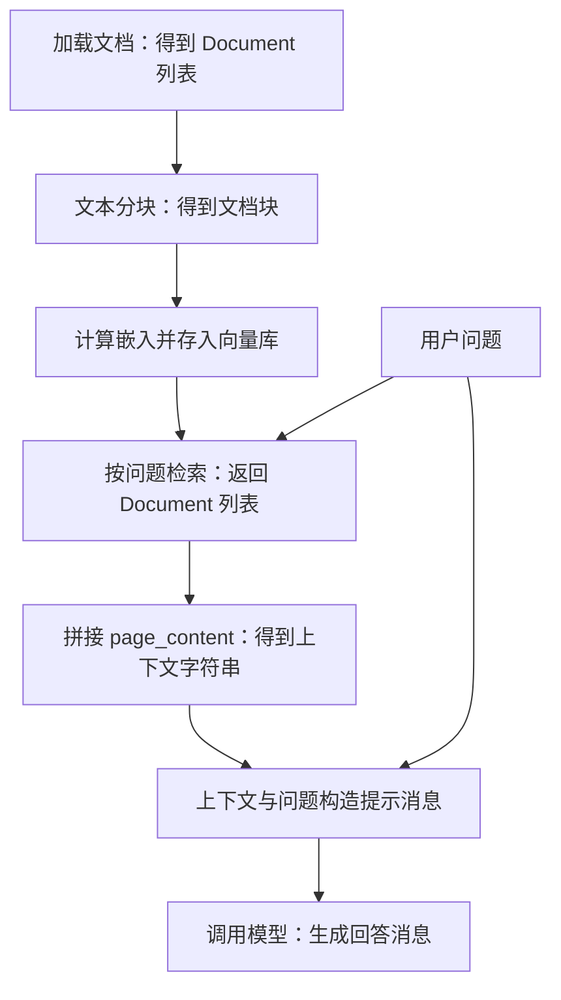

本文记录基于 LangChain 的 RAG 代码示例，依次整理文档加载、文本分块、嵌入与向量库、检索、上下文拼接和模型问答。

示例保留了 Notebook 中的代码片段与部分输出，并非可直接独立运行的脚本；`markdown_path`、`embedding_model_path` 以及相关类的导入需在运行环境中准备。截断的输出均作为文本展示。

## RAG 数据流

加载器将文档读为 `list[Document]`，分块后仍为 `list[Document]`；文档块经嵌入计算后存入向量库。查询得到的文档块拼接为上下文，再与问题一起构造提示消息，交给模型生成回答。



RAG 文档处理与问答流程。

## 模型配置

模型名称、接口地址和 API 密钥从环境变量读取；下文使用这些配置创建 `ChatOpenAI` 对象。

```python
model = os.getenv("LLM_MODEL_ID", "glm-4.7-flash-free")
base_url = os.getenv("LLM_BASE_URL", "https://aihubmix.com/v1")
api_key = os.getenv("LLM_API_KEY")
temperature = 0.7
max_tokens = 4096
```

## Document：文档数据结构

本例中文档加载、分块和检索都以 `Document` 为基本对象，主要关注两个属性：

- `doc.page_content`：文本内容。
- `doc.metadata`：来源等附加信息。

```python
from langchain_core.documents import Document
doc_example = Document(
    page_content="这是一个示例文档内容。",
    metadata={"source": "示例来源", "author": "示例作者"}
)
doc_example
```

输出示例：

```text
Document(metadata={'source': '示例来源', 'author': '示例作者'}, page_content='这是一个示例文档内容。')
```

## 加载文档

文档加载器用于读取 Markdown、PDF、DOCX 等格式的文档。这里使用 `UnstructuredMarkdownLoader` 加载 Markdown，返回 `list[Document]`。

```python
# 文档加载器：加载md，pdf和docx等格式的文档
loader = UnstructuredMarkdownLoader(markdown_path) # 加载器对象
docs: list[Document] = loader.load() # 默认返回Document格式
```

```python
docs[0].metadata
```

输出示例：

```text
{'source': '/home/xxx/project/all-in-rag/data/C1/markdown/easy-rl-chapter1.md'}
```

## 文本分块

- 把整篇文档切分为检索单元。
- 分块后，每个片段都能单独被检索。这里的“递归”大致指先尝试段落等较大的边界；如果片段仍然过长，再尝试换行、空格等更细的边界。

```python
chunk_size = 4000
chunk_overlap = 100
text_splitter = RecursiveCharacterTextSplitter(
    separators=["\n\n", "\n", " ", ""],
    chunk_size=chunk_size,
    chunk_overlap=chunk_overlap,
)
```

| 参数 | 含义 |
| --- | --- |
| `chunk_size` | 每块的目标最大长度 |
| `chunk_overlap` | 相邻块保留部分重叠，缓解知识在边界处被截断 |
| `separators` | 优先尝试的切分边界 |

`split_text` 接收 `str`，返回 `list[str]`；`split_documents` 接收 `list[Document]`，返回 `list[Document]`，保留文档内容及元数据。

> 这里的接口约定是：输入与输出尽量保留相似的数据结构。

```python
text_chunks = text_splitter.split_text(docs[0].page_content)       # str → list[str]
chunks = text_splitter.split_documents(docs) # list[Document] → list[Document]
text_chunks[0][:100], chunks[0].page_content[:100], chunks[0].metadata
```

输出示例：

```text
('第1章 强化学习基础\n\n1.1 强化学习概述\n\n强化学习（reinforcement learning，RL）讨论的问题是智能体（agent）怎么在复杂、不确定的环境（environment）中最大化',
 '第1章 强化学习基础\n\n1.1 强化学习概述\n\n强化学习（reinforcement learning，RL）讨论的问题是智能体（agent）怎么在复杂、不确定的环境（environment）中最大化',
 {'source': '/home/shared/ml/project/all-in-rag/data/C1/markdown/easy-rl-chapter1.md'})
```

## 嵌入模型：HuggingFaceEmbeddings

`HuggingFaceEmbeddings` 是适配器，将底层嵌入模型包装为 LangChain 可以统一调用的接口。创建 `embeddings` 对象主要是在加载模型；对文档进行编码则发生在调用嵌入接口或向量库添加文档时。

> 本例中的 `embeddings` 是封装了嵌入模型的对象。

```python
# embedding模型
embeddings = HuggingFaceEmbeddings(
    model_name=str(embedding_model_path),
    model_kwargs={
        'device': 'cuda:0',
        'local_files_only': True,
    },
    encode_kwargs={
        'normalize_embeddings': True,
    },
)
```

各参数的作用：

- `model_name`：这里传入本地模型目录。
- `model_kwargs`：传给底层模型加载过程。
- `device='cuda:0'`：本例使用第一个 CUDA 设备；使用 CPU 时可设置为 `device='cpu'`。
- `local_files_only=True`：只使用本地文件。
- `encode_kwargs`：传给向量编码过程。
- `normalize_embeddings=True`：将向量归一化为单位长度。

Python 中的 `{...}` 是字典，上述配置以“名称 → 值”的形式传递。

### 文档嵌入与查询嵌入

`embed_documents` 接收 `list[str]`，返回 `list[list[float]]`；`embed_query` 接收单个 `str`，返回 `list[float]`。

```python
vectors = embeddings.embed_documents( # 针对一组查询list[str]，得到使用list表示的向量：list[str] → list[list[float]]
    [
    "强化学习通过奖励学习策略。",
    "监督学习使用带标签的数据。",
    ]
)
vectors
```

```python
query_vector = embeddings.embed_query("什么是强化学习？") # 只针对单一查询str，得到使用list表示的向量：str → list[float]
len(query_vector), query_vector
```

原始输出节选：向量长度为 `512`，下方只展示其中三个分量。

```text
(512,
 [-0.06012639030814171,
  -0.015196173451840878,
  0.020946329459547997,]
)
```

## 构建向量库

创建 `InMemoryVectorStore` 时传入嵌入对象；调用 `add_documents(chunks)` 时，对文档块执行嵌入计算并存入向量库。

```python
vectorstore = InMemoryVectorStore(embedding=embeddings)
vectorstore.add_documents(chunks) # 作用对象是documents：list[Document]
```

## 检索向量库

- 本例使用 `InMemoryVectorStore` 按余弦相似度检索，返回 `list[Document]`。
- `k=3` 表示最多返回三个文档块，不代表找到三个例子，也不代表覆盖全文中的所有例子。

```python
question = "DeepMind 研发的走路的智能体是什么?"
results = vectorstore.similarity_search(question, k=3) # 作用对象是query：str
```

加入向量库的单位是 `Document`，查询后**返回的单位也是 `Document`**。以下是原始输出的截断节选：

```text
[Document(id='366eba3b-bc90-4a44-8a99-c77bff29ba63',Document(id='a2b13cd6-1947-4917-9b45-19227754673c',Document(id='1688693a-ad64-4a4f -9b02-f598a7daf223',]
```

查看第一个结果的前 100 个字符：

```python
results[0].page_content[:100]
```

也可以将向量库转为 `retriever`，通过 `invoke(question)` 查询：

```python
# 其他做法，使用retriever查询
retriever = vectorstore.as_retriever(
    search_kwargs={"k": 3}
)

retrieved_docs = retriever.invoke(question)
```

## 将检索结果转换为上下文

- 检索结果仍然是 `Document` 对象。
- 将多个文档的 `page_content` 拼接为一个完整的 `str`，作为提示词中的上下文。

```python
docs_content = "\n\n".join([doc.page_content for doc in results])
docs_content
```

## ChatPromptTemplate：构建提示消息

使用 `ChatPromptTemplate` 定义模板，通过 `context` 和 `question` 填入上下文与问题。

```python
prompt = ChatPromptTemplate.from_template("""
请根据下面提供的上下文信息来回答问题。

上下文:
{context}

问题: {question}

回答:
""")

# # 聊天格式：类似transformers库
# prompt = ChatPromptTemplate.from_messages([
#     ("system", "根据参考资料回答；资料不足时说明无法确定。"),
#     ("human", "参考资料：\n{context}\n\n问题：{question}"),
# ])

prompt
```

```python
messages = prompt.format_messages(
    context=docs_content,
    question=question,
)

# 自动成为 list[Message]格式，本质与transformers库的chat模式类似
messages
```

`format_messages` 得到消息对象列表，而非 `list[str]`，用法类似 Transformers 的聊天消息输入。原始输出节选：

```text
[HumanMessage(content="\n请根据下面提供的上下文信息来回答问题。\n\n上下文:\n图 1.8 可能的预演序列\n\n1.1.3 强化学...]
```

## 调用模型生成回答

将格式化后的 `messages` 传入 `llm.invoke`，得到回答消息。

```python
llm = ChatOpenAI(
    model=model,
    temperature=0.7,
    max_tokens=4096,
    api_key=api_key,
    base_url=base_url,
)

answer = llm.invoke(
    messages
)

# 上下文开销还是不小的，'completion_tokens': 214, 'prompt_tokens': 5917, 'total_tokens': 6131
```

返回值为 `AIMessage` 消息对象。原始回答节选如下，文本已截断：

```text
answer
AIMessage(content='DeepMind 研发的走路的智能体是一个通过强化学习训练的智能体：它每往前走一步就会获得奖励)
```

## Chain：连接提示词、模型与解析器

通过 `prompt | llm | parser` 连接提示模板、模型和 `StrOutputParser`。输入字典提供模板所需的字段；提示模板构造消息输入，模型返回消息，解析器再将输出转换为 `str`。

```python
from langchain_core.output_parsers import StrOutputParser

parser = StrOutputParser()
# ChatPromptTemplate
chain = prompt | llm | parser

input_dict = {
    "question": question,
    "context": docs_content,
}

answer = chain.invoke( # 需要填写 prompt对应的输入
    input_dict
)

# 其他输出方式：流式输出

# for text in chain.stream({
#     "question": question,
#     "context": docs_content,
# }):
#     print(text, end="", flush=True)

answer
```
