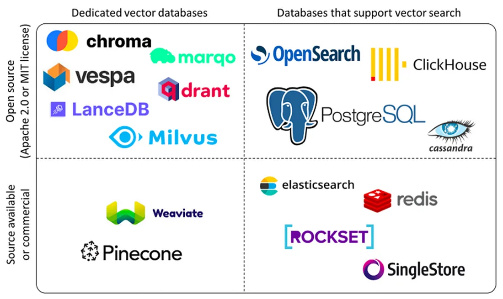
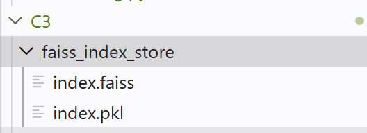
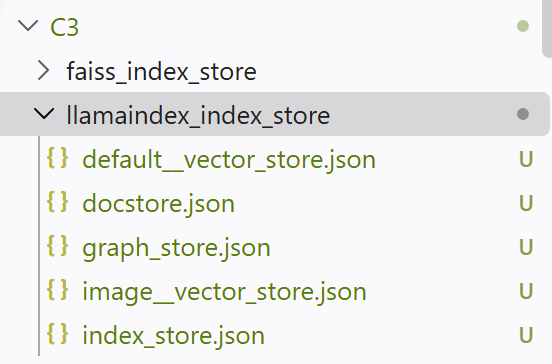
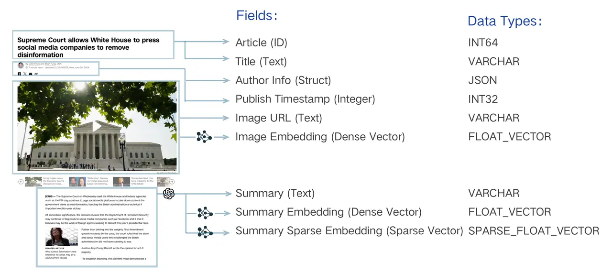
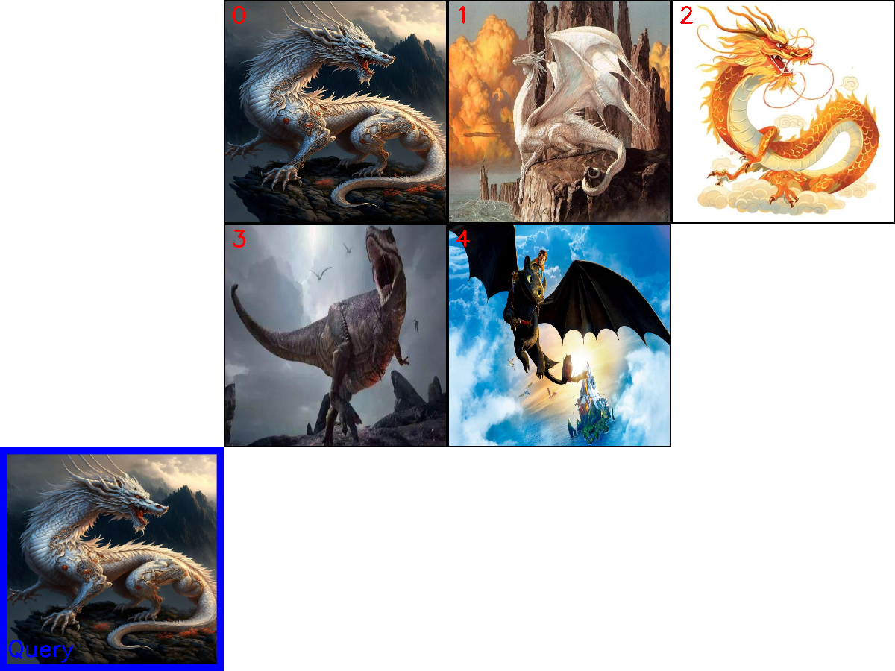
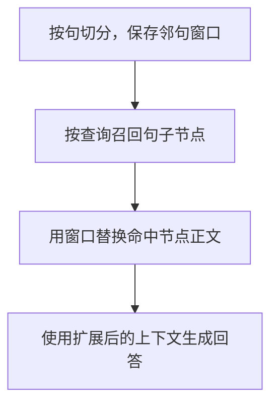
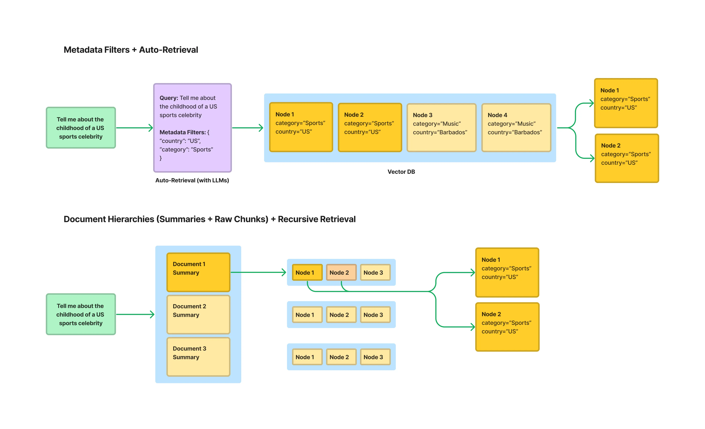

RAG 将文档块编码为向量，通过索引查找与查询相似的内容。本文先比较向量数据库与关系数据库，再用 FAISS、LlamaIndex 和 Milvus 展示索引的构建与使用，最后讨论如何为检索结果补充上下文。

这篇笔记承接[文档解析与分块](/posts/rag-parse-and-chunk/)。示例为 Notebook 片段，依赖事先准备的模型、文档和客户端配置。

## 向量数据库

传统数据库（如 MySQL）擅长<span style="color:red">结构化数据</span>的精确查询，如 `WHERE age = 25`。向量数据库面向<span style="color:red">高维向量</span>的存储、索引与相似性检索，在 RAG 中用于检索知识库内容。

| 维度 | 向量数据库 | 传统关系数据库 |
| --- | --- | --- |
| 核心数据 | 高维向量与元数据 | 文本、数字、日期等结构化数据 |
| 典型查询 | 向量相似性搜索 | 条件匹配、关联与聚合 |
| 常见索引 | HNSW、IVF 等 | B-Tree、Hash 等 |
| 应用示例 | RAG、推荐、图像或语音检索 | 业务系统、交易、报表 |

两者可以互补；规模、延迟和一致性取决于具体产品、索引与部署，不能仅按数据库类别判断。传统数据库也可能通过扩展支持向量搜索。

向量是有序数值组成的表示，可由嵌入模型从文本、图像或音频中提取。向量库的核心任务是高效进行**相似性搜索**。

从功能上可区分存储、索引、查询和服务四层：存储层保存向量与元数据；索引层构建和维护检索结构；查询层执行请求与过滤；服务层管理连接、监控和日志。

常见技术包括随机投影树（如 Annoy）、局部敏感哈希（LSH）、邻近图（HNSW），以及倒排索引与量化（如 Faiss 的 IVF、PQ）。

<figure><figcaption><p>向量检索产品示意</p></figcaption></figure>

图中分类仅作示意，产品许可和能力取决于版本。

| 产品 | 主要特点 |
| --- | --- |
| Pinecone | 托管向量数据库服务 |
| Milvus | 面向大规模向量检索的开源系统 |
| Qdrant | 基于 Rust 的向量检索引擎 |
| Weaviate | 支持向量检索与数据集成 |
| Chroma | 可用于本地原型与小规模实验 |

## FAISS 本地索引

FAISS 是相似性搜索与密集向量聚类的**算法库**。本例通过 LangChain 封装构建索引，再用 `save_local` 保存、`load_local` 恢复；查询时仍使用同一个嵌入模型。

```python
texts = [
    "张三是法外狂徒",
    "FAISS是一个用于高效相似性搜索和密集向量聚类的库。",
    "LangChain是一个用于开发由语言模型驱动的应用程序的框架。"
]
docs = [Document(page_content=t) for t in texts]

embeddings = HuggingFaceEmbeddings(
    model_name=str(embedding_model_path),
    model_kwargs={'device': 'cuda:0', 'local_files_only': True},
    encode_kwargs={'normalize_embeddings': True}
)
```

```python
vectorstore = FAISS.from_documents(docs, embeddings)
local_faiss_path = "./faiss_index_store"
vectorstore.save_local(local_faiss_path)
```

```python
loaded_vectorstore = FAISS.load_local(
    local_faiss_path,
    embeddings,
    allow_dangerous_deserialization=True
)
```

```python
query = "法外狂徒Langchain"
results = loaded_vectorstore.similarity_search(query, k=5)
results
```

`index.faiss` 保存向量索引；`index.pkl` 保存文档与 ID 映射。`allow_dangerous_deserialization=True` 启用后者的反序列化，仅应加载自己生成或可信的文件。

<figure><figcaption><p>FAISS 本地文件</p></figcaption></figure>

## LlamaIndex 索引持久化

`VectorStoreIndex.from_documents` 构建索引，`storage_context.persist` 保存当前存储上下文。本例的本地存储采用 JSON 文件。

> 这里的 `Document` 来自 `llama_index.core`，与 LangChain 的同名类不同。

```python
from llama_index.core import VectorStoreIndex, Document, Settings
from llama_index.embeddings.huggingface import HuggingFaceEmbedding

# 1. 配置全局嵌入模型
Settings.embed_model = HuggingFaceEmbedding(embedding_model_path)


# 2. 创建示例文档
texts = [
    "张三是法外狂徒",
    "LlamaIndex是一个用于构建和查询私有或领域特定数据的框架。",
    "它提供了数据连接、索引和查询接口等工具。"
]

# 这里的Document类是来自llama_index.core模块的，而不是langchain_core.documents模块
docs = [Document(text=t) for t in texts]

index = VectorStoreIndex.from_documents(docs)
```

```python
# 以json格式将向量和元信息存储至本地

persist_path = "./llamaindex_index_store"
index.storage_context.persist(persist_dir=persist_path)
print(f"LlamaIndex 索引已保存至: {persist_path}")
```

<figure><figcaption><p>LlamaIndex 索引文件</p></figcaption></figure>

`embedding_dict` 保存向量，`text_id_to_ref_doc_id` 保存节点与来源文档的映射。下方是两份存储数据的结构示意。

```json
# {
#   "embedding_dict": {
#     "node1": [-0.0185, 0.0321, 0.0478]
#   },
#   "text_id_to_ref_doc_id": {
#     "node1": "doc1"
#   },
#   "metadata_dict": {
#     "node1": {
#       "ref_doc_id": "doc1"
#     }
#   }
# }
# ```
#
# ```json
# {
#   "docstore/data": {
#     "node1": {
#       "__type__": "1",
#       "__data__": {
#         "id_": "node1",
#         "text": "张三是法外狂徒",
#         "metadata": {},
#         "embedding": null,
#         "class_name": "TextNode"
#       }
#     }
#   },
#   "docstore/ref_doc_info": {
#     "doc1": {
#       "node_ids": ["node1"],
#       "metadata": {}
#     }
#   }
# }
```

## Milvus

### 集合、字段与分区

Milvus 用 Collection 组织同一类数据，Schema 定义每条 Entity 的字段及类型，Partition 则把集合中的数据划分为子集。应用可以通过 Alias 使用一个固定名称访问当前指向的集合。

<figure><figcaption><p>Milvus 字段与类型</p></figcaption></figure>

| Milvus 术语 | MySQL 对应概念 | 作用 |
| --- | --- | --- |
| Database（数据库） | Database（数据库） | 管理多个 Collection / Table |
| Collection（集合） | Table（表） | 存储同一类数据 |
| Partition（分区） | Table Partition（表分区） | 将一张表的数据划分为不同子集 |
| Schema（模式） | Table Schema（表结构） | 定义字段、数据类型及约束 |
| Entity（实体） | Row / Record（行 / 记录） | 一条具体的数据 |
| Field（字段） | Column（列） | 保存数据的某个属性 |
| Primary Key（主键） | Primary Key（主键） | 唯一标识一条记录 |
| Index（索引） | Index（索引） | 加速数据检索，但索引类型与机制不同 |
| Alias（别名） | 近似于可切换的表名映射 | 通过固定名称访问不同 Collection |

```text
MySQL
Table: books
└── Table Schema
    ├── id: BIGINT
    ├── title: VARCHAR
    └── category: VARCHAR

Milvus
Collection: books
└── Collection Schema
    ├── id: INT64
    ├── title: VARCHAR
    └── vector: FLOAT_VECTOR(768)
```

### 向量索引类型

| 索引 | 查询方式 |
| --- | --- |
| `FLAT` | 逐个计算查询向量与候选向量的距离，做精确搜索。 |
| IVF 系列 | 先将向量聚类到 `nlist` 个桶，再搜索最接近的几个桶。`IVF_FLAT` 保留原始向量，`IVF_SQ8` 和 `IVF_PQ` 采用不同的量化方式。 |
| `HNSW` | 从稀疏的上层邻近图开始定位，逐层进入更密集的图，近似查找最近邻。 |
| `DISKANN` | 面向 SSD 等存储设备优化的近邻图索引。 |

[Milvus 索引说明](https://milvus.io/docs/index-explained.md)

### 图文混合查询示例

先初始化编码器和客户端。该片段会删除同名集合，适用于重建示例数据。

```python
print("--> 正在初始化编码器和Milvus客户端...")
encoder = Encoder(MODEL_NAME, MODEL_PATH)
milvus_client = MilvusClient(uri=MILVUS_URI)

print(f"\n--> 正在创建 Collection '{COLLECTION_NAME}'")
if milvus_client.has_collection(COLLECTION_NAME):
    milvus_client.drop_collection(COLLECTION_NAME)
    print(f"已删除已存在的 Collection: '{COLLECTION_NAME}'")
```

`FieldSchema` 定义主键、向量与图像路径。`dim` 需与编码器输出的向量维度一致。

```python
fields = [
    # 主键字段，设置自增 (auto_id=True)
    FieldSchema(name="id", dtype=DataType.INT64, is_primary=True, auto_id=True),
    # 向量字段，维度与模型的输出向量维度一致
    FieldSchema(name="vector", dtype=DataType.FLOAT_VECTOR, dim=dim),
    # 存储原图像路径的标量字段，最大长度限制 512 字符
    FieldSchema(name="image_path", dtype=DataType.VARCHAR, max_length=512),
]

schema = CollectionSchema(fields, description="多模态图文检索")
print("Schema 结构:")
print(schema)
```

创建集合。此处省略了将图像向量和路径写入集合的代码。

```python
milvus_client.create_collection(collection_name=COLLECTION_NAME, schema=schema)
print(f"成功创建 Collection: '{COLLECTION_NAME}'")
print("Collection 结构:")
print(milvus_client.describe_collection(collection_name=COLLECTION_NAME))
```

为 `vector` 建立使用余弦相似度的 `FLAT` 索引，然后加载集合。

```python
print(f"\n--> 正在为 '{COLLECTION_NAME}' 创建索引")
index_params = milvus_client.prepare_index_params()
index_params.add_index(
    field_name="vector", # 根据vector字段创建索引
    index_type="FLAT",
    metric_type="COSINE",
    params={}
)
milvus_client.create_index(collection_name=COLLECTION_NAME, index_params=index_params)
print("成功为向量字段创建 FLAT 索引。")
print("索引详情:")
print(milvus_client.describe_index(collection_name=COLLECTION_NAME, index_name="vector"))
milvus_client.load_collection(collection_name=COLLECTION_NAME)
print("已加载 Collection 到内存中。")
```

将查询图片与文本编码为一个查询向量，检索最相似的五项并取回 `image_path`。

```python
print(f"\n--> 正在 '{COLLECTION_NAME}' 中执行检索")
query_image_path = os.path.join(DATA_DIR, "dragon", "query.png")
query_text = "一条龙"
query_vector = encoder.encode_query(image_path=query_image_path, text=query_text)

search_results = milvus_client.search(
    collection_name=COLLECTION_NAME,
    data=[query_vector],
    output_fields=["image_path"],
    limit=5,
    search_params={"metric_type": "COSINE", "params": {}}
)[0]

retrieved_images = []
print("检索结果:")
for i, hit in enumerate(search_results):
    print(f"  Top {i+1}: ID={hit['id']}, 距离={hit['distance']:.4f}, 路径='{hit['entity']['image_path']}'")
    retrieved_images.append(hit['entity']['image_path'])
```

<figure><figcaption><p>龙图检索结果</p></figcaption></figure>

## 索引优化

> <span style="color:red">索引不等于检索器</span>：索引组织数据，检索器利用它查找相关内容。

### 句子窗口扩展

`window_size=3` 为句子保存前后各三句的窗口；`window` 存上下文，`original_text` 存当前句。这些节点是 `TextNode`，不是 `IndexNode`。参见 [LlamaIndex 节点解析器说明](https://developers.llamaindex.ai/python/framework/module_guides/loading/node_parsers/modules/)。

```python
node_parser = SentenceWindowNodeParser.from_defaults(
    window_size=3,
    window_metadata_key="window",
    original_text_metadata_key="original_text",
)

sentence_nodes = node_parser.get_nodes_from_documents(documents)
sentence_nodes[0].metadata, sentence_nodes[0].text[:50], sentence_nodes[0]# TextNode
```

原始输出如下，**窗口位于元数据**中window字段：

```text
({'page_label': '379',
  'file_name': 'IPCC_AR6_WGII_Chapter03.pdf',
  'file_path': '../../data/C3/pdf/IPCC_AR6_WGII_Chapter03.pdf',
  'file_type': 'application/pdf',
  'file_size': 21752444,
  'creation_date': '2026-11-05',
  'last_modified_date': '2026-11-05',
  'window': 'SPM\n379\n3\nOceans and Coastal \nEcosystems and Their Services\nThis chapter should be cited as:\nCooley, S., D.  Schoeman, L. Bopp, P .  Boyd, S. Donner, D.Y .  Ghebrehiwet, S.-I.  Ito, W. Kiessling, P . ',
  'original_text': 'SPM\n379\n3\nOceans and Coastal \nEcosystems and Their Services\nThis chapter should be cited as:\nCooley, S., D.  Schoeman, L. Bopp, P . '},
 'SPM\n379\n3\nOceans and Coastal \nEcosystems and Their',
 TextNode(id_='14d5fc13-4016-4005-ba7f-cdb0c8177d8e', embedding=None, metadata={'page_label': '379', 'file_name': 'IPCC_AR6_WGII_Chapter03.pdf', 'file_path': '../../data/C3/pdf/IPCC_AR6_WGII_Chapter03.pdf', 'file_type': 'application/pdf', 'file_size': 21752444, 'creation_date': '2026-11-05', 'last_modified_date': '2026-11-05', 'window': 'SPM\n379\n3\nOceans and Coastal \nEcosystems and Their Services\nThis chapter should be cited as:\nCooley, S., D.  Schoeman, L. Bopp, P .  Boyd, S. Donner, D.Y .  Ghebrehiwet, S.-I.  Ito, W. Kiessling, P . ', 'original_text': 'SPM\n379\n3\nOceans and Coastal \nEcosystems and Their Services\nThis chapter should be cited as:\nCooley, S., D.  Schoeman, L. Bopp, P . '}, excluded_embed_metadata_keys=['file_name', 'file_type', 'file_size', 'creation_date', 'last_modified_date', 'last_accessed_date', 'window', 'original_text'], excluded_llm_metadata_keys=['file_name', 'file_type', 'file_size', 'creation_date', 'last_modified_date', 'last_accessed_date', 'window', 'original_text'], relationships={<NodeRelationship.SOURCE: '1'>: RelatedNodeInfo(node_id='f9c14df2-a209-48ed-aee5-1b66e2622ac9', node_type=<ObjectType.DOCUMENT: '4'>, metadata={'page_label': '379', 'file_name': 'IPCC_AR6_WGII_Chapter03.pdf', 'file_path': '../../data/C3/pdf/IPCC_AR6_WGII_Chapter03.pdf', 'file_type': 'application/pdf', 'file_size': 21752444, 'creation_date': '2026-11-05', 'last_modified_date': '2026-11-05'}, hash='5fbcf96cac6226b402e2e6d7bb38a15112a6279f11ba360153f6ae672bcf8263'), <NodeRelationship.NEXT: '3'>: RelatedNodeInfo(node_id='9863764d-bdec-4de1-bb08-a11e4dd014e7', node_type=<ObjectType.TEXT: '1'>, metadata={'window': 'SPM\n379\n3\nOceans and Coastal \nEcosystems and Their Services\nThis chapter should be cited as:\nCooley, S., D.  Schoeman, L. Bopp, P .  Boyd, S. Donner, D.Y .  Ghebrehiwet, S.-I.  Ito, W. Kiessling, P .  Martinetto, E. Ojea, \nM.-F . ', 'original_text': 'Boyd, S. Donner, D.Y . '}, hash='09a7adefa7ee43d3d45aabfb87be923ae3f63b5d60361b714fb6e0a44a51fa87')}, metadata_template='{key}: {value}', metadata_separator='\n', text='SPM\n379\n3\nOceans and Coastal \nEcosystems and Their Services\nThis chapter should be cited as:\nCooley, S., D.  Schoeman, L. Bopp, P . ', mimetype='text/plain', start_char_idx=0, end_char_idx=132, metadata_seperator='\n', text_template='{metadata_str}\n\n{content}'))
```

先建立句子索引，再对比句子检索与常规检索。片段依赖预先准备的 `documents`、`base_index` 和 `base_query_engine`。

```python
# 创建向量数据库
sentence_index = VectorStoreIndex(sentence_nodes)

# %%
# 单纯检索功能
sentence_retriever = sentence_index.as_retriever(similarity_top_k=2)
base_retriever = base_index.as_retriever(similarity_top_k=2)

query = "What are the concerns surrounding the AMOC?"
sentence_retrieved = sentence_retriever.retrieve(query)
base_retrieved = base_retriever.retrieve(query)
```

```python
# window：临近的window_size个句子组成的片段，original_text：原始文本
```

```python
# sentence_retrieved结果包裹上下文的扩展
sentence_retrieved[0].metadata, base_retrieved[0].metadata
```

检索结果**仍保留窗口元数据**，此时尚未替换节点正文：

```text
({'page_label': '391',
  'file_name': 'IPCC_AR6_WGII_Chapter03.pdf',
  'file_path': '../../data/C3/pdf/IPCC_AR6_WGII_Chapter03.pdf',
  'file_type': 'application/pdf',
  'file_size': 21752444,
  'creation_date': '2026-11-05',
  'last_modified_date': '2026-11-05',
  'window': '9.2.1.3 (Fox-Kemper et\xa0al., \n2021)\n‘Upper-ocean stratification will continue to \nincrease throughout the 21st\xa0century (virtually \ncertain).’\n 9.2.1.3 (Fox-Kemper et\xa0al., \n2021)\nEastern boundary \nupwelling systems\n‘Only the California current system \nhas experienced some large-scale \nupwelling-favourable wind intensification since \nthe 1980s (medium confidence).’\n 9.2.5 (Fox-Kemper et\xa0al., \n2021)\n‘Eastern boundary upwelling systems will \nchange, with a dipole spatial pattern within \neach system of reduction at low latitude and \nenhancement at high latitude (high confidence).’\n 9.2.5 (Fox-Kemper et\xa0al., \n2021)\nAtlantic overturning \ncirculation (AMOC)\nThere is low confidence in reconstructed and \nmodelled AMOC changes for the 20th century.\n 2.3.3.4, 9.2.3 (Fox-Kemper \net\xa0al., 2021; Gulev et\xa0al., \n2021)\nThe AMOC will decline over the 21st\xa0century \n(high confidence, but low confidence for \nquantitative projections).\n 4.3.2.3, 9.2.3 (Fox-Kemper \net\xa0al., 2021; Lee et\xa0al., \n2021)\nSea ice\nArctic sea ice \nchanges\n‘Current Arctic sea ice coverage levels are the \nlowest since at least 1850 for both annual mean \nand late-summer values (high confidence).’\n 2.3.2.1, 9.3.1 (Fox-Kemper \net\xa0al., 2021; Gulev et\xa0al., \n2021)\n‘The Arctic will become practically ice-free in \nSeptember by the end of the 21st\xa0century under \nSSP2-4.5, SSP3-7.0 and SSP5-8.5[…](high \nconfidence).’\n',
  'original_text': '9.2.5 (Fox-Kemper et\xa0al., \n2021)\nAtlantic overturning \ncirculation (AMOC)\nThere is low confidence in reconstructed and \nmodelled AMOC changes for the 20th century.\n'},
 {'page_label': '511',
  'file_name': 'IPCC_AR6_WGII_Chapter03.pdf',
  'file_path': '../../data/C3/pdf/IPCC_AR6_WGII_Chapter03.pdf',
  'file_type': 'application/pdf',
  'file_size': 21752444,
  'creation_date': '2026-11-05',
  'last_modified_date': '2026-11-05'})
```

通过 `node_postprocessors` 注册窗口替换器，使模型生成回答前使用完整上下文。



句子窗口从索引到生成的处理流程。

```python
# 3. 构建查询引擎：检索+LLM回复
# sentence 数据库
sentence_query_engine = sentence_index.as_query_engine(
    similarity_top_k=2,
    node_postprocessors=[
        MetadataReplacementPostProcessor(target_metadata_key="window")
    ],
)
```

```python
# 4. 执行查询并对比结果
query = "What are the concerns surrounding the AMOC?"
print(f"查询: {query}\n")

print("--- 句子窗口检索结果 ---")
window_response = sentence_query_engine.query(query)
print(f"回答: {window_response}\n")

print("--- 常规检索结果 ---")
base_response = base_query_engine.query(query)
print(f"回答: {base_response}\n")
```

本次运行的回答对比，不代表通用效果保证：

```text
查询: What are the concerns surrounding the AMOC?

--- 句子窗口检索结果 ---
回答: Concerns about the AMOC center on uncertainty: there is low confidence in reconstructed and modeled AMOC changes for the 20th century, and while the AMOC is expected to decline over the 21st century with high confidence, quantitative projections remain low confidence.

--- 常规检索结果 ---
回答: The available information does not address the AMOC or concerns surrounding it, so I cannot provide an answer on that topic.
```

### 结构化索引

当查询只涉及少数文档时，无差别搜索所有文本块容易引入干扰。**结构化索引通过元数据过滤或文档摘要组织检索范围**。

<figure><figcaption><p>元数据过滤与递归检索</p></figcaption></figure>

#### 按工作表递归检索

为每个工作表创建 `PandasQueryEngine`，再以摘要 `IndexNode` 做顶层路由。`index_id` 对应 `query_engine_dict` 的键，使递归检索器能找到相应工作表引擎。

```python
excel_file = '../../data/C3/excel/movie.xlsx'
xls = pd.ExcelFile(excel_file)
```

```python
df_query_engines = {}
all_nodes = []

for sheet_name in xls.sheet_names:
    df = pd.read_excel(xls, sheet_name=sheet_name)

    # 为当前工作表（DataFrame）创建一个 PandasQueryEngine
    query_engine = PandasQueryEngine(df=df, llm=Settings.llm, verbose=True)

    # 为当前工作表创建一个摘要节点（IndexNode）
    year = sheet_name.replace('年份_', '')
    summary = f"这个表格包含了年份为 {year} 的电影信息，可以用来回答关于这一年电影的具体问题。"
    node = IndexNode(text=summary, index_id=sheet_name)
    all_nodes.append(node)

    # 存储工作表名称到其查询引擎的映射
    df_query_engines[sheet_name] = query_engine

    vector_index = VectorStoreIndex(all_nodes)

# 3. 创建递归检索器
# 3.1 创建顶层检索器，用于在摘要节点中检索
vector_retriever = vector_index.as_retriever(similarity_top_k=3)

# 3.2 递归检索器
recursive_retriever = RecursiveRetriever(
    "vector",
    retriever_dict={"vector": vector_retriever},
    query_engine_dict=df_query_engines,
    verbose=True,
)


query_engine = RetrieverQueryEngine.from_args(recursive_retriever)
```

原始运行输出，已去除网页复制按钮残留：

```text
查询: 1994年评分人数最少的电影是哪一部？
> Retrieving with query id None: 1994年评分人数最少的电影是哪一部？
> Retrieved node with id, entering: 年份_1994
> Retrieving with query id 年份_1994: 1994年评分人数最少的电影是哪一部？
> Pandas Instructions:
df[df['年份'] == 1994].nsmallest(1, '评分人数')['电影名称'].iloc[0]

> Pandas Output: 燃情岁月
回答: 燃情岁月
```

本次查询先命中 `年份_1994` 的摘要节点，再进入对应工作表引擎；模型生成 `nsmallest(1, '评分人数')` 查询，执行后返回“燃情岁月”。

候选结果如何合并与筛选，见 [RAG 检索优化](/posts/rag-retrieve/)。
