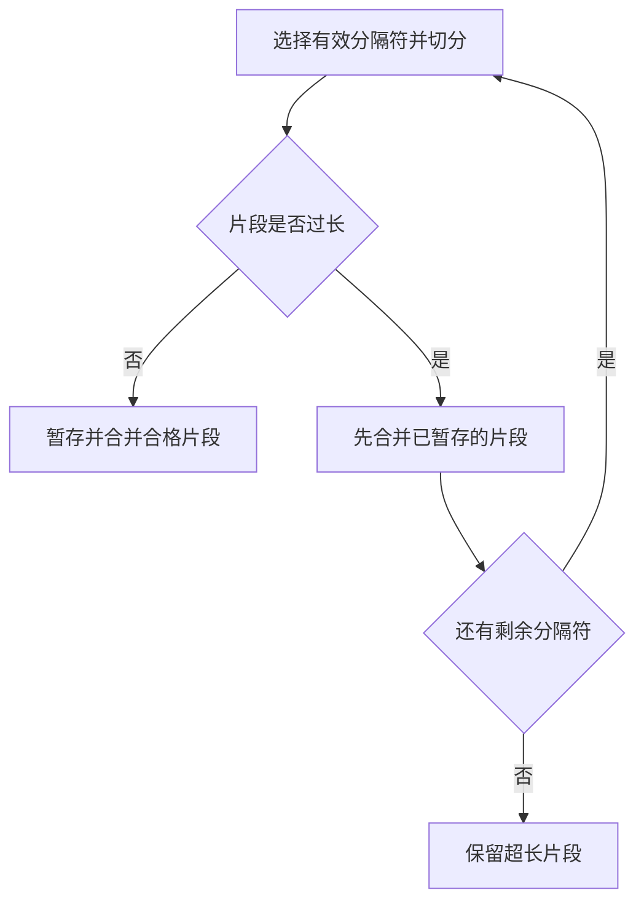
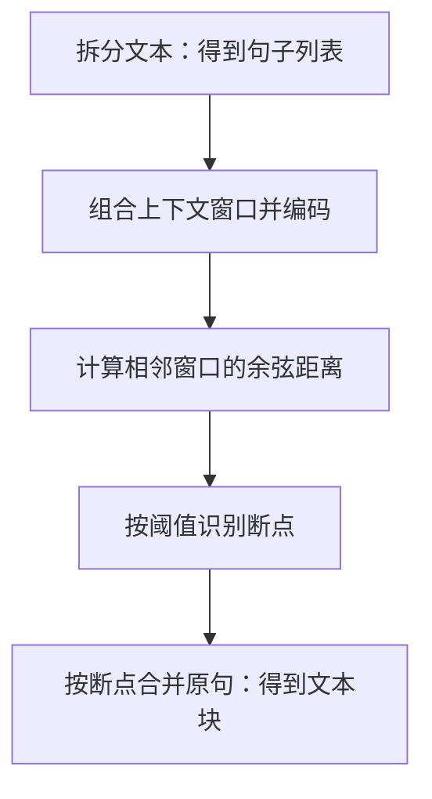

文档进入 RAG 索引前，需要先转成可处理的文档对象，再切成适合检索的文本块。解析决定哪些内容与结构能保留下来，分块则决定每条检索结果包含多少上下文。

## 文档加载器

文档加载器将 PDF、Word、Markdown、HTML 等非结构化文件转为程序可处理的文档对象。加载质量会影响后续索引、检索与回答。

| 工具 | 主要用途 | 示例场景 |
| --- | --- | --- |
| PyMuPDF4LLM | PDF 转 Markdown | 科研文献、技术手册 |
| TextLoader | 加载纯文本 | 文本文件 |
| DirectoryLoader | 批量加载目录 | 混合格式文档库 |
| Unstructured | 解析多种文档格式 | PDF、Word、HTML |
| FireCrawlLoader | 抓取网页内容 | 在线文档、新闻 |
| LlamaParse | 文档结构解析 | 合同、学术论文 |
| Docling | 文档解析与转换 | 企业合同、报告 |
| Marker | PDF 转 Markdown | 科研文献、书籍 |
| MinerU | 文档解析与内容提取 | 学术文献、财务报表 |

文档加载工具示例，具体能力取决于版本、配置与输入文件。

## 使用 Unstructured 解析文档

- `partition` 根据文档类型选择解析方法；下面的片段还需导入 `from unstructured.partition.auto import partition`。
- PDF 也可直接使用 `partition_pdf`；原笔记还列举了 PaddleOCR、MinerU 等解析工具。

```python
from unstructured.partition.pdf import partition_pdf

elements = partition(
    filename=pdf_path,
    content_type="application/pdf",
    languages=["eng", "chi_sim"]
)
```

原始解析输出节选：

```text
解析完成: 279 个元素, 7500 字符
元素类型: {'Header': 22, 'Title': 195, 'UncategorizedText': 41, 'NarrativeText': 3, 'Footer': 15, 'ListItem': 3}

所有元素:
Element 1 (Header):
网页
============================================================
Element 2 (Header):
新闻
============================================================
Element 3 (Header):
贴吧
============================================================
```

`strategy="ocr_only"` 指定 OCR 解析，`languages` 指定识别语言。参见 [Unstructured 分区说明](https://unstructured.readthedocs.io/en/latest/core/partition.html)。

```python
elements = partition_pdf(
    filename=pdf_path,
    strategy="ocr_only",
    languages=["eng", "chi_sim"]
)
```

## 文本分块

### 基于分隔符的分块

`CharacterTextSplitter` 先用分隔符拆分文本，再通过 `_merge_splits` 合并片段；`chunk_size` 控制目标长度，`chunk_overlap` 控制重叠。单个片段过长时仍可能保留，因此不能保证每块都不超过目标长度。

#### 单分隔符分块

使用单个分隔符，默认是 `"\n\n"`。本例读取文本后按 `chunk_size=200` 分块；代码注释中的“100 个字符”为笔误。

```python
loader = TextLoader("../../data/C2/txt/蜂医.txt")
docs = loader.load()

text_splitter = CharacterTextSplitter(
    chunk_size=200,    # 每个块的目标大小为100个字符
    chunk_overlap=10   # 每个块之间重叠10个字符，以缓解语义割裂
)

chunks = text_splitter.split_documents(docs)
```

输出为 `list[Document]`。原始运行结果节选：

```text
文本被切分为 14 个块。

--- 前5个块内容示例 ---
============================================================
块 1 (长度: 72): "# 蜂医

游戏《三角洲行动》中的支援型干员
```

#### 递归分块

按顺序寻找文本中存在的分隔符，再切分与合并。片段过长时使用剩余分隔符继续递归；没有剩余分隔符时保留超长片段，最后合并暂存片段。

```python
text_splitter = RecursiveCharacterTextSplitter(
    separators=["\n\n", "\n", "。", "，", " ", ""],  # 分隔符优先级
    chunk_size=200,
    chunk_overlap=10,
)

chunks = text_splitter.split_documents(docs)
```



递归分块的片段处理路径。

默认分隔符为 `["\n\n", "\n", " ", ""]`；中文文本可像上例一样加入句号、逗号。下面的 `from_language` 则是**按编程语言结构分块**，不是中文等自然语言的配置：

```python
splitter = RecursiveCharacterTextSplitter.from_language(
    language=Language.PYTHON,  # 支持Python、Java、C++等
    chunk_size=500,
    chunk_overlap=50
)
```

### 语义分块

`langchain_experimental.text_splitter.SemanticChunker` 利用嵌入模型识别语义变化，在相邻句子差异较大的位置切分。

> 核心思想是<span style="color:red">识别语义断点</span>。

先准备嵌入模型：

```python
embeddings = HuggingFaceEmbeddings(
    model_name=str(embedding_model_path),
    model_kwargs={'device': 'cuda:0', 'local_files_only': True},
    encode_kwargs={'normalize_embeddings': True}
)
```

`buffer_size=1` 将当前句子与前后各一句组合后编码；`breakpoint_threshold_type` 选择断点判断方法。

```python
text_splitter = SemanticChunker(
    embeddings,
    buffer_size = 1, # 捕捉上下文信息。对于列表中的每一个句子，这种方法会将其与前后各 buffer_size 个句子组合起来
    breakpoint_threshold_type="percentile" # 断点识别方法
)
```

处理顺序是先拆句，再编码上下文窗口、计算相邻窗口的余弦距离，按阈值找断点，最后合并各段原句。



语义分块的数据处理流程。

`breakpoint_threshold_amount` 配置阈值参数：

| `breakpoint_threshold_type` | 判断依据 | 默认参数 |
| --- | --- | --- |
| `percentile` | 距离超过指定百分位 | `95` |
| `standard_deviation` | 距离超过均值加上指定倍数的标准差 | `3` |
| `interquartile` | 距离超过均值加上指定倍数的四分位距 | `1.5` |
| `gradient` | 距离梯度超过指定百分位 | `95` |

此处 `interquartile` 使用均值作为阈值基准。[SemanticChunker 源码](https://github.com/langchain-ai/langchain-experimental/blob/main/libs/experimental/langchain_experimental/text_splitter.py)

### LlamaIndex 节点解析与句子窗口

LlamaIndex 的节点解析器将文档转换为 `Node`；具体类型包括 `TextNode`、`IndexNode` 等。

- 结构感知：`MarkdownNodeParser`、`JSONNodeParser`、`CodeSplitter` 按标题、JSON 结构或代码结构切分。
- 语义感知：`SemanticSplitterNodeParser` 利用嵌入识别语义断点；`SentenceWindowNodeParser` 为句子节点保存上下文窗口。
- 常规切分：`TokenTextSplitter`、`SentenceSplitter` 按 Token 或句子边界切分。

句子窗口策略先按单句检索，再取上下文送给模型；每个节点的元数据中，<span style="color:red">会存储其前后相邻的句子，组成窗口</span>。下面用借书规则模拟扩展过程：

```python
doc = Document(text=(
    "普通图书可借三十天。"
    "到期前可续借一次。"
    "续借后可再借三十天。"
    "已被预约的图书不能续借。"
))

parser = SentenceWindowNodeParser.from_defaults(
    sentence_splitter=split_sentences,
    window_size=1,  # 前后各保留一句
)
```

假设问题是“续借后还能借多久？”，手动选择第三个节点模拟命中。片段中的 `split_sentences` 和 `nodes` 需事先准备；此处不执行真实向量检索。

```python
hits = [
    NodeWithScore(
        node=nodes[2].model_copy(deep=True),
        score=1.0,
    )
]

processor = MetadataReplacementPostProcessor(
    target_metadata_key="window"
)
expanded = processor.postprocess_nodes(hits)

print("扩展后正文：", expanded[0].node.text)
```

`MetadataReplacementPostProcessor` 用 `window` 元数据替换命中节点的正文。输出如下：

```text
扩展后正文： 到期前可续借一次。 续借后可再借三十天。 已被预约的图书不能续借。
```

分块完成后，可继续阅读 [RAG 索引与向量数据库](/posts/rag-index-and-vectordb/)，了解如何存储向量和扩展命中片段的上下文。
