建立[索引](/posts/rag-index-and-vectordb/)后，RAG 还需要把问题变成可执行的查询，召回候选，再筛出适合交给模型的上下文。本文按混合检索、查询构建与改写、查询路由、召回后处理的顺序整理示例。代码为 Notebook 片段，模型、连接配置和数据需事先准备。

## 混合检索

### 稀疏检索与密集检索

**稀疏检索**以词项匹配为典型用法。稀疏向量的大多数分量为零，非零分量可以是词频或权重。

> <span style="color:red">稀疏向量的非零分量可以是小数</span>。

以 BM25 为例，它根据查询词的权重、词频和文档长度计算相关性：

$$
\begin{align}
\operatorname{BM25}(Q,D)
&= \sum_{i=1}^{n} w_i \frac{f_i(k_1+1)}{f_i+k_1 L_D}
\end{align}
$$

其中，$$Q$$ 为查询，$$D$$ 为文档，$$n$$ 为查询词数量。长度归一化因子为

$$
L_D = 1-b+b\frac{\lvert D\rvert}{\mathrm{avgdl}}
$$

- $q_i$ 为第 $i$ 个查询词，$w_i$ 为它的逆文档频率权重。
- $f_i$ 为该词在文档中的出现次数。
- $\lvert D\rvert$ 为文档长度，$\mathrm{avgdl}$ 为文档集合的平均长度。
- $k_1$ 控制词频饱和程度，$b$ 控制长度归一化的强度。

[BM25 原理](https://doi.org/10.1561/1500000019)

**密集检索**使用模型编码文本、图像等内容，再按稠密向量的相似度召回候选。混合检索可以同时利用词项匹配与语义相似性。

### 倒数排名融合（RRF）

RRF 汇总候选在各路结果中的名次。一个文档在某一路排名越靠前，该路对融合分数的贡献就越大。

$$
\begin{align}
\operatorname{RRF}(d) &= \sum_{i=1}^{k} \frac{1}{\operatorname{rank}_i(d)+c}
\end{align}
$$

其中，$$d$$ 为候选文档，$$k$$ 为检索路数，$$\operatorname{rank}_i(d)$$ 为文档在第 $$i$$ 路的名次，$$c$$ 为平滑常数。某一路未召回该文档时，该路贡献为零。示例中的 `RRFRanker(k=60)` 用参数 `k` 设置这个平滑常数。 [Milvus RRF 说明](https://milvus.io/docs/rrf-ranker.md)

#### Milvus 混合检索示例

同一集合为稀疏向量和密集向量分别建索引，查询时分别构造请求，由 `RRFRanker` 合并排名。第一段会删除同名集合，适用于重建示例数据。

```python
milvus_client = MilvusClient(uri=MILVUS_URI)
if milvus_client.has_collection(COLLECTION_NAME):
    print(f"--> 正在删除已存在的 Collection '{COLLECTION_NAME}'...")
    milvus_client.drop_collection(COLLECTION_NAME)

fields = [
    FieldSchema(name="pk", dtype=DataType.VARCHAR, is_primary=True, auto_id=True, max_length=100),
    FieldSchema(name="img_id", dtype=DataType.VARCHAR, max_length=100),
    FieldSchema(name="path", dtype=DataType.VARCHAR, max_length=256),
    FieldSchema(name="title", dtype=DataType.VARCHAR, max_length=256),
    FieldSchema(name="description", dtype=DataType.VARCHAR, max_length=4096),
    FieldSchema(name="category", dtype=DataType.VARCHAR, max_length=64),
    FieldSchema(name="location", dtype=DataType.VARCHAR, max_length=128),
    FieldSchema(name="environment", dtype=DataType.VARCHAR, max_length=64),
    FieldSchema(name="sparse_vector", dtype=DataType.SPARSE_FLOAT_VECTOR),
    FieldSchema(name="dense_vector", dtype=DataType.FLOAT_VECTOR, dim=ef.dim["dense"])
]
```

`sparse_vector` 使用稀疏倒排索引，`dense_vector` 使用自动索引。

```python
if not milvus_client.has_collection(COLLECTION_NAME):
    print(f"--> 正在创建 Collection '{COLLECTION_NAME}'...")
    schema = CollectionSchema(fields, description="关于龙的混合检索示例")
    # 创建集合
    collection = Collection(name=COLLECTION_NAME, schema=schema, consistency_level="Strong")
    print("--> Collection 创建成功。")

    # 4. 创建索引：创建密集和系数向量进行索引
    print("--> 正在为新集合创建索引...")
    sparse_index = {"index_type": "SPARSE_INVERTED_INDEX", "metric_type": "IP"}
    collection.create_index("sparse_vector", sparse_index)
    print("稀疏向量索引创建成功。")

    dense_index = {"index_type": "AUTOINDEX", "metric_type": "IP"}
    collection.create_index("dense_vector", dense_index)
    print("密集向量索引创建成功。")
```

集合准备好后，发起两路检索并融合候选。

```python
collection = Collection(COLLECTION_NAME)

#创建 RRF 融合器
rerank = RRFRanker(k=60)

#创建搜索请求
dense_req = AnnSearchRequest([dense_vec], "dense_vector", search_params, limit=top_k)
sparse_req = AnnSearchRequest([sparse_vec], "sparse_vector", search_params, limit=top_k)

#执行混合搜索
results = collection.hybrid_search(
    [sparse_req, dense_req],
    rerank=rerank,
    limit=top_k,
    output_fields=["title", "path", "description", "category", "location", "environment"]
)[0]
```

运行输出节选：

```text
--- [混合] 稀疏+密集向量搜索结果 ---
1. 悬崖上的白龙 (Score: 0.0328)
    路径: ../../data/C3/dragon/dragon02.png
    描述: 一头雄伟的白色巨龙栖息在悬崖边缘，背景是金色的云霞和远方的海岸。它拥有巨大的翅膀和优雅的身姿，是典型的西方奇幻生物。...
2. 中华金龙 (Score: 0.0320)
    路径: ../../data/C3/dragon/dragon06.png
    描述: 一条金色的中华龙在祥云间盘旋，它身形矫健，龙须飘逸，展现了东方神话中龙的威严与神圣。...
3. 奔跑的奶龙 (Score: 0.0315)
    路径: ../../data/C3/dragon/dragon04.png
```

### 线性融合

当两路分数已经转换到可比较的尺度，可以按权重相加：

$$
\begin{align}
s_{\mathrm{hybrid}}
&= \alpha s_{\mathrm{dense}} + (1-\alpha)s_{\mathrm{sparse}}
\end{align}
$$

其中，$$s_{\mathrm{dense}}$$ 和 $$s_{\mathrm{sparse}}$$ 分别为密集检索和稀疏检索的分数，$$\alpha\in[0,1]$$ 为密集检索分数的权重。

## 查询构建（Text-to-Query）

查询构建用 LLM 将自然语言转成数据源可以执行的查询。向量库可以接收元数据过滤条件，图数据库可以使用 Cypher，关系数据库则可以执行 SQL。

### 向量数据库的元数据过滤

<figure>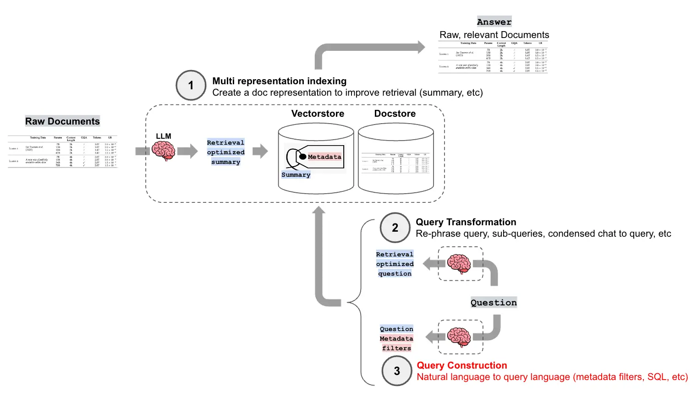<figcaption><p>查询构建与索引</p></figcaption></figure>

> 帮我找一个时长超过 600 秒的 Python 教程。

这里包含两个条件。“Python 教程”适合语义检索，`length > 600` 适合精确过滤。LLM 解析这两个条件，自查询检索器再将过滤条件转换成 Chroma 可执行的语法。

`AttributeInfo` 声明字段名、类型和描述。模型据此识别出“时长”对应以秒为单位的整数字段 `length`。

```python
#3. 配置元数据字段信息
metadata_field_info = [
    AttributeInfo(
        name="title",
        description="视频标题（字符串）",
        type="string",
    ),
    AttributeInfo(
        name="author",
        description="视频作者（字符串）",
        type="string",
    ),
    AttributeInfo(
        name="view_count",
        description="视频观看次数（整数）",
        type="integer",
    ),
    AttributeInfo(
        name="length",
        description="视频长度，以秒为单位的整数",
        type="integer"
    )
]
```

`SelfQueryRetriever.from_llm` 将查询构造链与后端翻译器接起来：

- **构造**：模型根据 `document_contents` 和 `metadata_field_info` 将原问题拆为语义查询和结构化过滤条件。
- **翻译**：翻译器将过滤条件转成 Chroma 的查询语法。

`retriever.invoke` 接收自然语言查询，执行构造和翻译，再调用向量库检索。

```python
#4. 创建自查询检索器
llm = ChatDeepSeek(
    model="deepseek-chat",
    temperature=0,
    api_key=os.getenv("DEEPSEEK_API_KEY")
    )

retriever = SelfQueryRetriever.from_llm(
    llm=llm,
    vectorstore=vectorstore,
    document_contents="记录视频标题、作者、观看次数等信息的视频元数据",
    metadata_field_info=metadata_field_info,
    enable_limit=True,
    verbose=True
)

#5. 执行查询示例
queries = [
    "时间最短的视频",
    "时长大于600秒的视频"
]
```

```text
--- 查询: '时间最短的视频' ---
INFO:httpx:HTTP Request: POST https://api.deepseek.com/v1/chat/completions "HTTP/1.1 200 OK"
INFO:langchain.retrievers.self_query.base:Generated Query: query=' ' filter=None limit=1
标题: 《吴恩达 x OpenAI Prompt课程》【专业翻译，配套代码笔记】02.Prompt 的构建原则
作者: 二次元的Datawhale
观看次数: 18788
时长: 1063秒
==================================================

--- 查询: '时长大于600秒的视频' ---
INFO:httpx:HTTP Request: POST https://api.deepseek.com/v1/chat/completions "HTTP/1.1 200 OK"
INFO:langchain.retrievers.self_query.base:Generated Query: query=' ' filter=Comparison(comparator=<Comparator.GT: 'gt'>, attribute='length', value=600) limit=None
WARNING:chromadb.segment.impl.vector.local_hnsw:Number of requested results 4 is greater than number of elements in index 3, updating n_results = 3
标题: 《吴恩达 x OpenAI Prompt课程》【专业翻译，配套代码笔记】03.Prompt如何迭代优化
作者: 二次元的Datawhale
观看次数: 7090
时长: 806秒
```

日志里，“时长大于 600 秒”生成了 `length > 600`。而“时间最短”只生成了 `limit=1`，只限制返回数量，无法表达按时长升序排列。后面的 JSON 排序示例专门处理这个需求。

### Text-to-SQL

Text-to-SQL 将自然语言转换成 SQL。以下示例查询 `users` 表。

| id | name | age | city |
| --- | --- | --- | --- |
| 1 | 张三 | 25 | 北京 |
| 2 | 李四 | 32 | 上海 |
| 3 | 王五 | 28 | 广州 |
| 4 | 赵六 | 35 | 深圳 |

> 帮我查询年龄大于 30 岁的用户。

模型生成的 SQL 如下，结果摘录仅展示姓名、年龄与城市。

```sql
SELECT * FROM users
WHERE age > 30;
```

| name | age | city |
| --- | --- | --- |
| 李四 | 32 | 上海 |
| 赵六 | 35 | 深圳 |

如果模型误把 `age` 写成 `user_age`，SQL 就会执行失败。教程用 RAG 检索表结构、字段描述和历史查询示例，补齐生成 SQL 所需的信息。

<figure>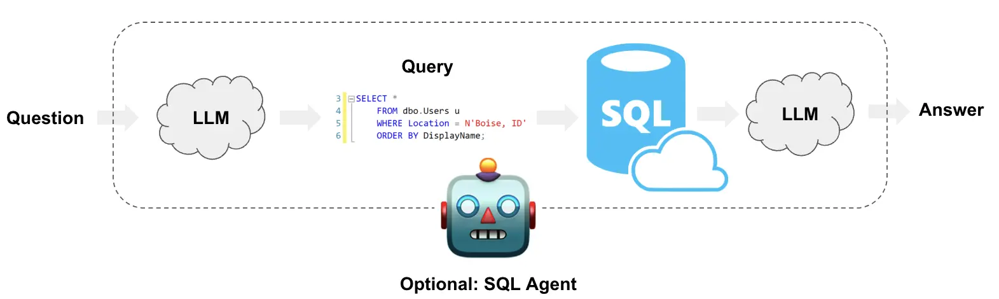<figcaption><p>从问题到 SQL</p></figcaption></figure>

| 技术 | 作用 |
| --- | --- |
| Milvus | 存储和检索数据库相关知识 |
| BGE-M3 | 将文本转换为向量，实现语义检索 |
| DeepSeek | 理解问题并生成 SQL |
| SQLite | 执行 SQL，查询真实数据 |
| Agent | 协调检索、SQL 生成、执行和纠错 |

本例先向量化问题、检索相关数据库知识，再把知识连同原问题交给模型生成 SQL。SQLite 执行 SQL，失败时把错误交给模型修复后重试。教程示例最多尝试 3 次，每次查询最多返回 100 行。

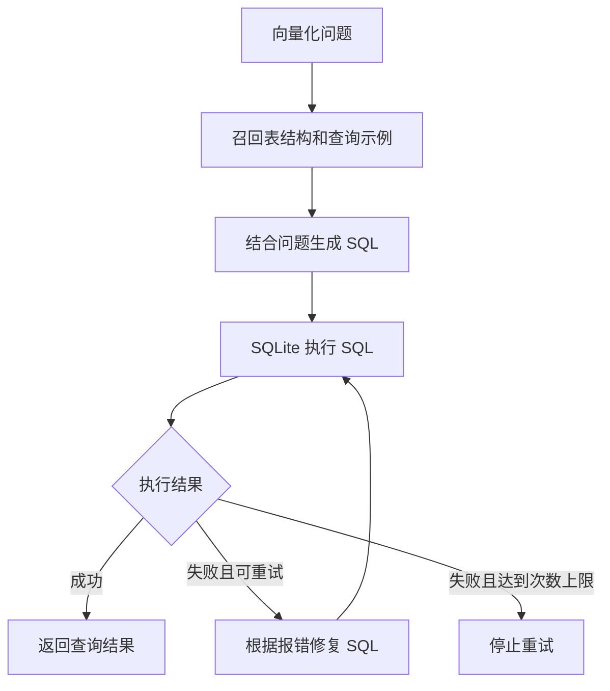

带检索与纠错的 SQL 生成流程。

#### 检索数据库知识

教程将以下三类知识编码后存入 Milvus：

| 知识类型 | 内容 | 作用 |
| --- | --- | --- |
| DDL | 数据库表结构 | 告诉 LLM 有哪些表和字段 |
| Q-SQL | 自然语言与 SQL 示例 | 告诉 LLM 如何编写类似查询 |
| Description | 字段的业务描述 | 帮助 LLM 理解字段含义 |

例如：

**DDL（数据定义语言）**描述表结构。

```sql
CREATE TABLE users (
    id INTEGER,
    name TEXT,
    age INTEGER,
    city TEXT
);
```

**Q-SQL** 提供可参考的历史查询。

```text
问题：查询年龄超过 25 岁的用户

SQL：
SELECT * FROM users WHERE age > 25;
```

**字段描述**补充业务含义。

```text
users：用户信息表
name：用户姓名
age：用户年龄
city：用户所在城市
```

#### 生成 SQL

把检索结果和问题拼到提示词中。历史 Q-SQL 提供少样本示例。

```text
你是一名 SQL 专家。

数据库结构：
users(id, name, age, city)

字段说明：
age 表示用户年龄。

参考示例：
问题：查询年龄超过25岁的用户
SQL：SELECT * FROM users WHERE age > 25;

用户问题：
查询年龄大于30岁的用户。

请生成 SQL。
```

模型根据这些上下文生成：

```sql
SELECT * FROM users WHERE age > 30;
```

#### 执行与纠错

SQLite 执行生成的 SQL。如果模型写了不存在的 `user_age`，数据库会返回错误：

```sql
SELECT * FROM users WHERE user_age > 30;
```

```text
no such column: user_age
```

系统将原 SQL、报错和实际字段发回模型：

```text
原始 SQL：
SELECT * FROM users WHERE user_age > 30;

错误信息：
no such column: user_age

数据库字段：
id, name, age, city

请修复 SQL。
```

模型修复 SQL 后，数据库重新执行：

```sql
SELECT * FROM users WHERE age > 30;
```

Text-to-SQL 是查询构建在关系数据库中的一种应用。

| 对比 | Query Construction | Text2SQL |
| --- | --- | --- |
| 主要目标 | 将自然语言转换为结构化查询 | 将自然语言**转换为 SQL** |
| 查询对象 | 向量数据库、图数据库等 | 关系型数据库 |
| 示例 | `length > 600` | `WHERE age > 30` |
| 核心技术 | LLM + 查询构建 | LLM + RAG + SQL |
| 主要场景 | 元数据过滤、图关系查询 | 数据统计、条件查询、表关联 |

## 查询翻译

### 结构化排序指令

示例把“时间最短”或“播放量最高”转成包含 `sort_by` 和 `order` 的 JSON，再对已有的 `all_documents` 排序，取出第一条。

```python
#6. 执行查询示例
queries = [
    "时间最短的视频",
    "播放量最高的视频"
]

for query in queries:
    print(f"\n--- 原始查询: '{query}' ---")

    # 使用大模型将自然语言转换为排序指令
    prompt = f"""你是一个智能助手，请将用户的问题转换成一个用于排序视频的JSON指令。

你需要识别用户想要排序的字段和排序方向。
- 排序字段必须是 'view_count' (观看次数) 或 'length' (时长) 之一。
- 排序方向必须是 'asc' (升序) 或 'desc' (降序) 之一。

例如:
- '时间最短的视频' 或 '哪个视频时间最短' 应转换为 {{"sort_by": "length", "order": "asc"}}
- '播放量最高的视频' 或 '哪个视频最火' 应转换为 {{"sort_by": "view_count", "order": "desc"}}

请根据以下问题生成JSON指令:
原始问题: "{query}"

JSON指令:"""
    response = client.chat.completions.create(
            model="deepseek-chat",
            messages=[
                {"role": "user", "content": prompt}
            ],
            temperature=0,
            response_format={"type": "json_object"}
        )
    # print(response)
    # {"sort_by": "length", "order": "asc"}
    try:
        import json
        instruction_str = response.choices[0].message.content
        instruction = json.loads(instruction_str)
        print(f"--- 生成的排序指令: {instruction} ---")

        sort_by = instruction.get('sort_by')
        order = instruction.get('order')

        if sort_by in ['length', 'view_count'] and order in ['asc', 'desc']:
            # 在代码中执行排序
            reverse_order = (order == 'desc')
            sorted_docs = sorted(all_documents, key=lambda doc: doc.metadata.get(sort_by, 0), reverse=reverse_order)

            # 获取排序后的第一个结果
            if sorted_docs:
                doc = sorted_docs[0]
                title = doc.metadata.get('title', '未知标题')
                author = doc.metadata.get('author', '未知作者')
                view_count = doc.metadata.get('view_count', '未知')
                length = doc.metadata.get('length', '未知')
                print(f"标题: {title}")
                print(f"作者: {author}")
                print(f"观看次数: {view_count}")
                print(f"时长: {length}秒")
                print("="*50)
            else:
                print("没有找到任何视频")
        else:
            print("生成的指令无效，无法执行排序")

    except (json.JSONDecodeError, KeyError) as e:
        print(f"解析或执行指令失败: {e}")
```

### 多查询改写与分解（Multi-query）

多查询可以从不同角度改写同一个问题，也可以把复杂问题拆成可分别检索的子问题。各路结果合并去重后，作为生成答案的上下文。

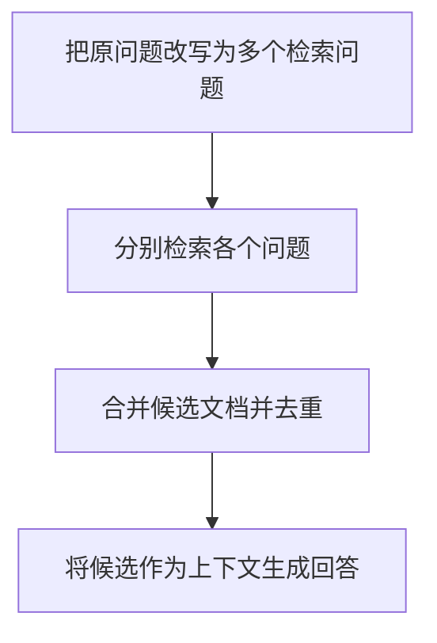

多查询的召回与合并流程。

原问题是“在《流浪地球》中，刘慈欣对人工智能和未来社会结构有何看法？”可以拆为以下三个问题。

- 《流浪地球》中描述的人工智能技术有哪些？
- 《流浪地球》中描绘的未来社会是怎样的？
- 刘慈欣关于人工智能的观点是什么？

`MultiQueryRetriever` 将多查询生成与检索封装在一起。下面的提示链只演示查询改写。

```python
multi_query_prompt = ChatPromptTemplate.from_template("""
你是一个 RAG 查询优化助手。

请将用户的问题改写为 3 个不同角度的检索问题，
帮助向量数据库召回更多相关文档。

要求：
1. 保持原始问题的核心意图
2. 从不同角度进行改写
3. 每行输出一个问题
4. 不需要回答问题

原始问题：
{query}
""")

multi_query_chain = multi_query_prompt | llm | parser
```

### 退步提示（Step-Back Prompting）

先将具体问题抽象成<span style="color:red">更概括的退步问题</span>，找出背后的通用原理，再用该原理回答具体问题。

示例问的是气体物质的量不变时，绝对温度变为原来的 2 倍、体积变为 8 倍，压力如何变化。退步问题是“这个问题背后的物理原理是什么？”根据理想气体状态方程 $$PV=nRT$$，压力随温度成正比、随体积成反比，因此变为原来的 $$2/8=1/4$$。

<figure>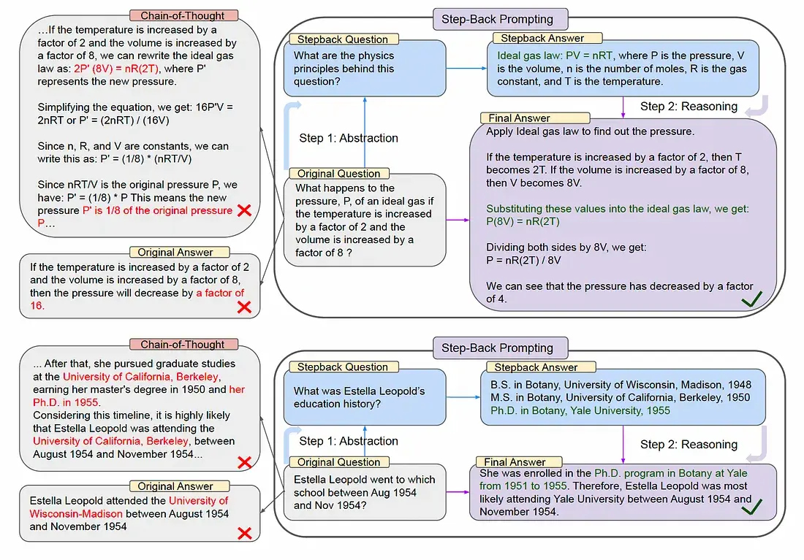<figcaption><p>退步提示示例</p></figcaption></figure>

```python
step_back_prompt = ChatPromptTemplate.from_template("""
你是一个 RAG 查询优化助手。

请将用户的具体问题转换为一个更抽象、
更通用的原理性问题。

要求：
1. 保留核心研究主题
2. 提升问题的抽象层次
3. 只输出一个问题
4. 不需要回答问题

原始问题：
{query}
""")

step_back_chain = step_back_prompt | llm | parser
```

### 假设性文档嵌入（HyDE）

短查询与详细文档的表达方式可能相差较大。HyDE 先用 LLM 根据问题生成一段假设性文档，再用编码器把它转换为向量，最后用该向量检索真实文档。假设性文档用于召回，最终上下文来自检索命中的真实文档。

<figure>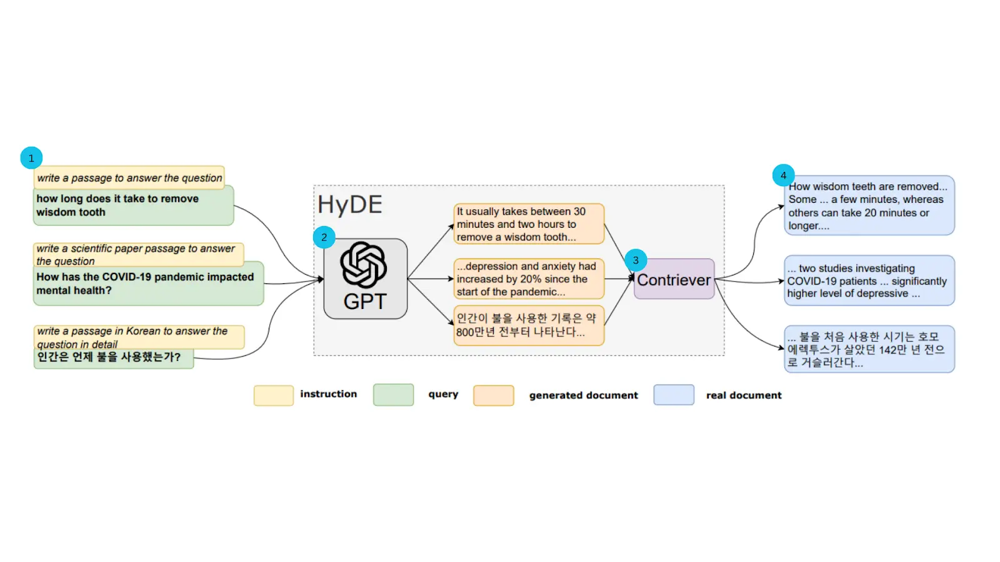<figcaption><p>HyDE 检索流程</p></figcaption></figure>

```python
hyde_prompt = ChatPromptTemplate.from_template("""
你是一个 RAG 技术专家。

请根据用户的问题，生成一段可能出现在
专业技术文档中的解释性内容。

要求：
1. 直接生成一段假设性的答案
2. 使用技术文档的表达方式
3. 内容控制在 150 字左右
4. 不要添加额外说明

用户问题：
{query}
""")

hyde_chain = hyde_prompt | llm | parser
```

### 三种方法的输出对比

同一问题分别经过多查询改写、退步提示和 HyDE，示例输出如下。

```text
INFO:httpx:HTTP Request: POST https://api.deepseek.com/v1/chat/completions "HTTP/1.1 200 OK"
原始问题：
为什么 RAG 系统的文本分块太小会影响回答质量?

========== Multi-query ==========
INFO:httpx:HTTP Request: POST https://api.deepseek.com/v1/chat/completions "HTTP/1.1 200 OK"
文本分块尺寸过小对 RAG 回答质量的影响
RAG 系统中 chunk 大小与检索召回效果的关系
分块粒度如何影响 RAG 生成答案的完整性和准确性

========== Step-Back ==========
文本分块粒度如何影响检索增强生成系统的回答质量？

========== HyDE ==========
INFO:httpx:HTTP Request: POST https://api.deepseek.com/v1/chat/completions "HTTP/1.1 200 OK"
文本分块过小会导致语义单元被割裂，使检索到的片段缺乏完整上下文，模型难以准确理解实体关系与事件逻辑。同时，过小的块会增加向量数量与检索噪声，降低召回片段的信息密度，易引入无关内容。此外，跨块的关键信息需多次检索才能拼接，增加遗漏风险，最终导致生成答案不完整或偏离事实。
```

## 查询路由

系统有<span style="color:red">多个数据源或处理链</span>时，可以根据问题选择相应的检索器、处理组件或提示模板。下面分别用 LLM 分类和向量相似度做路由。

### 基于 LLM 的意图识别

<figure>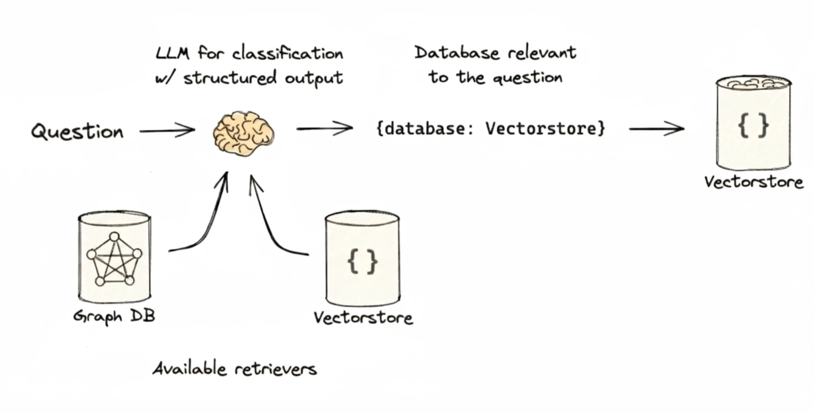<figcaption><p>意图分类与检索路由</p></figcaption></figure>

```python
#1. 设置不同菜系的处理链
sichuan_prompt = ChatPromptTemplate.from_template(
    "你是一位川菜大厨。请用正宗的川菜做法，回答关于「{question}」的问题。"
)
sichuan_chain = sichuan_prompt | llm | StrOutputParser()

cantonese_prompt = ChatPromptTemplate.from_template(
    "你是一位粤菜大厨。请用经典的粤菜做法，回答关于「{question}」的问题。"
)
cantonese_chain = cantonese_prompt | llm | StrOutputParser()

#定义备用通用链
general_prompt = ChatPromptTemplate.from_template(
    "你是一个美食助手。请回答关于「{question}」的问题。"
)
general_chain = general_prompt | llm | StrOutputParser()

#2. 创建路由链
classifier_prompt = ChatPromptTemplate.from_template(
    """根据用户问题中提到的菜品，将其分类为：['川菜', '粤菜', 或 '其他']。
    不要解释你的理由，只返回一个单词的分类结果。
    问题: {question}"""
)
classifier_chain = classifier_prompt | llm | StrOutputParser()
classifier_chain

router_branch = RunnableBranch(
    (lambda x: "川菜" in x["topic"], sichuan_chain),
    (lambda x: "粤菜" in x["topic"], cantonese_chain),
    general_chain  # 默认选项
)

#组合成完整路由链
full_router_chain = {"topic": classifier_chain, "question": lambda x: x["question"]} | router_branch
print("完整的路由链创建成功。\n")
```

`RunnableBranch` 按顺序检查条件，将输入传给第一个匹配的链。示例先检查 `topic` 是否包含“川菜”，再检查“粤菜”。两个条件都不满足时执行 `general_chain`。

### 基于嵌入的路由

系统比较问题与<span style="color:red">预设路由示例</span>的向量相似度，并调用得分最高的处理链。示例片段需预先准备 `route_names` 和 `route_prompt_embeddings`。在 Notebook 中应先定义 `route`，再执行 `RunnableLambda(route)`。

<figure>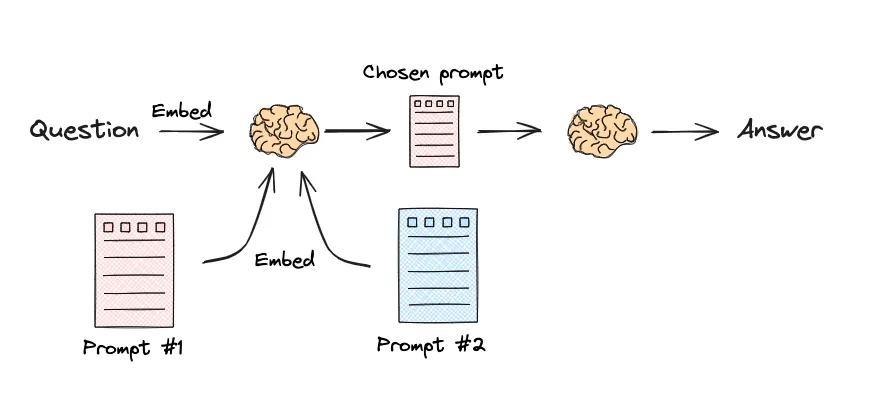<figcaption><p>基于嵌入的路由</p></figcaption></figure>

```python
#定义川菜和粤菜处理链
sichuan_chain = (
    PromptTemplate.from_template("你是一位川菜大厨。请用正宗的川菜做法，回答关于「{query}」的问题。")
    | llm
    | StrOutputParser()
)
cantonese_chain = (
    PromptTemplate.from_template("你是一位粤菜大厨。请用经典的粤菜做法，回答关于「{query}」的问题。")
    | llm
    | StrOutputParser()
)

route_map = { "川菜": sichuan_chain, "粤菜": cantonese_chain }
print("川菜和粤菜的处理链创建成功。\n")
#创建完整的路由链
full_chain = RunnableLambda(route)

#3. 创建路由函数：如果根据用户查询嵌入和最相似的路由进行比较
def route(info):
    # 对用户查询进行嵌入
    query_embedding = embeddings.embed_query(info["query"])

    # 计算与各路由提示的余弦相似度
    similarity_scores = cosine_similarity([query_embedding], route_prompt_embeddings)[0]

    # 找到最相似的路由
    chosen_route_index = np.argmax(similarity_scores)
    chosen_route_name = route_names[chosen_route_index]

    print(f"路由决策: 检测到问题与“{chosen_route_name}”最相似。")

    # 获取对应的处理链
    chosen_chain = route_map[chosen_route_name]

    # 直接调用选中的链并返回结果
    return chosen_chain.invoke(info)

#4. 运行演示查询
demo_queries = [
    "水煮鱼怎么做才嫩？",        # 应该路由到川菜
    "如何做一碗清淡的云吞面？",    # 应该路由到粤菜
    "麻婆豆腐的核心调料是什么？",  # 应该路由到川菜
]

for i, query in enumerate(demo_queries, 1):
    print(f"\n--- 问题 {i}: {query} ---")
    try:
        # 传入字典，full_chain 会直接返回最终答案
        result = full_chain.invoke({"query": query})
        # full_chain: RunnableLambda，接受info，当作字典来作为输入
        print(f"回答: {result}")
    except Exception as e:
        print(f"执行错误: {e}")
```

`RunnableLambda` 将 Python 函数 `route` 封装成 LangChain 的 Runnable，使其可以在 LCEL 链中与提示模板、模型和输出解析器组合。

## 召回后的处理

### 重排序

初步召回后，可以融合多路候选，或用更细粒度的相关性信号重新排序。

| 特性 | RRF | RankLLM | Cross-Encoder | ColBERT |
| --- | --- | --- | --- | --- |
| 核心机制 | 融合多个排名 | LLM 推理，生成排序列表 | 联合编码查询与文档，计算单一相关分 | 独立编码，后期交互 |
| 计算成本 | 低（简单数学计算） | 中 (API 费用与延迟) | 较高（逐对打分） | 取决于候选数与 Token 数 |
| 交互粒度 | 无（仅排名） | 概念/语义级 | 句子级（Query-Doc Pair） | Token 级 |
| 适用场景 | 多路召回结果融合 | 高价值语义理解场景 | Top-K 精排 | Top-K 重排 |

<figure>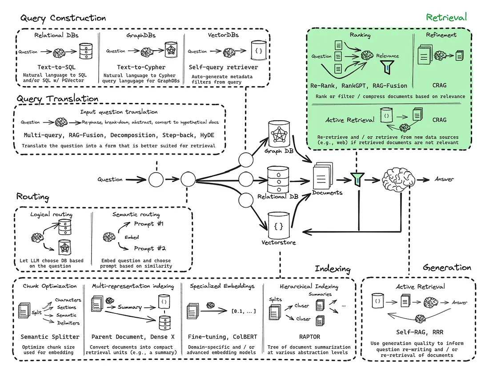<figcaption><p>RAG 检索技术总览</p></figcaption></figure>

<figure>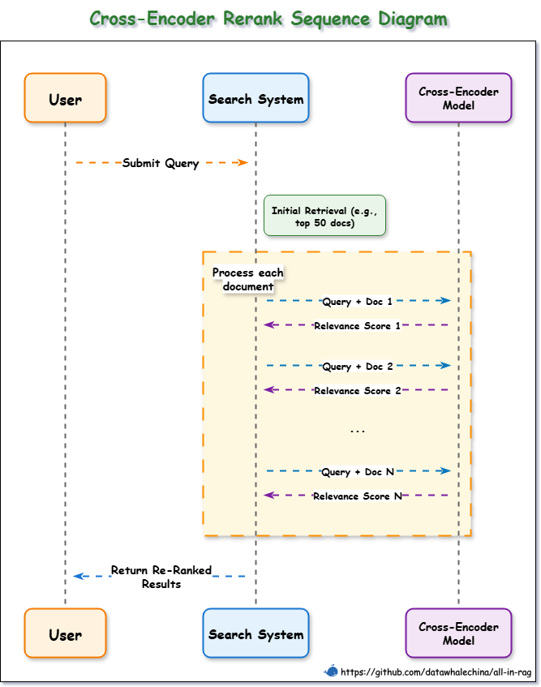<figcaption><p>交叉编码器重排序</p></figcaption></figure>

### 上下文压缩（Compression）

召回的文本块整体相关时，仍可能包含与当前问题无关的段落。压缩可以在块内提取，也可以直接过滤整篇文档。

- **内容提取**：保留与查询相关的句子或段落。
- **文档过滤**：移除经过复核后判为不相关的文档。

### 校正检索（CRAG）

<figure>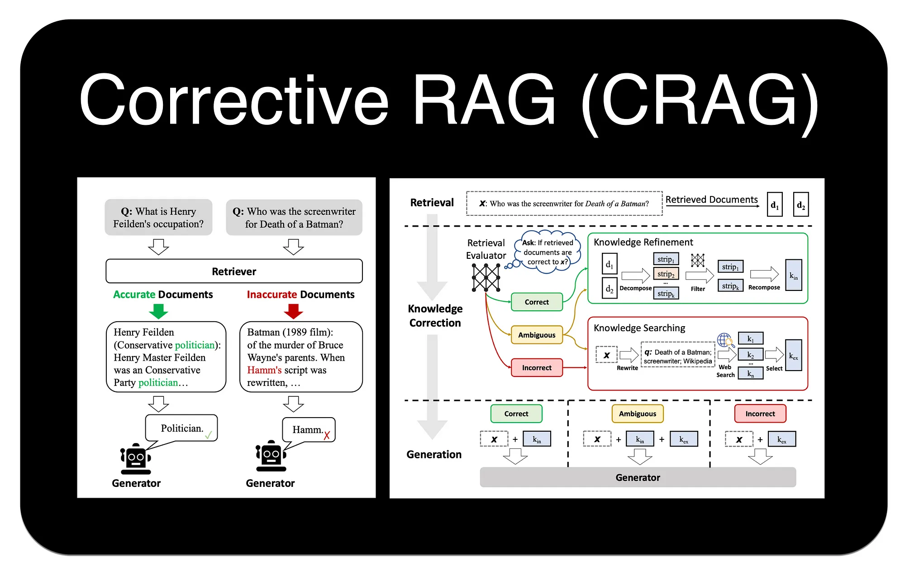<figcaption><p>CRAG 的检索校正</p></figcaption></figure>

检索评估器根据文档与查询的相关性判断整组检索结果的可靠程度，再决定如何准备生成所需的上下文。

| 评估结果 | 后续处理 |
| --- | --- |
| 可信（Correct） | 将召回文档拆成知识片段，过滤无关片段并重新组合。 |
| 不可信（Incorrect） | 改写原始查询并执行 Web 搜索，用外部知识补充上下文。 |
| 不确定（Ambiguous） | 结合内部文档精炼后的内容与外部搜索结果。 |

[CRAG 论文](https://arxiv.org/abs/2401.15884)
