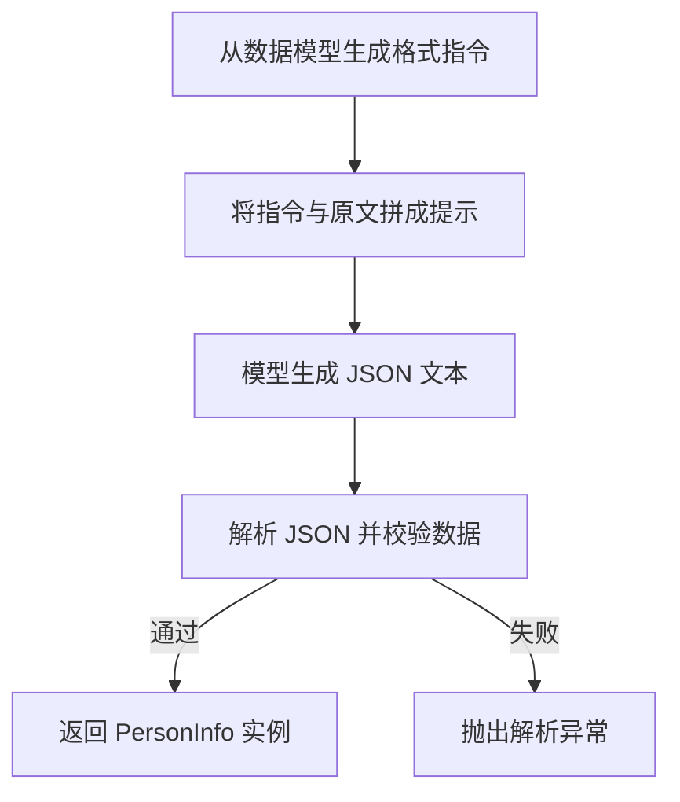
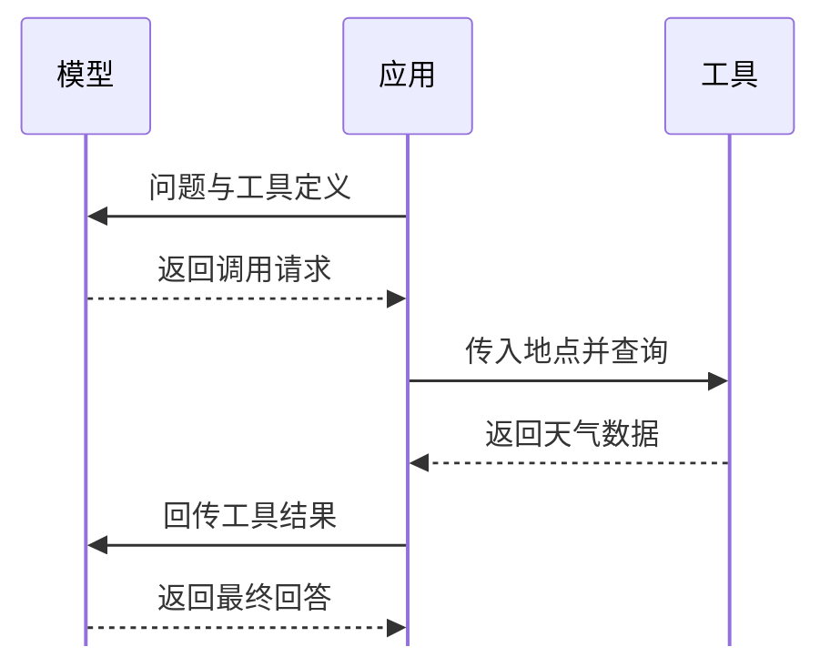

提取人物信息时，应用需要得到能直接读取的字段。查询天气时，应用还要根据模型给出的参数执行工具，再把结果交给模型。这两个示例都用到 JSON Schema，前者用它描述回答的结构，后者用它定义工具的入参。

## 用 PydanticOutputParser 提取人物信息

`PydanticOutputParser` 把 Pydantic 模型的 JSON Schema 写入格式指令，提示模型按指定结构生成 JSON。收到输出后，解析器再将其解析并校验为 Pydantic 对象。**格式指令在生成前引导模型，数据校验在生成后执行。**

### 定义数据模型

`PersonInfo` 定义姓名、年龄和技能三个字段。`Field` 的 `description` 会进入 JSON Schema，因此可以用它说明各字段应提取什么内容。在 Pydantic 的默认模式下，示例中的字符串 `"30"` 会被转换为整数 `30`。

```python
from typing import List

from langchain_core.output_parsers import PydanticOutputParser
from langchain_core.prompts import PromptTemplate
from pydantic import BaseModel, Field


class PersonInfo(BaseModel):
    name: str = Field(description="人物姓名")
    age: int = Field(description="人物年龄")
    skills: List[str] = Field(description="技能列表")


person = PersonInfo(name="张三", age="30", skills=["Python", "机器学习"])
```

### 将格式指令注入提示词

`get_format_instructions()` 根据模型的 JSON Schema 生成格式指令。创建 `PromptTemplate` 时，通过 `partial_variables` 预先填入这段指令，每次调用只需传入待提取的 `text`。

```python
parser = PydanticOutputParser(pydantic_object=PersonInfo)

prompt = PromptTemplate(
    template="请根据以下文本提取信息。\n{format_instructions}\n{text}\n",
    input_variables=["text"],
    partial_variables={"format_instructions": parser.get_format_instructions()},
)
```

### 调用模型并校验输出

用 LangChain 表达式语言（LCEL）将提示模板、已配置的 `llm` 和解析器串起来。解析器先读取模型输出中的 JSON，再调用 Pydantic v2 的 `PersonInfo.model_validate()` 校验数据。校验成功时返回 `PersonInfo` 实例，校验失败时抛出 `OutputParserException`。[LangChain 解析器实现](https://github.com/langchain-ai/langchain/blob/master/libs/core/langchain_core/output_parsers/pydantic.py)

```python
chain = prompt | llm | parser

text = "张三今年30岁，他擅长Python和Go语言。"
result = chain.invoke({"text": text})
```

预期的 `result` 如下。

```text
PersonInfo(name='张三', age=30, skills=['Python', 'Go'])
```

**人物信息提取与校验流程**



## 用 Function Calling 查询天气

Function Calling 让模型提出工具调用请求，由应用执行工具，再将结果交回模型。下面以 OpenAI Chat Completions 的消息格式为例。

### 定义工具和入参

工具定义包含函数名、用途和参数的 JSON Schema。这里的 `get_weather` 接收必填的字符串参数 `location`。

```python
tools = [
    {
        "type": "function",
        "function": {
            "name": "get_weather",
            "description": "获取指定地点的天气信息",
            "parameters": {
                "type": "object",
                "properties": {
                    "location": {
                        "type": "string",
                        "description": "城市和省份，例如：杭州市, 浙江省",
                    }
                },
                "required": ["location"]
            },
        }
    },
]
```

OpenAI 支持用 `strict: true` 约束工具调用参数。启用时，应在 `function` 中设置 `strict`，并在参数 Schema 的每个对象上设置 `additionalProperties: false`，同时将 `properties` 中的所有字段列入 `required`。[OpenAI 严格模式说明](https://developers.openai.com/api/docs/guides/function-calling#strict-mode)

```python
"function": {
    "name": "get_weather",
    "strict": True,          # OpenAI:严格模式,输出必符合 schema
    "parameters": { ... }
}
```

上面是 `strict` 的位置示意，实际请求需填入完整的参数 Schema。

### 读取并执行工具调用

应用将“杭州今天天气怎么样？”和工具定义发给模型。模型若选择调用工具，会在 `assistant` 消息的 `tool_calls` 中给出调用 ID、函数名和参数。`arguments` 是一个 JSON 字符串，应用解析后用它调用实际的天气查询函数。

```json
{
  "role": "assistant",
  "tool_calls": [
    {
      "id": "call_weather",
      "type": "function",
      "function": {
        "name": "get_weather",
        "arguments": "{\"location\": \"杭州市, 浙江省\"}"
      }
    }
  ]
}
```

### 回传结果并生成回答

应用保留带有 `tool_calls` 的 `assistant` 消息，再追加一条 `role` 为 `tool` 的消息。该消息的 `tool_call_id` 与原调用 ID 对应，模型据此把工具结果与调用关联起来，再结合用户问题生成回答。

```json
{
  "role": "tool",
  "tool_call_id": "call_weather",
  "content": "24℃，晴朗"
}
```

**天气查询的消息往返**


